# 宸宫纪 · Forbidden City

**在宫城里处理朝政、走访后宫，看孩子长大，写下属于你的一朝本纪。**

宸宫纪是一款中国古代宫廷题材的浏览器养成游戏。你从登基大典开始，以月为单位安排政务与宫中生活：在御书房权衡朝臣建议，在御花园设宴，到妃嫔宫里探望母子，再为长大的皇嗣安排教养、婚事与前程。性情、家世、交情和过去的选择共同影响人物的行动；一朝结束后，还可以由继承人接续。

**[进入游戏](https://aubreykuang.github.io/Forbidden-City/)** · **[测试版与金手指](https://aubreykuang.github.io/Forbidden-City/dev.html)**

原生 HTML / CSS / JavaScript · Canvas 宫城与古风立绘 · Web Audio 配乐 · 浏览器本地存档 · 桌面与手机布局

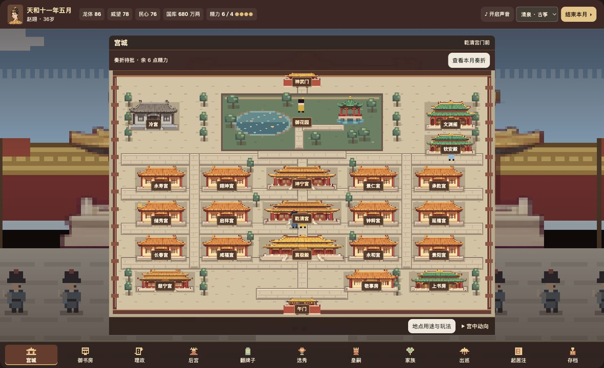

*本文截图均由当前版本实际运行时拍摄。中后期界面使用演示存档，便于展示人物与玩法；并不代表这些事件会在同一局、同一月份自然出现。*

[开始游玩](#开始游玩) · [选秀与后宫](#选秀与后宫) · [人物性情与记忆](#人物性情与记忆) · [个人经历完整图鉴](docs/character-experiences/README.md) · [生育与皇嗣](#生育与皇嗣) · [家族与太后](#家族与太后) · [岁时与宴会](#岁时与宴会) · [朝堂与政务](#朝堂与政务) · [传承与记录](#传承与记录) · [画面与配乐](#画面与配乐) · [测试模式与金手指](#测试模式与金手指) · [宫城与日常](#宫城与日常) · [宫中故事与后话](#宫中故事与后话) · [历史典故](#历史典故) · [本地运行与验证](#本地运行与验证) · [代码结构](#代码结构)

## 开始游玩

点击「新开一局」，在宸极殿设置国姓、名讳、年号与帝王性情。登基后，可以应礼部奏请前往储秀宫选秀，也可以暂缓选秀，先理朝政。

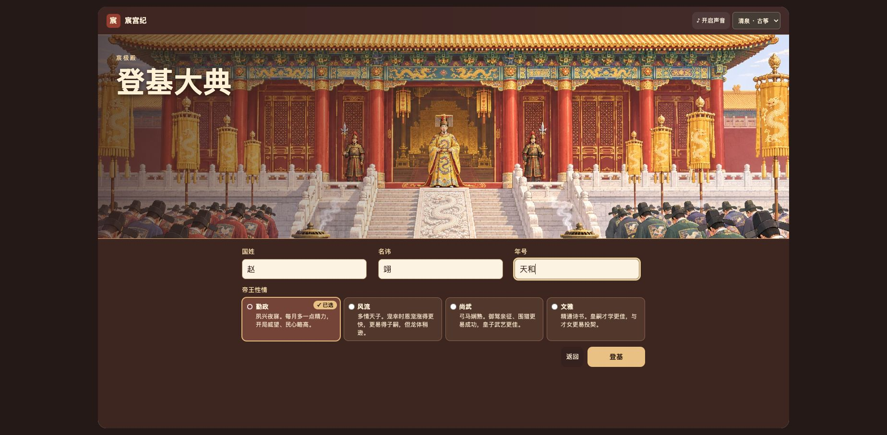

| 帝王性情 | 开局特点 |
|---|---|
| 勤政 | 每月多一点精力，开局威望与民心略高 |
| 风流 | 宠幸时恩宠提升更快，更易得子嗣，初始龙体略低 |
| 尚武 | 围猎、亲征更易成功，皇子武艺更佳 |
| 文雅 | 皇嗣才学更佳，更容易与才女投契 |

## 选秀与后宫

### 选人、相处与册封

三年一度大选，也可提前下旨选秀，但要承担国库与民心代价。容貌、才情、家世和性情可以直接看见，德行与心机需要有限次数的暗访。

选秀先逐人觐见：每位秀女带着立绘走到席前，行礼、说话，也可展示抚琴、读书、刺绣等所长。看完后统一回名册留牌、撂牌和暗访；也可直接看名册，或点「再见一面」回看。展示才艺不会额外改变人物属性，反复查看不会重新抽取表现。

| 逐人觐见与才艺 | 新入宫的反应 |
|:---:|:---:|
| <a href="docs/screenshots/showcase-selection-audience.jpg">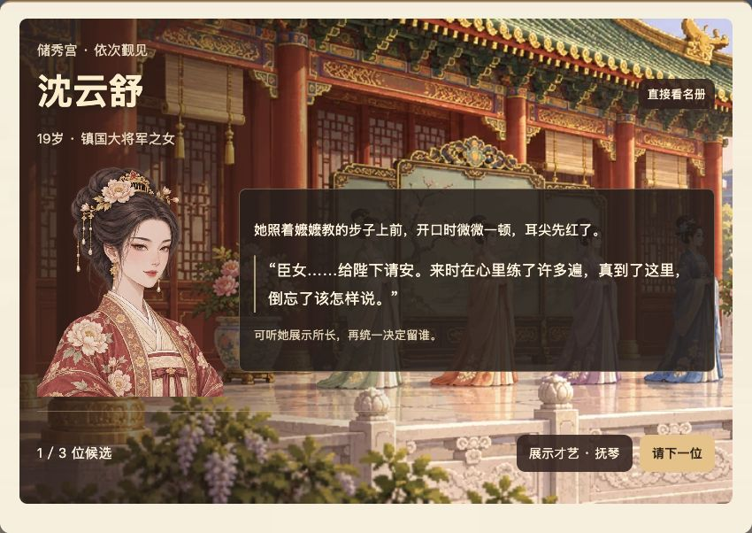</a> | <a href="docs/screenshots/showcase-newcomer.jpg">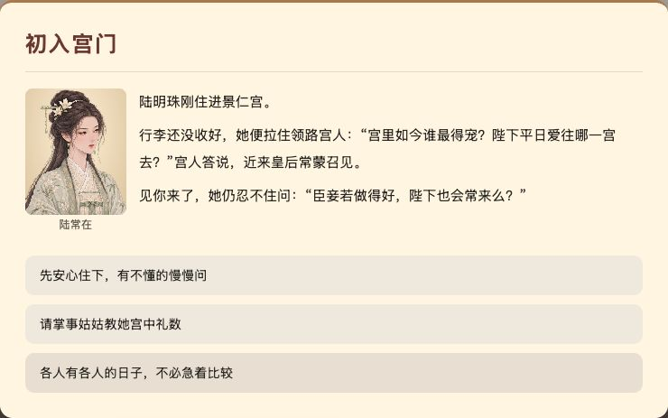</a> |

留选后会接上「初入宫门」：有人忐忑，有人清静自持；处事谨慎者借请安与赏赐打听宫中人事，直率而张扬者可能当面问谁最受宠。性情与心机共同影响表现，并非才情低就一律失礼。皇帝的回应会留下记忆，入宫头几个月的闲谈也会接着说起认路、习礼与慢慢安顿的变化。


位分依次为 **官女子、答应、常在、贵人、嫔、妃、贵妃、皇贵妃、皇后**，高位有名额限制。你可以翻绿头牌召幸、闲话家常、挑选赏赐、晋封、赐封号、立后废后，也可以处罚、打入冷宫或遣出宫。

人物既可能来自选秀，也可能是太后荐入的族女、娘家送来的姐妹、西域贡女、市井相识或宫女。家世会影响亲族、势力、往事与可能出现的个人经历。

### 从宫门走到她面前

从主地图点宫名直达，或点建筑看皇帝走过宫道，抵达有人居住的宫殿后，会先出现**立绘与迎驾对白**。同宫多人可切换拜访；坐下闲谈、看看母子与宫中近况、查看详情或告辞，都有独立入口。下方后宫名册仍直接打开人物信息，返回宫殿时不重复迎驾。

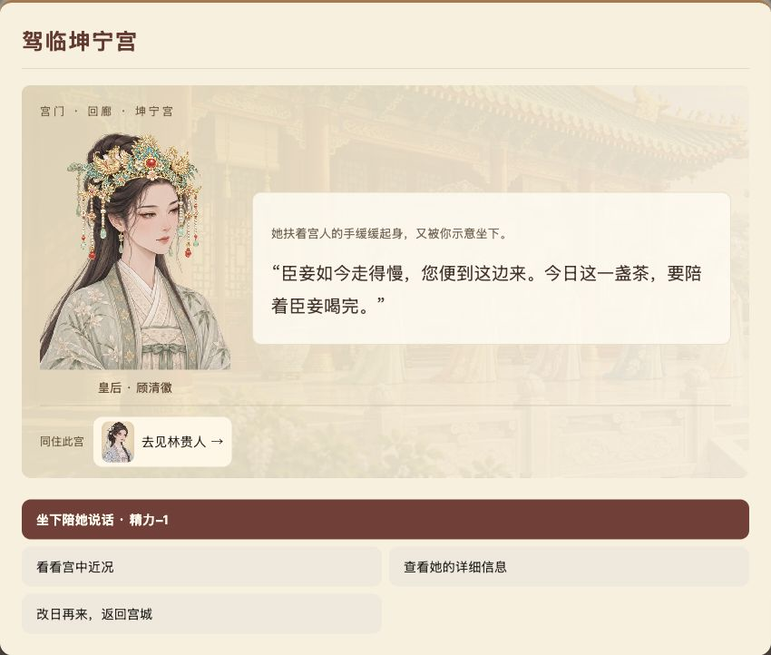

十九种性情有不同的招呼；初入宫的拘谨、相伴多年的熟稔、失宠的疏远、孕中的期待与丧亲的低落会改变她的回应。迎驾不扣精力，每人每月只留一次到访记忆，不会靠反复进门刷情分；选择坐下闲谈才消耗精力。冷宫、寺居、离宫与已故人物不会正常出迎，空宫保持无人居住的说明。

### 宫室分配与迁宫

**坤宁宫只住皇后**，由她照护的幼儿可随居；其余十二宫每宫设一名主位与三处侧殿。嫔位及以上可任主位，名额满时也可暂居侧殿；低位妃嫔初入宫时会参考空位、主位与已有交情安置，不再人人独占一宫。

| 查看主位与同住者 | 她也会主动请求迁宫 |
|:---:|:---:|
| <a href="docs/screenshots/showcase-residences.jpg">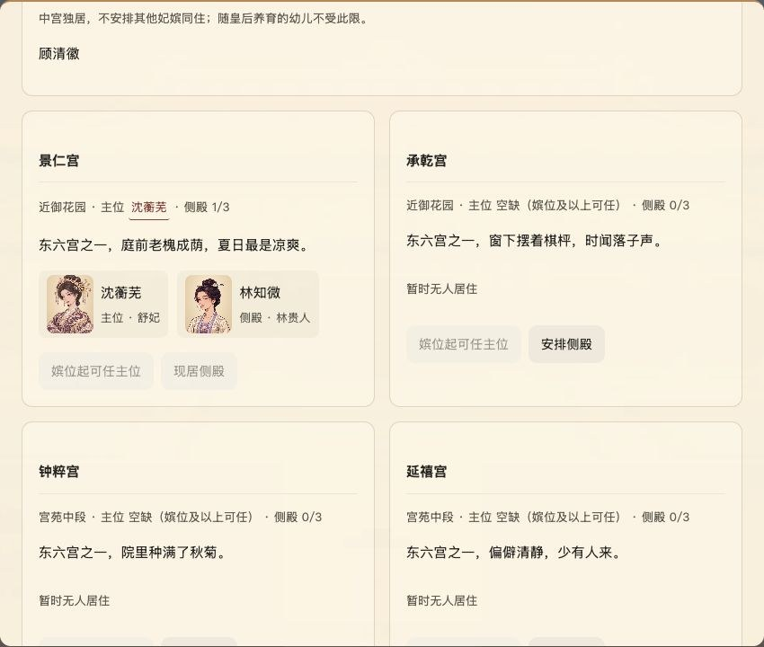</a> | <a href="docs/screenshots/showcase-residence-request.jpg">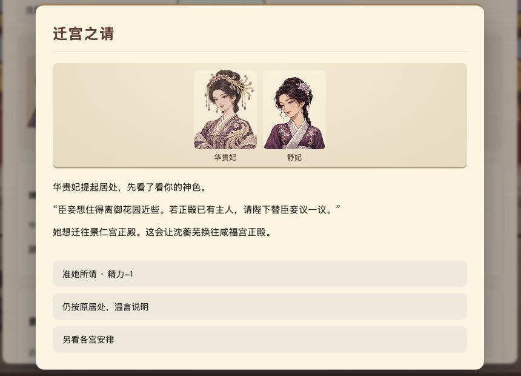</a> |

从后宫名册的「宫室分配」、人物详情的「安排居所」或宫殿页面进入，可指定同住、另择侧殿，或让两位主位交换宫室。确认时会写明双方住处，每次安排花一点精力；侧殿住民不会随着主位换宫被一并挪走。随母亲或养母生活的幼儿会跟随迁居，人物纪事、同住交情与心情也会改变。

得宠而骄纵者可能请求住得更靠近御花园，淡泊、沉静或体弱者可能求清静，与好友交情深者则可能求同住。请求有全宫与个人间隔，不会每月轮番出现；答应、婉拒或另行安排都有后续。旧档会校正非皇后住进坤宁宫、主位重叠与住处超额，暂赴寺中修行者仍保留原住处。

本作沿用「坤宁宫为皇后寝宫」的设定；历史用途可参阅[故宫博物院介绍](https://www.dpm.org.cn/explore/building/236487.html)。一宫一主位、三处侧殿等名额用于游戏管理，并非复刻某一朝代的完整宫廷制度。

### 宫女与母亲入宫

宫女可能出现在御花园、长街或奉茶的深夜。承恩后可封为答应或官女子，也可留作贴身宫女，或打发回去当差。贴身宫女不进常规位分、可随时侍奉，之后也能册封、调回或放出宫嫁人；有孕与生育有后续安排。随机宫女偶遇共用间隔，已经结识的人仍可主动来往。

妃嫔的「再见母亲一面」心愿可得到回应，也可在人物详情每两年安排一次母亲入宫，不限位分。母亲会住两三个月，带来心情改善、谢恩与母女夜话；详情中能看到母亲立绘与剩余居留时间。「接母亲入宫」入口会显示剩余等待月份、母亲在宫状态或国库不足的原因。

### 内库珍饰与御赐装扮

御书房的「内库珍藏」收存 **九凤点翠冠、花树珠翠冠、金凤衔珠冠、牡丹花簪、孔雀步摇、白玉流苏步摇**。可以从内库选人赏赐，也可以在妃嫔详情的「赏赐」中挑选。旧藏先有牡丹花簪与白玉流苏步摇，其余由岁首、端午、中秋或地方进献逐渐添入。

| 内库与赏赐入口 | 六种珍饰实际叠戴 |
|:---:|:---:|
| <a href="docs/screenshots/showcase-jewelry-vault.jpg">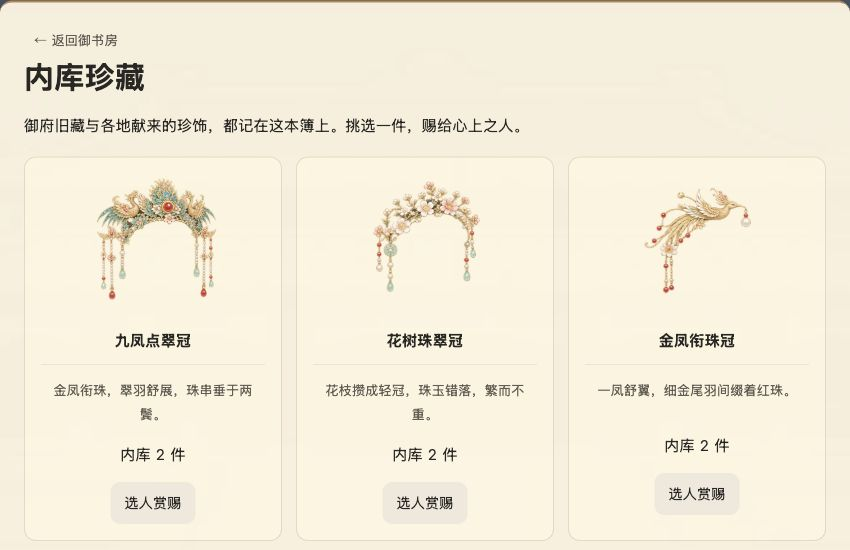</a> | <a href="docs/screenshots/showcase-jewelry-worn.jpg">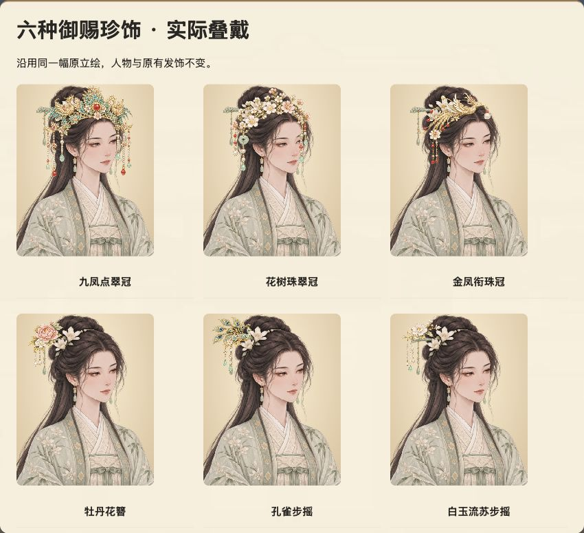</a> |

赐出后扣除一件库存，归受赏者所有并立即戴上；人物详情可以换戴或收起。首饰以透明图层叠在原画上，保留原有面容、服装与发饰。皇后的默认凤冠也使用细绘的九凤点翠冠；已有自选珍饰时显示所选装扮。库存、归属、佩戴与赏赐日期都随存档保存。

| 节庆进献 | 得宠孕妃讨赏 |
|:---:|:---:|
| <a href="docs/screenshots/showcase-jewelry-tribute.jpg">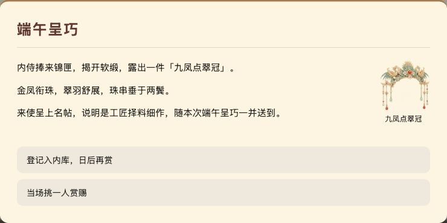</a> | <a href="docs/screenshots/showcase-jewelry-request.jpg">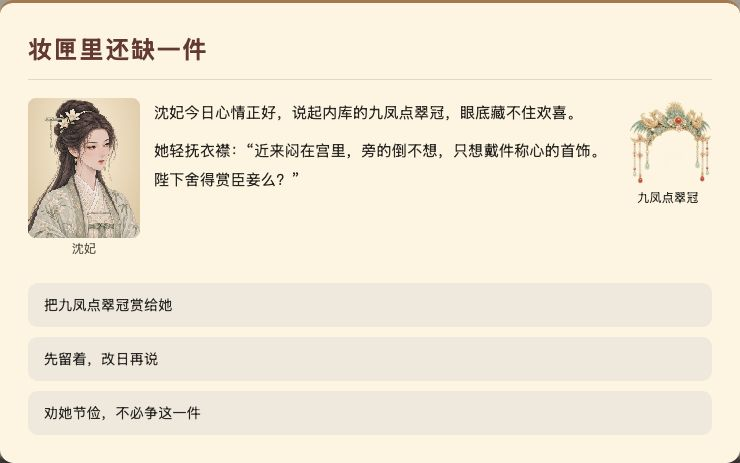</a> |

骄纵、骄矜、贪财的妃嫔，在得宠且心情好时可能小概率讨赏，身孕会影响请求条件与说辞。可以允准、缓议或劝她节俭，并留下纪事与不同心情。进献、讨赏都有全宫间隔，讨赏另有个人间隔；冷宫、离宫和已故人物不会来讨赏。

## 人物性情与记忆

### 同一种性情，也会有不同的人

人物拥有 **19 种主性情**：温婉、骄纵、骄矜、聪慧、善妒、淡泊、活泼、城府、痴情、体弱、将门、才女、贪财、沉静、爽直、持重、好客、巧手、好学。选秀会降低已经常见的性情权重。

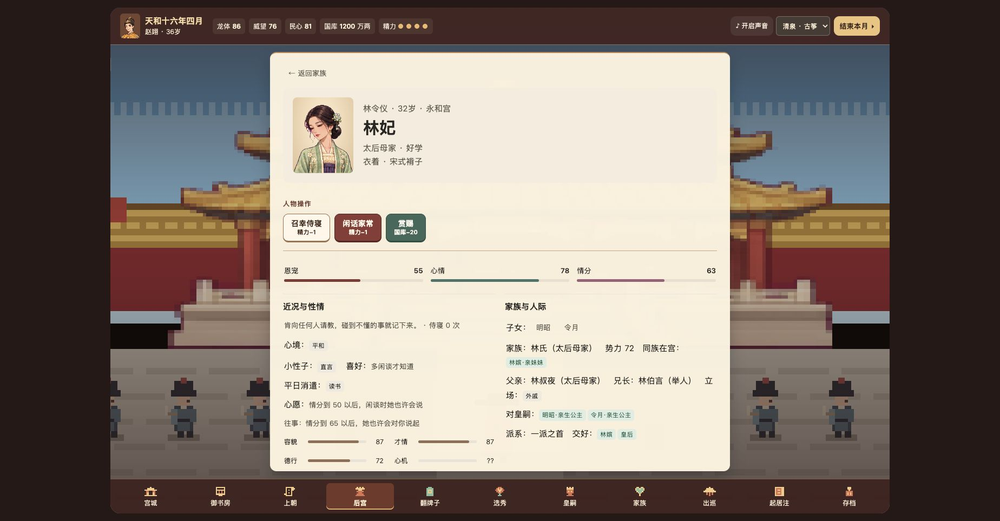

主性情之外，还有独立的小性子、日常消遣、礼物喜好、心愿、往事和人际经历。同是好学的人，也可能一个护短，一个直言；相同的身份不会决定完全相同的反应。

| 人物细节 | 会怎样影响相处 |
|---|---|
| 18 种小性子 | 嗜甜、怕雷、爱猫、路痴、好胜、念旧、嘴硬心软、爱哭、贪睡、护短、记仇、好读史、信佛、擅厨艺、直言、擅舞、畏寒、擅骑射，各有对白或琐事 |
| 日常消遣 | 读书、品茶、刺绣、侍花、骑射等影响地点与邀约对象 |
| 礼物喜好与忌讳 | 可从十种礼物中挑选，送中所爱更有效，送了忌讳会扫兴；闲谈帮助了解喜好 |
| 心愿 | 情分达到一定程度后，可能想见母亲、学骑马、养猫、看烟火或求一首亲笔诗，可在详情中成全 |
| 往事 | 更亲近后才会说起入宫前的经历，内容受家世约束 |
| 记忆 | 生辰、病中探望、赏罚、过继、冷宫与陪伴会留下不同印象，之后的闲谈和行动会读取这些经历 |

骄纵的人得宠后更容易争份例、争席次，有孕时也可能请旨。偏袒会影响她下次的态度，并牵动皇后或同席者的感受；也可以照顾身孕，同时维持原定安排。

### 见面时，她也有话想说

进入妃嫔、皇嗣详情即可看到人物心声，不必等随机事件。主性情、小性子、喜好、年龄、身孕、恩宠、婚后处境和过去的相处都会影响说话内容；同月反复打开不会刷新抽签。闲话、探望则有更具体的回应，并留下记忆。离宫皇嗣通过家书表达近况。

说话方式还会随 **初见、渐熟、亲近、相伴多年与疏远** 改变：初来会斟酌礼数，相熟后才敢提出自己的要求，十年旧人可能省去客套；恩宠低落或情分疏远时，话里也会多一道隔阂。时间与实际往来共同影响亲近程度，并非入宫久了就自动知心。六类性情口吻对应五个阶段，共有 90 句阶段对白，另与个人性情、兴趣、孕育、孩子、赠礼和近期经历配合。

| 初次相见 | 十年知心 | 相识已久却疏远 |
|:---:|:---:|:---:|
| <a href="docs/screenshots/showcase-voice-first.jpg">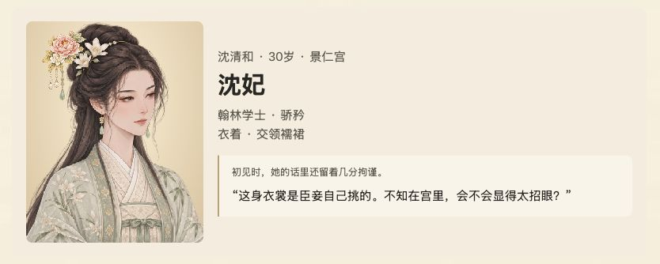</a> | <a href="docs/screenshots/showcase-voice-years.jpg">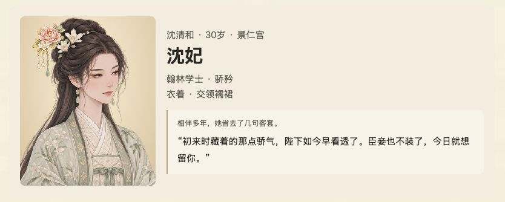</a> | <a href="docs/screenshots/showcase-voice-distant.jpg"></a> |

刚入宫时不会一见面就倾诉深藏往事、心愿或私议他人。实际闲谈会记下最近说过的话，优先避开重复；同月只打开详情不会消耗随机数或刷出另一段人生。悲恸、病弱、冷宫与寺居等处境仍优先于日常亲昵。

### 交好、争执与心境

共同兴趣和投契性情更容易结交：有人合校旧抄本，有人交换绣样，也有人结伴投壶。旧友可能在失宠或受委屈时来探望，你可以准许往来、请她说出亲见的事情，或让双方避嫌。

恩宠、位分、家族与派系也会带来嫉妒和敌意。人物可能依附皇后或高位妃嫔，出现投靠、倾轧、姐妹求情，以及针对仇人的陷害；受害者的人缘会影响查明真相的机会。

| 心境 | 常见起因与表现 |
|---|---|
| 欢喜、感激、释然 | 晋位、得子、收到所爱之物、脱离冷宫或心愿得偿；可能邀看新衣、绣寝衣 |
| 思念、委屈 | 亲近却被冷落、受训或降位；可能送香囊、托人求见 |
| 惶恐 | 调查、揭发或同族获罪；可能脱簪待罪 |
| 嫉恨、怨恨 | 对手得宠、自己受冤或与孩子分离；可能宴上失态、称病或暗中报复 |
| 悲恸、心如死灰 | 小产、失子、长期受罚与悲伤；可能求法事或出家 |
| 野心 | 儿子入主东宫后，更关心娘家与朝中往来 |

心境注明起因与持续时间，会改变对白与相处效果，也可能被陪伴逐渐化解。重复事件按人物、类型或全宫设置间隔；生育、丧仪等重要进程则有专门的推进方式。

### 个人经历

**[📖 查看个人经历完整图鉴 →](docs/character-experiences/README.md)**

目前有 **10 类连续经历与 64 个独立个人经历**，按诗书、技艺、四时、亲情、处事、成长、母子与失意八类展开。完整图鉴列出已实现的题目、触发条件、回应、不同结果及典故来源，另收录婚后家事和人物活动入口。

经历按性情、兴趣、处境与关系筛选。人物详情的「她自己的事」可回应邀约，支持后隔二至四个月再听后话，也可让她自主处理或暂缓；结果会影响属性、纪事与记忆。每人每题只经历一次，同题全宫至少隔四十八个月；邀请不会强制弹窗。

连续经历涵盖日常相伴、手艺、家族与身世；固定身世与调查只分配给少数符合背景的人物：

| 经历 | 人物背景与内容 |
|---|---|
| 边关烽火 | 少数将门女面对父亲的边关疑案；查访依据已确定的履历与案情，在信任、削权和处置间抉择 |
| 故人诗 | 少数才女与入宫前的旧识、新科状元重逢 |
| 宫中手艺 | 校补旧卷、听琴辨音，或整理四时花谱 |
| 旧案 | 少数宫女或寒门出身的人，背负为父翻案的秘密 |
| 续命汤 | 体弱者的心疾，寻药或陪伴的选择 |
| 驼铃 | 少数西域贡女受到母国与家人处境的牵制 |
| 凤位 | 深藏城府者对后位的追求 |
| 金玉其外 | 少数人物的兄长借国舅名义敛财 |
| 纸鸢 | 从断线纸鸢到宫外灯会，展现对自由与陪伴的心意 |
| 相伴有凭 | 六种性情信物，一同完成、日常照应与是否许下约定 |

旧案、驼铃、边关烽火、金玉其外与故人诗等限制每朝分配人数，并配合调查间隔，避免不同人不断重复同一身世。部分结局有长期影响，例如「同心」「知己」会改变恩宠衰减。

相伴可以留下并蒂花笺、对弈手记、同心绳结、合画小扇、批注小册或鸳鸯帕。信物随性情不同，记录一同完成、病中照应与是否愿意许诺；平常相处也会留下日后能够提起的共同小事。

### 前事有后话：同一个人的故事会继续

端午的分工、父兄的回奏、母子的一次相处，都可以成为数月后再见同一批人物的缘由。人物详情的「近来牵挂的事」保留起因与上次的选择；地图和宫殿迎驾也能直接接着谈。相处后可以再听后话，日后的自主活动继续体现共同经历。

| 经历 | 可以怎样回应 | 往后怎样变化 |
|---|---|---|
| 端午主事与帮手 | 按实补记功劳、私下协调，或给帮手独立署名的机会 | 她会决定继续合作还是先独立做事；尊重或改变她的打算，会影响下一次是否愿意帮忙 |
| 父兄差事与家书 | 问她对公事的判断，或先照应家中近况；丧亲时可一起整理家书，也可留时间给家人 | 差事的功过继续保留，家书寄达后父兄也会回应；人物会记得自己的意见是否被认真听过 |
| 孩子自己的打算 | 让孩子先试、母子一起商量，或先依母亲的安排练习 | 孩子带回对应的成果；复盘方式影响亲子信任，之后的母子日常会接着做那件事 |

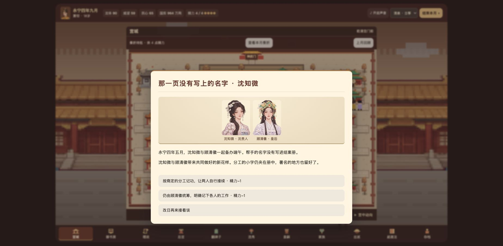

事情绑定真实的参与者和起因。改封号或重新排序不会换人；暂时离宫会暂停相聚，死亡、离宫定居或孩子成年会留下相应收束。未回应的邀请会由人物自行安排，已经开始的事情留待适合的时候继续。

情分表达相处的亲近，具体心结另有来由。普通闲聊和礼物可以改善当下心情，漏记的功劳与未被尊重的决定仍需要当面说清；重复的日常互动共享月内情分收益递减，共同经历则能继续改变关系。她可以亲近你，同时保留自己的判断。

| 家庭回奏与个人意见 | 孩子的计划与母亲的回应 |
|:---:|:---:|
| 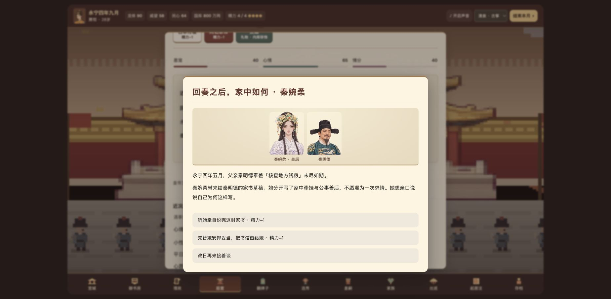 | 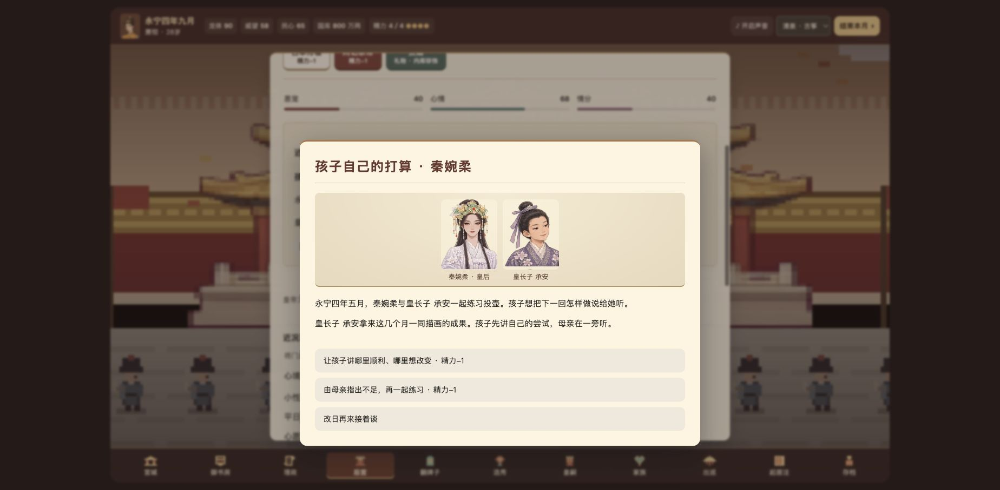 |

### 宫墙私情

满十五岁的皇子与年龄接近的妃嫔，在共同兴趣、性情、交情与受宠处境满足条件时，可能出现低概率的私下往来：投契闲谈、私笺传情，直至回廊牵手相拥。

十五岁起可投契闲谈、交换书笺，牵手相拥阶段须双方满十八岁。年龄差不超过八岁，妃嫔须在皇子满十五岁后入宫；排除生母、现任或旧养母、已记录母系亲族、皇后及无法自由来往的人。全宫同时只推进一段，阶段之间隔数月，新往来也有较长间隔。

线索出现在文渊阁、御花园或对应宫殿。可以观察、提醒界限、另排课业或让适龄皇子就藩，或在坐实后公开申斥、压下消息；皇帝威望、皇子支持、亲人关系和嫡妻信任可能受影响。双方会保留记忆，详情留有「宫墙往事」。这是游戏原创情节。

| 偶遇线索 | 私笺传情 | 回廊相依 |
|:---:|:---:|:---:|
| <a href="docs/screenshots/showcase-romance-clue.jpg">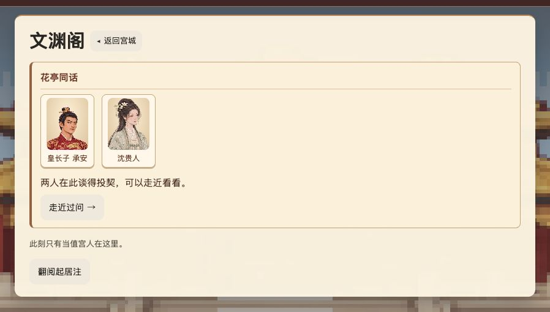</a> | <a href="docs/screenshots/showcase-romance-letter.jpg">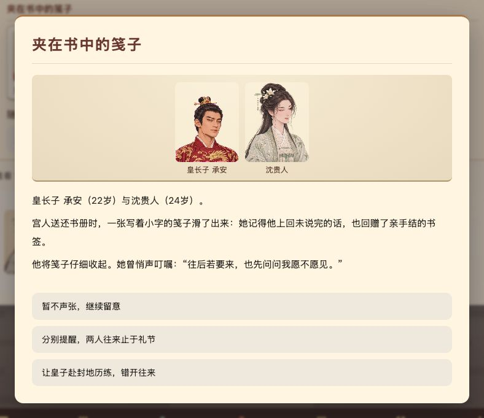</a> | <a href="docs/screenshots/showcase-romance-choices.jpg">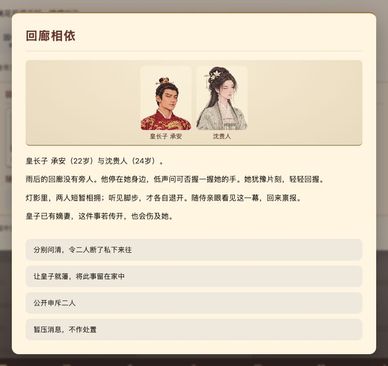</a> |

点击截图可查看大图。线索、书笺与处置随往来阶段推进，已婚皇子的嫡妻也可能受到影响。

### 身世疑云与孩子安置

双方成年、私情仍在延续时，极少数往来可能带来身孕。生父在受孕时固定记录，多胎共用同一生父；未露线索前保持原有身份，出现疑云后显示「待查证」；查明生父为皇子后，可以从孩子详情查看、跳转到生父。

疑云也可能由早产、晚产与起居时日不合、宫人的窃语，或有嫌隙妃嫔的告密引起。新孕程记录真实时日，旧档不凭空补造起居记录；同一孩子只揭起一次此类疑云，全宫至少间隔三年，另有低概率门槛。**早晚产与流言并不等于私情**，帝王亲生的孩子可以在调查后澄清，身份不变，也不会出现按私情定罪的处置选项。

可以调阅起居簿、书笺并分别问询，次月听取回奏。「滴血验亲」作为剧情中的旧说出现，太医会提醒不能以血滴是否相融判定亲缘，查证仍须依凭记录与证词。

| 查验身世 | 查明生父与处置 | 传闻不实，疑云已释 |
|:---:|:---:|:---:|
| <a href="docs/screenshots/showcase-parentage-inquiry.jpg">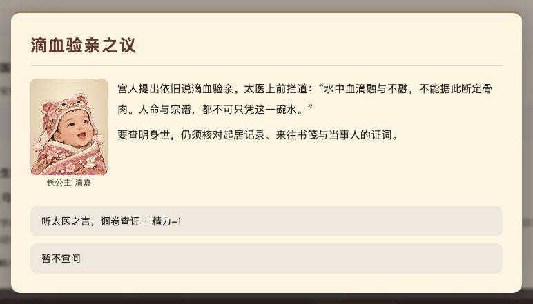</a> | <a href="docs/screenshots/showcase-parentage-verdict.jpg">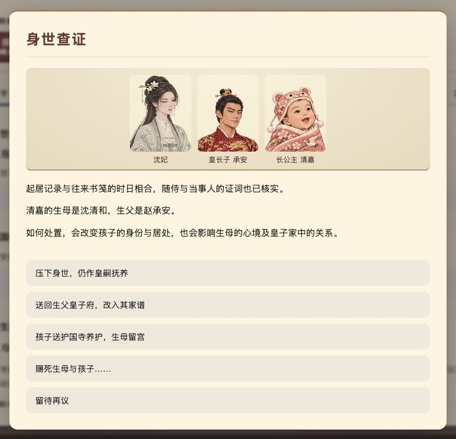</a> | <a href="docs/screenshots/showcase-parentage-cleared.jpg">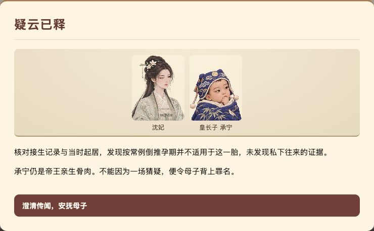</a> |

查明后可压下身世、仍作皇嗣抚养，或送回生父皇子府、改入其家谱；也可让孩子在护国寺养护、生母留宫。赐死生母与孩子须再过一次明确的复核界面。安置会改变居处、皇嗣身份与储位资格，生母牵挂、生父纪事及嫡妻信任也会留下后果；反复打开或读档不会重抽生父。

### 换婴疑案与寻回亲生孩子

少数无亲生皇子、心机较深且缺少顾忌的妃嫔，可能谋划抱入宫外男婴冒报皇子。新案情区分三种缘由，**正常生下健康男婴不会再无故调换，多胞胎也不套用单胎换婴**：

| 缘由 | 查明后的后续 |
|---|---|
| 生下女婴，妄图以男婴固宠 | 保存亲生女儿的出生年月与亲缘，可寻回或继续追访 |
| 亲生孩子出生时已无生息 | 核实接生、殓葬记录，留下悼念记录，不虚构寻亲 |
| 孕中已经小产，却继续隐瞒 | 保存真实小产年月，仍按原报产期装作待产；宫外抱婴可能成功，也可能失败 |

临产前，宫女可能报告她与稳婆私下来往。换心腹稳婆、加派守卫能阻止这次调换；未采信报告时也不一定得手。小产隐瞒另有「迟来的脉案」：可先核验原始脉案、另派医官问诊，及早阻止冒报；也可暂存疑点，等后续线索。真实失胎日期、抱婴结果、宫外生父母及原来孩子去向都会保存，不能靠读档重抽。

| 提前核验脉案 | 原报产期过后查明真相 |
|:---:|:---:|
| <a href="docs/screenshots/showcase-concealed-loss.jpg">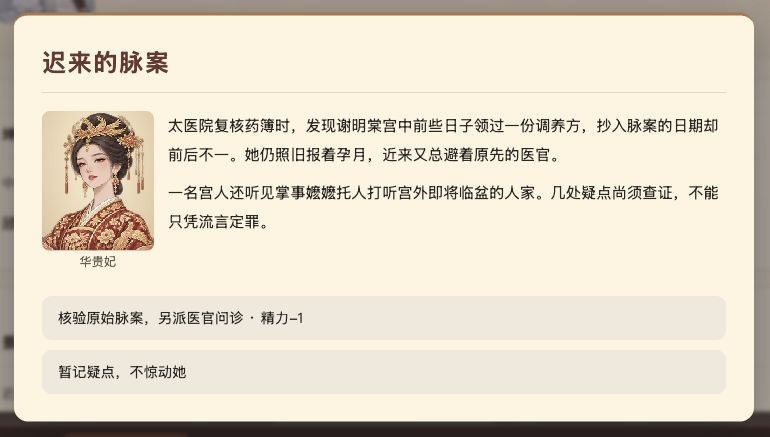</a> | <a href="docs/screenshots/showcase-concealed-loss-verdict.jpg">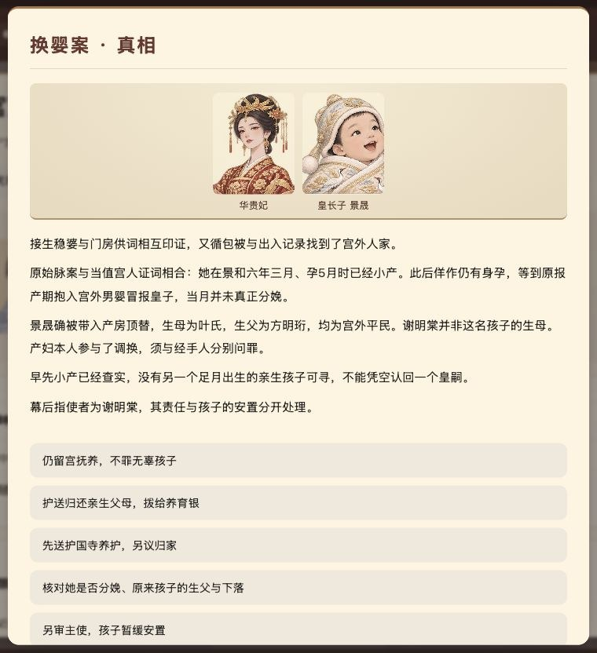</a> |

隐瞒小产的案情为低概率原创支线，另有全宫三年的间隔。**小产本身不作罪责**；调查的是隐瞒、冒报与调换。不能仅凭孕期变化或传言定罪。

| 出生后出现线索 | 查明来历与分别处置 |
|:---:|:---:|
| <a href="docs/screenshots/showcase-birth-swap-clue.jpg">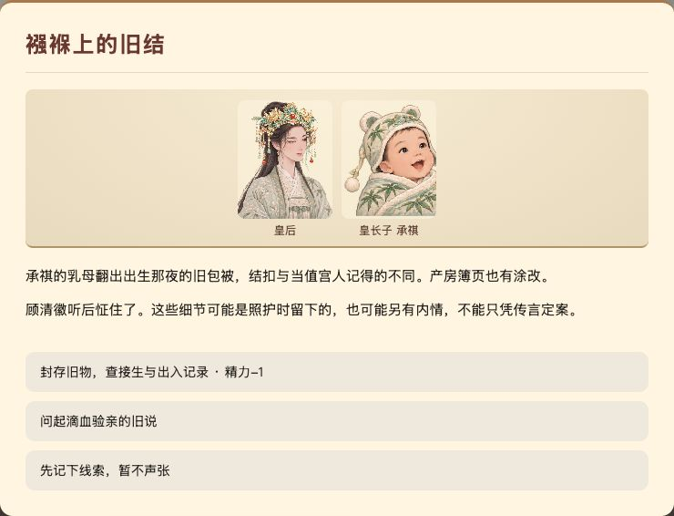</a> | <a href="docs/screenshots/showcase-birth-swap-verdict.jpg">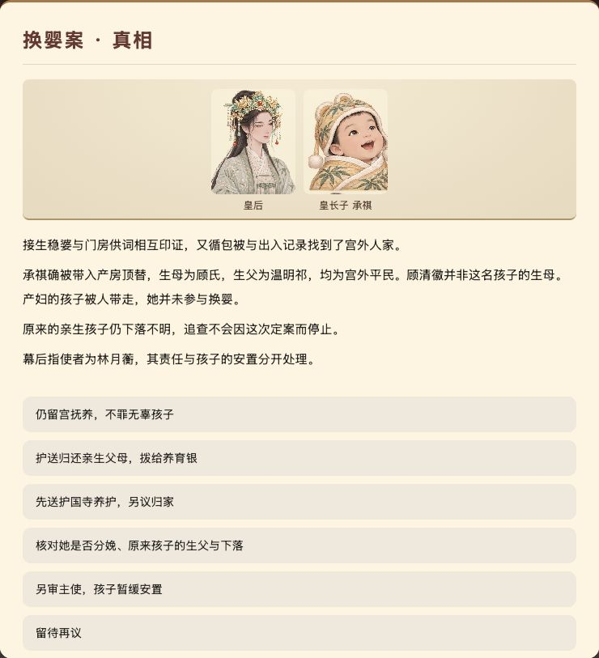</a> |

出生后数月可出现包被、出入簿和乳母证词的线索，调查仍需等待次月回奏。查出未遂会澄清亲缘；确实调换则记录真实生父母；原来的孩子被送走且仍可能在世时，才安排寻亲。寻到者接回宫中，暂未寻到者仍有后续追访；死胎与早先小产按核实的亡故记录处理。

换来的孩子可留宫收养、护送归还亲生父母并给养育银，或暂在护国寺养护。由妃嫔本人主使时，她承担相应罪责；旧案中未参与调换的生母仍属受害者，不自动获罪。家谱、照护关系和个人纪事随真相更新。

**孩子安置、成人问罪、寻回原来的孩子分别推进。** 调查会核实产妇是否实际分娩、原来孩子的生父和去向，以及成人是否参与。原来的孩子有出生时保存的亲缘，不会因为生在宫中就一律判为皇帝亲生。

| 核实分娩、亲缘与去向 | 安置孩子后继续问罪 |
|:---:|:---:|
| <a href="docs/screenshots/showcase-birth-swap-original.jpg">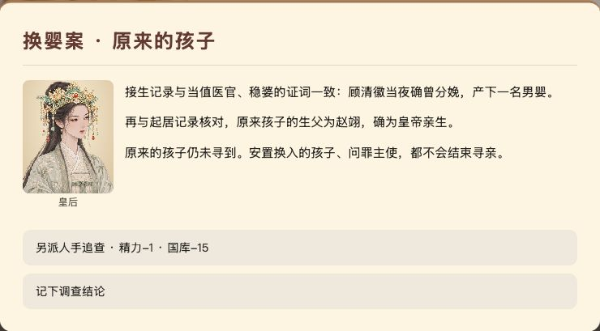</a> | <a href="docs/screenshots/showcase-birth-swap-justice.jpg">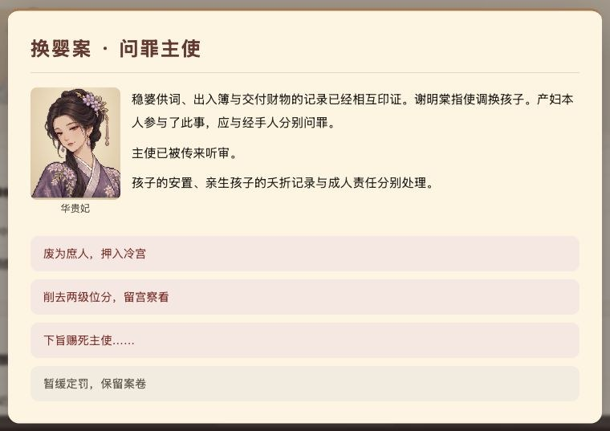</a> |

安置换入的孩子后会接着审理主使，可削位、废为庶人押入冷宫，或经第二次复核赐死。孩子和涉案妃嫔详情保留「换婴案卷」，已安置的旧档也可继续问罪。受害生母不被自动当作主使，两名孩子也不因成人获罪被连坐。

孩子未寻到时，可以花一点精力与十五万两另派人手，两个月后回奏；若只查到新的转送线索，可继续追访。寻回后沿用原出生年月和亲缘，另赐名入册，不会变成一个重新出生的孩子。调查进度、定罚结果和寻回身份随存档保存，重复点击或读档不会重复扣款、重复处罚或多生一个孩子。

### 异世旧梦：来自未来的她

少数妃嫔带有「异世来客」背景，可与原有性情、家世、心愿组合。她可能自述来自二十一或二十二世纪，因时空乱流失去归路，记得地铁、手机、星港或人造城；也会怀疑眼前的世界是否出自 AI。**这是人物的自述与猜想，属于原创架空支线**，不会改成所有人必须经历的主线。

| 信任后的坦白 | 同类逐步相认 | 国师问来处 |
|:---:|:---:|:---:|
| <a href="docs/screenshots/showcase-traveler-confession.jpg">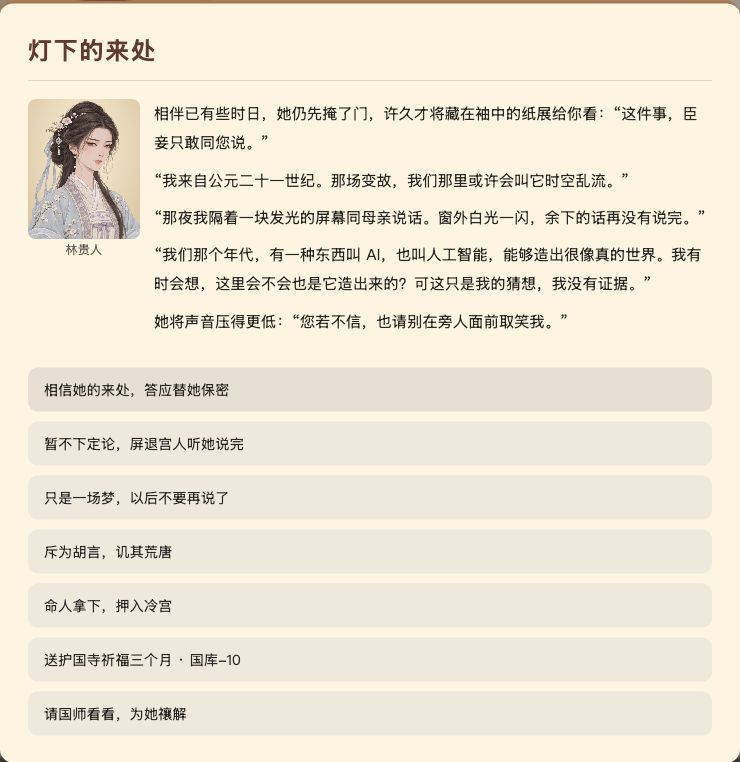</a> | <a href="docs/screenshots/showcase-traveler-peers.jpg">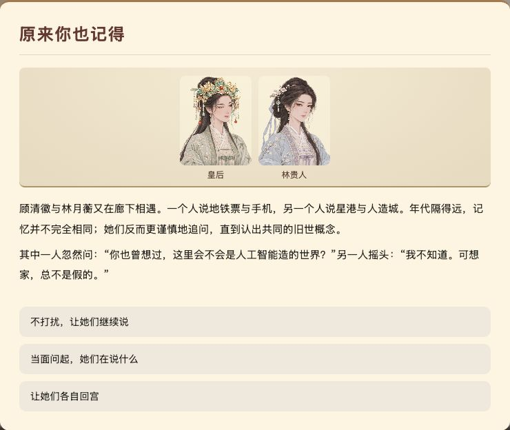</a> | <a href="docs/screenshots/showcase-traveler-ritual.jpg">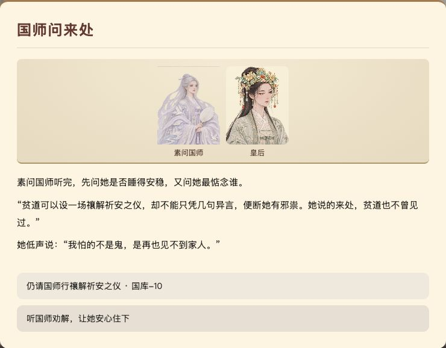</a> |

才情与处事心机都较低时，她容易急于自证、说漏陌生词语，隔一段时间又想解释；聪慧、持重或善于藏言者，会等相处满一年、情分至少 75 才私下开口。后续从来处转向生活细节与思亲，不每次重讲同一段。把她的过往当作梦、或斥为胡言后，她会永久收起对皇帝的倾诉；即使后来情分升高，也记得那次伤害。

其中极不谙世事、又不懂藏话的来客，会在**选秀觐见时当场失言**，说出自己来自二十一或二十二世纪，甚至追问这是不是人工智能造出的世界。聪慧谨慎者仍会隐瞒；才情低但懂分寸者也不会一律暴露。入宫后记得这次殿前失言，后续对白会承接它。

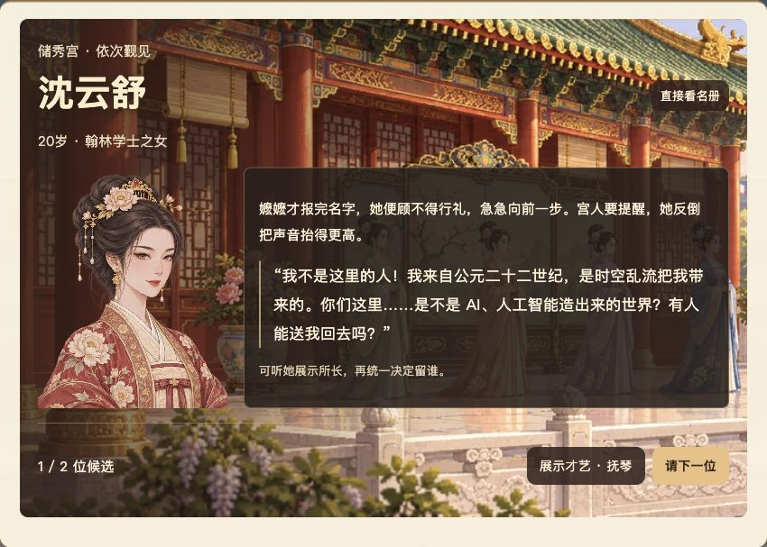

可以相信、静听、拒绝，也可经复核押入冷宫，安排护国寺祈福三个月，或请国师禳解。寺居沿用照护、孕期限制与回宫规则；国师不会因几句异言就断定附邪，仪式也不会抹去她的记忆。

两位来客若同住、兴趣相投或已有交情，可能从一个陌生词试探彼此，再隔数月核对生活细节。来自不同世纪也能相认，但不会一见面便自动成为知己；不再向皇帝开口的人，仍可能向同类说起乡愁。事件、情分、两人关系、冷却与未完成选择随存档保存。详见 [六种来处、条件与全部分支](docs/character-experiences/time-travelers.md)。

### 记忆如何保留

NPC 记忆区分客观事件与人物主观理解。同一场争执，受助者与被责罚者会留下不同感受；记忆包含来源事件、情绪、确信程度与获知方式，影响后续闲谈和人际判断。闲聊提起朋友间的具体往事时引用实际记录；没有共同经历时，只表达眼下的亲疏与看法。

这套记忆由本地 JavaScript 规则生成，**不需要大模型服务或 API 密钥**。每人最多保留 **96 条短期记忆、160 条长期记忆与 24 条旧事摘要**，随存档保存，旧档自动衔接。

不同的经历会分别留下细节；只有对象、内容、情绪方向和获知方式一致的重复日常才会合并，并记录累计次数、最早与最近的时间。心愿、受罚、母子离别等重要经历优先保留；退出日常记忆的代表性旧事进入摘要，仍可用于闲谈检索与人际判断。亲历与传闻不会混并，重复听见也不会自动变成确信。

重复日常保留最多六条代表性事件来源，并清理无记忆引用的旧事件，控制存档体积。记忆仍有容量上限，不能恢复旧版已经遗忘的内容，也不提供完整人生录像或世界事件重放。

## 生育与皇嗣

### 怀孕、赐名与出生禀赋

召幸后可能受孕，下一月末由太医诊出喜脉。可以照料、赏赐或晋位；孕期事件与照顾情况影响风险。临盆后由皇帝赐名，产后有恢复期，体弱者存在难产风险。

孩子的初始禀赋与父母有关：生母才情明显影响才学，德行与心机分别关联品德与野心，生父文才、武略和帝王性情也有作用，同时保留个体差异。出生时记录父母属性与初始数值，后续教养继续改变成长结果。

| 罕见出生事件 | 游戏设定 |
|---|---|
| 双胞胎 | 每次生产 2%，可能同为皇子、公主或龙凤胎 |
| 三胞胎 | 每次生产 0.1% |
| 出生异象 | 独立 3% 概率；赤霞映阙、文星流彩、长虹贯庭分别带来小幅体魄、才学或武艺加成与标签 |

多胎共享生日和生产批次，分别排行、逐个赐名，中途读档可以继续。异象与概率属于游戏演绎。

皇嗣列表按实际去向分为 **宫内 / 已出宫**，点击分栏查看；婚嫁本身不等于离宫，开府、就藩、远嫁和寺中居留等状态共同决定归属。皇子在京开府后也归入「已出宫」，住在京中皇子府；旧档成年皇子的居处会同步补全，储君保留东宫安排。列表保留年龄、生母与主要属性，具体住处留在详情中。

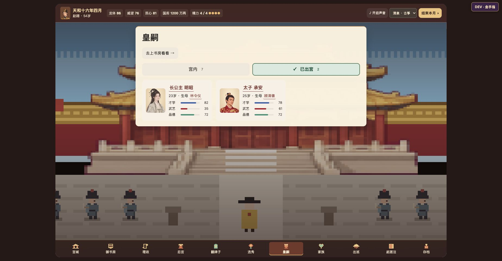

### 同生手足：龙凤、双龙、双凤与三胞

同生的孩子有专属贺称，也有各自的名字、性情和心事。人物详情设有「同生手足」，可直接查看兄弟姐妹，参与 **10 组专属场景、20 个回应分支**；御花园与上书房也会出现适龄的活动入口。

| 同胎组成 | 专属标签 |
| --- | --- |
| 两位皇子 / 两位公主 | 双龙并耀 / 双凤齐鸣 |
| 一位皇子、一位公主 | 龙凤呈祥 |
| 三位皇子 / 三位公主 | 三龙同辉 / 三凤同辉 |
| 两位皇子、一位公主 / 一位皇子、两位公主 | 双龙伴凤 / 双凤伴龙 |

出生先后放进诞生簿说明，日常以「同生哥哥、姐姐、弟弟、妹妹」相称。宫中皇子、公主的排行继续分别记载。

- **襁褓与幼年**：国师讲云气、星影、并蒂花的瑞梦，母亲按自己的性情回应；三至五岁的孩子会抗议只被叫作“一对小殿下”，想让父皇记住自己的名字与喜好。
- **一同长大**：争论谁先出生、功课被认错、不愿总被比较，也会替手足说一句公道话。龙凤胎可以分别试学；三胞同生会为第三个人留出位置，或合画一树、各自落款。
- **各有前程**：少年可以商量分开求学与定期相聚；有人离宫后，生辰月通过家书互送问候。每人的成长记和心声承接实际选择，三胞同生的三人各有记忆。

| 龙凤各有志向 | 三个人都要有位置 |
|:---:|:---:|
| 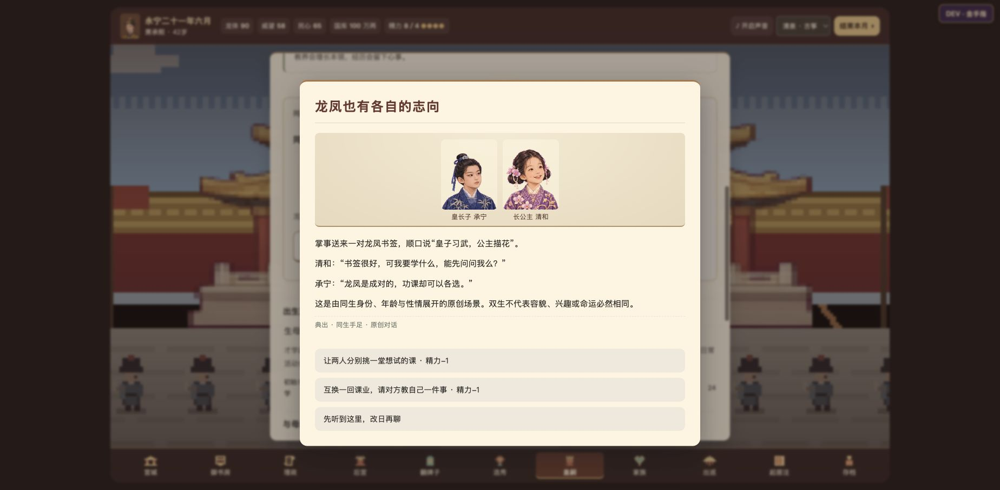 | 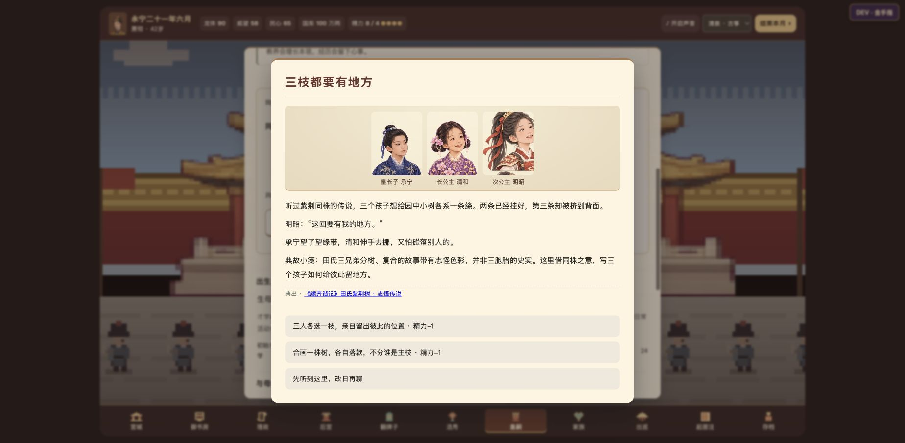 |

| 国师瑞梦与母亲回应 | 共同经历留下自己的感受 |
|:---:|:---:|
| 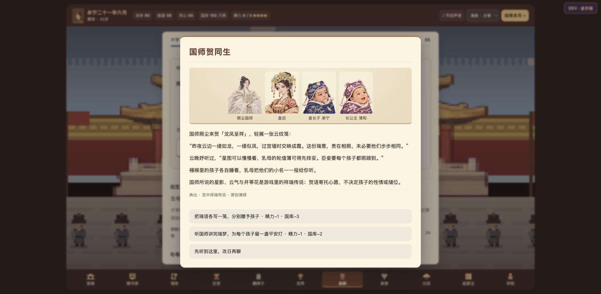 | 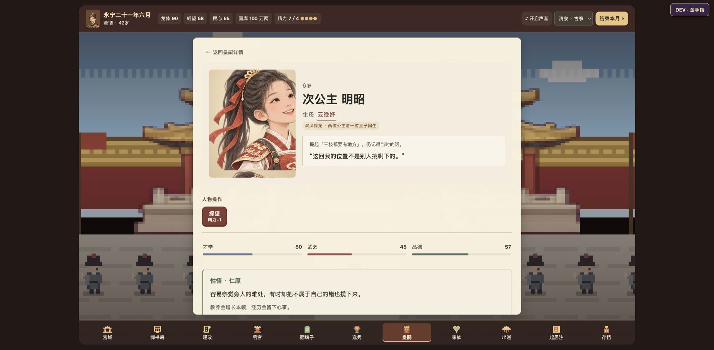 |

对话核对年龄、性情、真实同生关系、健康和居处；同组互动至少隔六个月，每个话题只经历一次。已故、收押或无法到场的人不会被写成正在一起玩；离宫家书使用通信。换婴真相与寻回身份也会同步修正同生关系，旧档不会仅凭相同生日认作双生。

贺称与瑞梦属于原创祥瑞传说，长幼之议、元方季方、紫荆树、常棣分别注明古代笔记、志怪或诗意改编。详见 [全部话题、条件与典故来源](docs/multiple-births.md)。

### 孩子各有自己的性情

皇子、公主有 **好奇、好胜、仁厚、内敛、爽直、灵动、审慎、自矜** 八种稳定性情。教养改变才学、武艺等本领，性情不会随着最高属性来回跳变；旧档也会补齐并保持一致。

三至五岁的幼童、六至十一岁的孩子、十二岁起的少年分别使用适龄对白。婴幼儿、病中、寺居与思念冷宫母亲等处境优先于普通心声，人物不会脱离自己的身份说话。课业成就、顽童琐事与新故事也会核对年龄和性情。

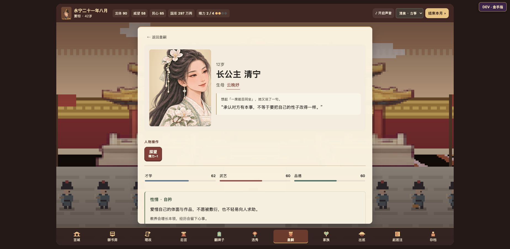

### 母子同住、陪伴与过继

六岁前，孩子随当前生母或养母住在对应宫殿。到宫里可能看见哄睡、学步、认字、点心、彩线、木马或安慰母亲等场景；活动会参考年龄、母亲特长、性情和心情。可以坐下陪伴，也可以轻声旁观。

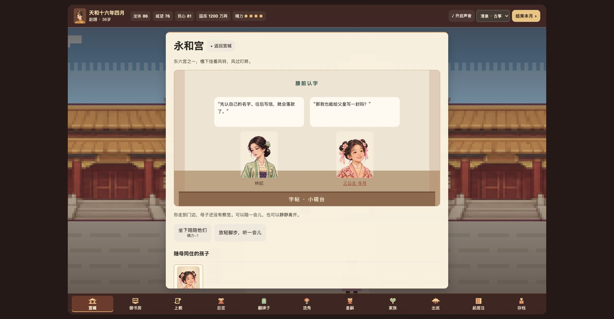

生母、养母分别与孩子积累信任和相处记忆。孩子有心事时会找更信任的人；详情中可以安排陪伴、准许或暂缓生母探望，点击母亲姓名即可查看她。

皇嗣可交给贵人及以上的妃嫔抚养，挑选时能看她的才情、德行和膝下子女。养母会影响教养与争储所依靠的家族，生母可能伤心、怨恨或私下探望；也可以让孩子回到生母身边。

生母或养母被打入冷宫后，与她亲近、满四岁的在宫孩子可能来求情。你可以准探望送衣食、减罚放出、解释缘由或斥退。处罚、解释与陪伴都会改变孩子的感受。

### 请养孩子与姐妹续缘

年长、膝下无子且有足够位分、恩宠与供养条件的妃嫔，可能主动请求抚养六岁前的孩子。孩子须因生母去世、冷宫或离宫而缺少母亲的长期照护，且没有合适养母；已有乳母的日常照料不会被写成无人照顾。普通请养排除皇后与妃位及以上生母的孩子，也不会由出身低微又不得宠者贸然提出。

| 无子妃嫔主动请养 | 新人初见，先问姐姐的孩子 |
|:---:|:---:|
| <a href="docs/screenshots/showcase-foster-petition.jpg">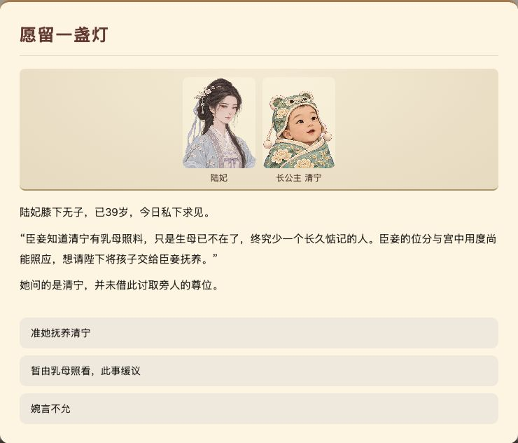</a> | <a href="docs/screenshots/showcase-kin-arrival.jpg">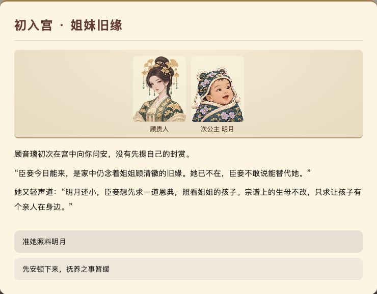</a> |

高位妃嫔去世、入冷宫或离宫后，家中成年亲妹妹或堂妹也可能来信请入宫，希望续住家门旧缘。准入后，**第一次问安便提到姐姐**；若姐姐留下需要照护的幼儿，新人会当面请求抚养，而不是说一段与身世无关的通用欢迎词。

亲族照护是独立条件，允许照看高位姐妹的孩子，但仍保护已有养母与现有居处；不会自动抱走孩子，是否允准由玩家决定。生母身份保留，养母与孩子分别留下记忆；冷宫中的生母若得知姐妹代为照料，也可能稍感宽慰。亲姐妹共用同一个父亲节点，堂姐妹保留不同父系，不会为同一父亲重复画两棵树。请养与家门续缘都有较长间隔，读档后未说完的入宫问安可继续。

### 钦安殿、国师与东海之约

**钦安殿** 独立位于宫城地图右侧、文渊阁下方，也可从御花园进入。国师有男女各两种形象，单个存档固定一位；简洁玉冠与素簪搭配宽袖鹤氅、云鹤刺绣。另四张清雅人物用于讲道时来访的文士、女史与女客。

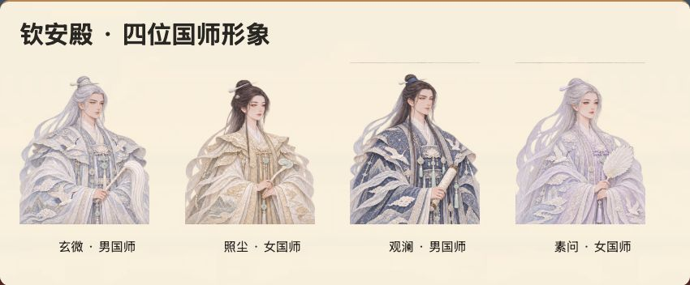

| 钦安殿与来访人物 | 国师讲读《逍遥游》 |
|:---:|:---:|
| <a href="docs/screenshots/showcase-dao-hall.jpg">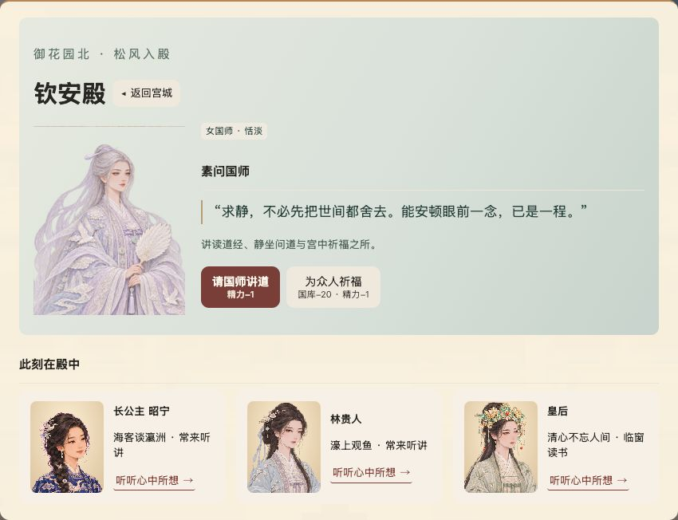</a> | <a href="docs/screenshots/showcase-dao-teaching.jpg">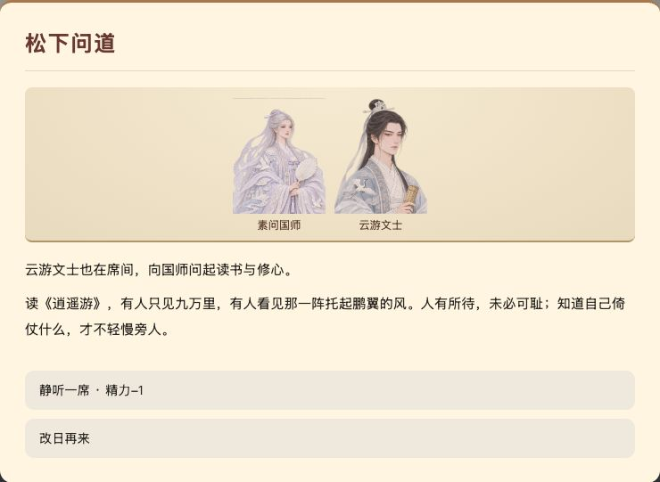</a> |

淡泊、沉静、好学或暂时失意的妃嫔，以及满十二岁、居于宫内或可从京中府邸回宫、野心较低或才学较好的皇嗣，可能主动来访。来过多次后会留下「向道初识」「潜心问道」的经历，之后闲谈也会说起殿前松风与读书所得；保留原有性格，信佛人物不会自动改作向道。冷宫、寺居、圈禁、病重等不合条件的人不在来访名单中。

可以谈鲲鹏、梦蝶、濠上观鱼与树下清风，也可能听见孩子念起“海客谈瀛洲，烟涛微茫信难求”，请求一起去东海。答应后留下约定，之后可花费国库 50 万两与两点精力同行，每年一次；观潮、听仙山传闻或探访沿海人家，会形成不同纪事、属性变化与后续话语。存档可续接未完成的行程。

| 诗中问仙 | 真正赴东海游历 |
|:---:|:---:|
| <a href="docs/screenshots/showcase-yingzhou-wish.jpg">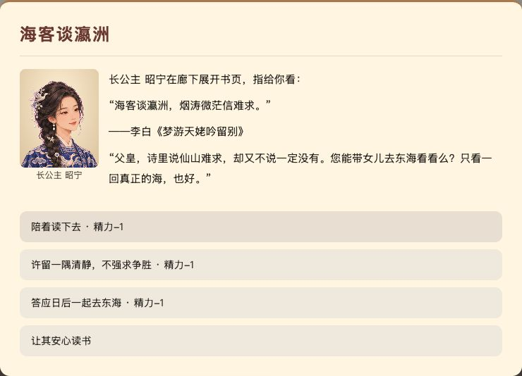</a> | <a href="docs/screenshots/showcase-dao-coast.jpg">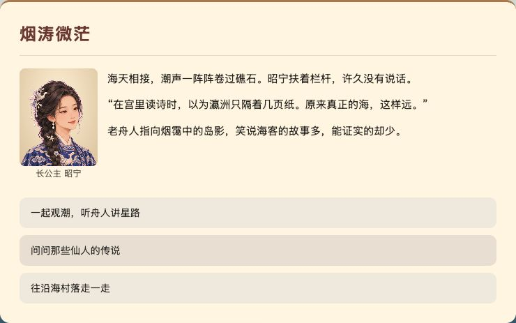</a> |

国师每三个月可讲道一次，每年可主持一次祈愿并安排施济。钦安殿问道与护国寺礼佛、寺居各自独立；宫廷中道教和佛教均有活动场所。地点参考故宫资料，人物与游历情节为原创。详见 [六类问道话题、玩法条件与原典来源](docs/qin-an-hall.md)。

### 护国寺祈福与远方牵挂

在世、已赐名且未被圈禁的皇子公主，无论年幼、成年或身世存疑，可在体弱、灾异或身世事件中选择送寺，也可由皇帝「出巡 → 护国寺祈福」后，在寺中安排半年或一年祈福。普通人物详情不常驻送寺按钮，已在寺中才显示状态与接回操作。年幼者由乳母随行，住寺旁客舍，不作剃度；寺中居留期间暂停宫内活动，届期返回原居处，也可提前接回。身世处置中的长期寺居另行记录，不会被普通祈福倒计时自动撤销。

初生体弱，或出生时恰逢京畿地动、久旱，可能引出低概率的「国师请祈福」。可以送寺并安排乳母、太医，留在母亲身边请太医照料，或拒绝以灾异责罚孩子。此类建议全宫至少间隔三年，每胎最多一次。

| 到访护国寺 | 国师请祈福 | 母亲牵挂远方的孩子 |
|:---:|:---:|:---:|
| <a href="docs/screenshots/showcase-temple-arrangements.jpg">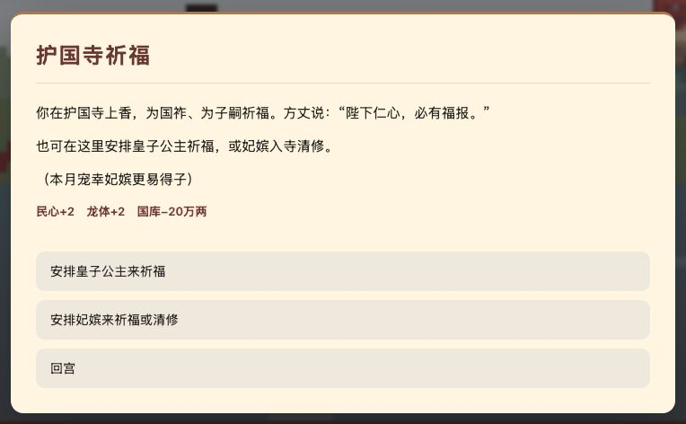</a> | <a href="docs/screenshots/showcase-temple-advice.jpg">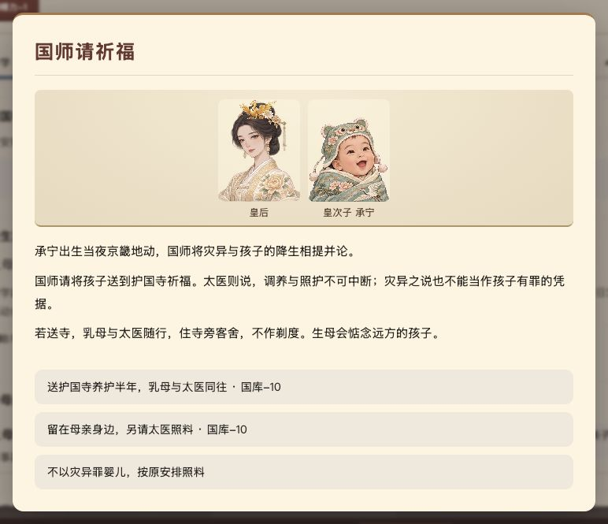</a> | <a href="docs/screenshots/showcase-mother-longing.jpg">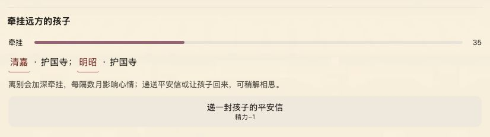</a> |

皇帝到访护国寺时，也能选择妃嫔祈福三个月、清修半年或暂不定归期。原宫室与位分保留，宫女随行；寺居时不参加宫内日常、宴请与召幸，期满或提前迎回后恢复。

生母与养母都有「牵挂远方的孩子」近况：列出孩子与居处，离别会加深牵挂并影响心情；不同性情会说出不同的话。每三个月可递一封平安信，年幼者由乳母代写。接回孩子、收到回信，会缓和思念；离别与团聚都进入人物纪事和记忆。

### 教养与上书房生活

三岁起可选择均衡、读书、习武、修德或放养；六岁起可延请太傅。探望、母亲陪伴与人物主动行动也会影响才学、武艺、品德、体魄、野心与父爱。


六至十五岁的在宫孩子会共读、争论功课、课间投壶或替同窗解围。你的回应会改变属性和手足关系，双方各自留下记忆。孩子还可能染病、被太傅夸赞、闯祸，或触发与年龄匹配的典故。

十三至十五岁会有志向、争辩与对未来伴侣的想象。公主在妃嫔宫里可能遇见随长辈进宫的少年公子；初识只留下心意，对方身份随存档保留，双方满十六岁后才可沿这条路线议婚。已记录的母系、养母同族及皇室同姓会被排除。

### 议婚、开府与储位

满十五岁后，进入皇嗣详情可见「议婚 / 赐婚」，先看名帖、听本人意愿，再确认或暂缓半年；列表保留人物与基本信息。


| 成长方向 | 可以安排的事 |
|---|---|
| 皇子婚事 | 查看书香、将门、清正官宦三类具名人选，家世与投契程度影响婚后属性；候选与配偶随存档保留 |
| 公主婚事 | 下嫁重臣、和亲、自择驸马、暂缓，或在合适年龄重提少年时的旧识 |
| 公主开府 | 十五岁后可独立开府，依才学、武艺或性情提出校书、女骑赛、就近安家等计划；开府与婚事分别安排 |
| 府中来信 | 拨银、引荐人手或交由她自筹，数月后收到回信；可邀她回宫，远嫁者通过家书往来 |
| 皇子成年 | 十六岁封亲王，可在京开府辅政或就藩；开府后列入「已出宫」 |
| 立储与夺嫡 | 皇子五岁起可立储，十岁后积累朝臣支持；野心、品学与母家势力可能引出结党、争储甚至逼宫 |

### 婚后的日子

驸马与王妃在详情中有固定姓名与立绘。议婚时可以先谈日常，了解兴趣、用度习惯和相处节奏；婚后继续记录 **夫妻信任、府中和睦、孕期与子女总数**。


- **定期近况**：约四至七个月写一则生活纪事，结合夫妻兴趣、父母处境、远嫁、照料孩子等条件，避免连续同题。
- **可以参与的家事**：商量家用、独处与相伴、亲族往来、共同育儿；回应会改变信任或和睦，有的两个月后继续反馈。
- **共同计划**：支持校书、整理骑场花径或家宴，数月后看成果；成年皇子也可谈纳妾，嫡妻的感受与后果会保留。
- **添丁与亲子记录**：双方满十八岁、符合关系和身体条件才可能有孕；九个月后生产，显示孩子姓名、父母、年龄、性别及总数，并保留恢复间隔。
- **联系出宫皇嗣**：皇子与公主都可探问小家，远方以家书往来。公主府、婚后纪事和亲族关系可跨代延续。

妻妾分别记录孕程与产后休养，可以在同一年同一月先后报喜；一人有孕不会占用其他人的孕程。纳妾、正妻或妾室有孕、分娩都带明确年月、身份与姓名，同月的第二则孕信会记为「同月……亦有喜」。府中仅显示各自当前孕月，报喜的具体年月保留在纪事中；生产后分别登记孩子与生母。

「询问皇子纳妾意愿」在皇子与正妻均成年、婚后满两年、距上次商议满两年且妾室少于两人时可用；未到时间会显示剩余月数，已满两人则说明原因。先听皇子的意愿，再决定准许或暂缓，并非点击就直接纳妾。


## 家族与太后

### 能顺着人物追溯的家谱

底栏「家族」可以切换关系图与家族列表。图中有太后、皇帝、妃嫔父兄、妃嫔与皇嗣的头像，点击人物能进入详情；返回时回到来处，并保留原来的分支和位置。


- **亲姐妹共用父亲**：同父姐妹从同一个父亲节点分叉，堂姐妹按父亲分房；同姓不会直接被认作同父。
- **生母与养母分别记录**：皇嗣列于生母支系，另外标明抚养关系。过继后仍保留亲生身份。
- **家族荣辱相连**：有势力的同族妃嫔共享家族影响，一人晋位或获罪会牵动姐妹与父兄。
- **姐妹有各自的关系**：亲近、嫡庶旧怨、姐妹同心、娥皇女英与外戚坐大等事件，需要符合人物身份和在宫状态。
- **恩怨传到下一代**：孩子会亲近母亲的好友，也可能受到母亲间冲突的影响；同母或同养母长大的手足通常更亲近。

### 太后荐人与母家往来

请安时，太后可能推荐族女。既有族女入宫已久、长期失宠或尚未生育时，还可能再推荐同族堂妹作伴；家族身份与姐妹关系会保留，接受或婉拒后各有间隔，并非一生只推荐一次。

选秀也可能遇到已有妃嫔的妹妹，受宠者的娘家还可能来信求送妹妹入宫。父亲年老病故、兄长军功与朝中立场，会成为女儿真正关心的家事。

### 丧仪与追思

太后去世会有明确讣告和慈宁宫丧仪画面：素幡、灵位与长明灯，母族妃嫔按性情表达悲伤。可厚葬或从简尽礼，新丧当月暂停宴饮。

在冷宫的族女于自己的住处哀悼。丧仪可以在读档后继续；之后慈宁宫保留追思入口，可以添香、陪族女谈旧事。悲伤与安抚会留在人物故事和记忆里。

## 岁时与宴会

### 人物会主动发起活动

人物行动由性情、小性子、喜好、季节、心境、记忆和教养方针共同筛选。宫城会给出地点与参与者，到场可以先旁观，再决定是否花精力加入。

| 日常活动 | 人物与情境 |
|---|---|
| 拾花伤春、秋夜听雨 | 沉静、痴情、淡泊或念旧的人，在思念与委屈时流露心事 |
| 暖阁分茶、邀友赏花 | 温婉、好客或爱花草的人，与相熟的姐妹小聚 |
| 佛堂抄经 | 信佛且心中有事的妃嫔，在太后健在时前往慈宁宫 |
| 中宫核账、重算账目 | 聪慧、持重或好读史的人，在开支与政务上提出看法 |
| 花亭试投、投壶约赛 | 爽直、将门、好胜或喜欢投壶的人相约比试 |
| 交换绣样、合校旧抄本 | 巧手的人分享手艺，好学的人结伴读书 |
| 送汤、拿出旧礼、移座避寒 | 身体状况、旧情与小性子影响关照和回应 |
| 带孩子练弓、拜访太傅 | 母亲的特长与护短心影响孩子的日常 |
| 主动校书、约手足比试、给手足补课 | 读书、习武、修德的教养方针各有相应行动 |

妃嫔与皇嗣每月各至多一人发起新的主动行动，既有邀约与后续可并行。同一活动全宫间隔至少十二个月，同一个人间隔至少十八个月。冷宫、离宫、就藩或圈禁等状态会限制人物出席日常活动；冷宫来信、奉旨问话、孩子求情等有各自的条件。

### 性格决定的小聚与手艺

这些活动出现在相应地图地点，玩家可以参与并选择具体做法。人物的才情、德行、心情、交情或孩子的亲子记忆会随选择变化，并留下记录。历史器物与习俗提供灵感，人物对白与结果为游戏改编。

| 活动 | 何时、由谁发起 | 可以怎样参与 |
|---|---|---|
| 春蚕试养 | 二、三月，中宫或持重、巧手的妃嫔 | 两宫轮值照料，或记录用量留丝节用 |
| 月下借针 | 七月，巧手、好胜或喜欢刺绣的人 | 先比试再互教，或合作做针线包 |
| 斗草辨芳名 | 四、五月，活泼、爽直、好学或爱侍花的母亲与幼儿 | 让孩子自己试，或一起做草木簿；次月有后续 |
| 三清茶辨香 | 冬日，爱品茶、好客、沉静或淡泊的人 | 记住朋友口味，或将茶方送往当值暖阁 |
| 残卷补纸 | 文渊阁，好学、巧手或持重且有才情的人 | 补纸校字，或另抄副本供大家读 |
| 旧锦裁冬衣 | 冬日，温婉、持重、巧手且重德行的人 | 给幼儿备衣，或教针线房节用 |

月末随机见闻以一至三条为上限，出生、丧仪等必需事件独立处理。普通同类见闻通常有十个月的全宫间隔，同一人物至少十八个月；疑案、惊变等有更长间隔。已经见过的题材也会降低优先级。间隔随存档保存，换一个妃嫔或重新读档不会立即重演。


### 节日与有后续的小事

| 活动 | 参与方式与后续 |
|---|---|
| 上元寻灯 | 正月带两名满五岁的在宫皇嗣，从御花园走到文渊阁、上书房，三站猜谜，可合作或比试，保留成绩 |
| 御花园种花 | 春天选择向阳处或树影下种下花苗，来年回访；种得不合适也可移栽 |
| 上书房的旧砚 | 请年长皇嗣将旧砚传给弟妹，三个月后回来看新作 |
| 端午宫务 | 四月委派两位妃嫔分管宴席和节礼、拨付银两；五月查验，再设端午宴 |
| 结百索、绘兔儿爷、描消寒图、备笔砚 | 按节令与人物条件发生，可请母亲陪做、让孩子教同窗，一个月后继续回访 |
| 画扇、查冰票、七夕种生、摆菊分糕、冰嬉、腊八粥 | 季节、年龄、体魄、兴趣与关系决定谁会参与 |

端午筹备中，主事者可能向熟人求助，也可能遇到争份例、漏记帮手或开支不清。按实记功、私下协调或照册办结，会影响她们各自的记忆与日后合作。

### 小宴、万寿宴与千秋宴

在御花园可 **全员宴请**，由宫人按家人分桌，也可自选宾客、调整席次。邀请界面列出皇子公主总数，并在妃嫔席卡区分亲生与抚养的孩子；全员宴请允许幼童观礼。


席间可选投壶或共绘花枝，再决定让新手试手、同席轮流合作，还是由擅长的人领投领笔。座次、人物特长和交情影响结果；投契的人两个月后可能再约，届时可以从地图赴约。


| 宴会 | 举办时机 | 开支 |
|---|---|---|
| 御花园小宴 | 与上次普通小宴间隔三个月 | 精力 1 点、15 万两 |
| 皇帝万寿宴 | 皇帝生辰月，每年一次 | 精力 1 点、30 万两 |
| 皇后千秋宴 | 皇后生辰月，每年一次 | 精力 1 点、30 万两 |
| 端午宴 | 四月筹备、五月查验后举行 | 筹备时拨银 20 万两，开宴用精力 1 点 |

## 朝堂与政务

在宸极殿处理河患、蝗灾、地震、盐政、殿试、边关、弹劾外戚和立储等奏请。决定会改变威望、民心、国库与龙体，也可能牵动后宫中某人的父兄。


御书房有 **外戚、文官、武将、太后、皇子** 五方势力。每月可花精力与预算采纳一项建议。各方影响力与家族地位、民心、武略、太后状态、皇子支持和议政历史相关；同派妃嫔与对立派人物也会形成不同反应。

| 朝堂往来 | 玩家可以权衡什么 |
|---|---|
| 外戚请封 | 准许父亲擢用儿子、驳回，或让他外放历练 |
| 科场案 | 严查文官门生、从轻发落，或交三司会审 |
| 边关捷报与失利 | 父亲或兄长立功、遇挫；捷报可赏将领、晋封对应妃嫔、赏锦缎珠玉，或只记功 |
| 慈宁宫用膳 | 太后借家常表达对某位妃嫔的关照 |
| 国本之争 | 两位皇子背后的母家上疏，立储与家族势力彼此牵连 |

父兄有姓名、官职、年龄和功绩，会随岁月变化。军情对全宫和同一家族分别设置间隔，亲姐妹共享父兄记录。晋封遵守位分名额；一份奏折的处置会留在人物故事和起居注中。

### 可以往来的父兄

在**家族树点父亲或兄长的头像、妃嫔详情点父兄姓名**，即可打开个人档案；御书房和宸极殿也有「朝臣与外家」入口。同父姐妹共用同一份父兄履历，从详情返回时会回到原来的家族页或人物页。

| 父兄详情与往来 | 差事回奏 | 家谱中的故人 |
|:---:|:---:|:---:|
| <a href="docs/screenshots/showcase-official-profile.jpg"></a> | <a href="docs/screenshots/showcase-official-report.jpg"></a> | <a href="docs/screenshots/showcase-official-family.jpg"></a> |

- **召见与书信**：可问任上见闻、家中近况，或谈公私与用人。持正、谨慎、进取、圆融四种处事风格有不同回答；家人离世、女儿入冷宫、奉差在外、致仕归乡也会改变对白。每三个月可深入交谈一次，增加信任。
- **委派与回奏**：武职可巡边整饬军备、护送粮道，其他外家人物可核查钱粮、巡察民情；领差花精力与国库，约两至三个月后回奏。才干与信任影响办差结果，边关任务有低概率遇伏身亡。进展与结果随存档保存。
- **赏赐与致仕**：新增功绩达到条件后可论功赏赐，避免反复点取收益；年长者可准予致仕，符合年龄和间隔条件时再征召。故人可以赐祭抚恤，生前的履历继续保留。
- **纪事互相对应**：军功、差事、赏罚和死讯写入本人履历、相关姐妹纪事与起居注。阵亡、病故、伏诛、流放会影响档案与后续资格；不会一面写着阵亡，一面又领兵、受封或带儿子入宫。

旧存档中明确写下的「兄长战死」、父亲病故，以及「边关烽火」「金玉其外」的相关结局，会补入家族状态；没有记载的具体日期或死因不会凭空编造。[查看阵亡人物档案示例](docs/screenshots/showcase-official-memorial.jpg)。

离开游戏一段时间后再读档，御案上可能出现积压奏折。民心归零会走向亡国；龙体归零则进入驾崩与传承。

## 传承与记录

### 从一朝走向下一朝

皇帝驾崩时，根据威望、民心等生成庙号、谥号与本纪。有继承人时，可以由太子或皇子接续游戏，历代皇帝记入记录；逼宫成功也可能迫使你禅位，以新帝身份继续。

先帝皇后尊为嫡母太后；如果新君生母另有其人，也会分别保留身份与立绘。慈宁宫能看到她们原来的面容和往事。潜邸嫡妻成为皇后，妻妾、已有孩子与身孕接入新朝；家族页的「先朝亲族」继续查看兄弟姐妹及其小家。


### 起居注与纪念卡

妃嫔有自己的故事，皇嗣有成长记；全朝大事进入「起居注」，可以筛选大事，月度回顾优先呈现有后续的人际变化，也可以将上个月的经历导出为像素风 PNG 纪念卡。

### 浏览器存档


- **三个手动存档位与行动后自动存档**，记录人物、关系、记忆、活动与事件进度。
- **岁首快照**：每年正月留档，最多保留四份，可回到某一年的岁首。
- **JSON 文件备份**：下载文件保存进度，换浏览器时选择文件导入；导入前自动备份，可恢复原来的进度。
- **旧档迁移与回退**：补齐兼容字段；主档损坏时尝试恢复上一份有效快照。

存档包含尚未处理的事件与已完成的选择。旧版本从未写入存档的普通事件无法事后找回；如果未来版本无法续接某份事件记录，会保留原存档并暂停覆盖，供下载备份。存储写入失败时，有状态变化的本次操作会撤回。

数据存于当前浏览器的 LocalStorage；不同设备、浏览器或站点地址之间不会自动同步，需要下载备份文件后再导入。

## 画面与配乐

### 立绘与场景

人物使用精细像素风 WebP 图集，浏览器加载后裁取对应格子；**不是每次现场生成一张新立绘**。图集未就绪时有程序绘制的后备形象。宫城、行走人物、四季与部分背景由 Canvas 绘制，登基和选秀有专门场景素材。

女性共用图库有 **67 张立绘**，包括不同眉眼、发髻、襦裙、宋式褙子、圆领袍、骑装、西域舞衣，以及取意金陵十二钗的成年佳人与盛装华服。妃嫔、皇子选妃候选人和婚后的王妃共用这套图库；选妃名帖确定后，婚后与继位为后都保留原来的脸。分配会优先避开当前宫中与待选名帖已经使用的形象。

皇子有 **26 套成长形象**，公主有 **30 种成年造型**。其中 26 套男女成长形象覆盖襁褓、孩童和长成后三阶段，共 156 张；公主另外四张成年造型在十八岁起使用，幼年沿用对应的成长形象。风格包含清雅、英气、温润与礼服造型，公主包括披发、半披发、侧辫、双丫髻、珠冠与花冠。存档保留已经分配的人物形象。

点进妃嫔或皇嗣详情后，主立绘在桌面以 224 × 280 显示，手机以 176 × 220 居中显示。人物图集按需加载，详情、事件、家族与测试面板使用同一人物形象。

清雅人物图集包含四张妃嫔与四张成年公主立绘，每格 **448 × 560**，透明背景保留发丝、服饰与古画设色。


多人相遇、宴请、争执与议婚会并排展示相关人物。家族图、皇嗣列表与活动入口也使用对应头像，便于认出同一个人。


### 古筝、琵琶与琴箫

| 配乐 | 气质与演奏细节 |
|---|---|
| 清泉 · 古筝 | 清亮五声旋律，琶音与按弦 |
| 花月 · 琵琶 | 倚音、轮指与拨弦韵味 |
| 松风 · 琴箫 | 更疏朗的停顿与琴箫呼应 |
| 随场景变奏 | 朝堂、后宫、花园、夜间与市井分别配曲 |

点击顶部声音开关播放，旁边可随时选曲；选曲保存在当前浏览器，切换时渐隐旧声部。全部背景配乐没有鼓点，登基与上朝保留轻钟提示。音乐由 Web Audio 实时合成，为原创旋律，并非《高山流水》等曲目的录音或改编。

### 手机游玩


手机采用紧凑御案、底部导航与纵向人物面板。地点指引在地图下方展开；家族关系图可横向查看分支，人物详情和事件按屏幕宽度排布。

<p>
  
  
  
</p>

## 测试模式与金手指

打开 **[dev.html](https://aubreykuang.github.io/Forbidden-City/dev.html)**，点击右上角「DEV · 金手指」。可以新开一局，也可以载入正式版自动存档的副本。


| 编辑方式 | 能做什么 |
|---|---|
| 常用属性 | 选择皇帝、太后、妃嫔或皇嗣，编辑年龄、国库、精力、才学、武艺、德行、恩宠、情分、位分、宫殿及相关状态 |
| 年龄直接应用 | 输入年龄时预览对应成长形象，点击旁边「应用年龄」立即保存；皇嗣以出生月份换算，读档后仍保留 |
| 跳过时间 | 输入月数或年数，点击「跳过并保存」；同步日历和人物年龄，单次最多一百年，可回退 |
| 立绘预览 | 从缩略图选择形象；皇嗣更换后仍保留随年龄切换的成长阶段 |
| 完整属性 JSON | 编辑表单之外的字段及嵌套记录 |
| 完整世界／存档属性 | 查看和编辑人物关系、家族、记忆、世界标记与事件进度 |
| 修改预览与回退 | 先查看差异，再确认保存；可回退上一次修改前的完整测试状态 |


时间跳过用于调试与查看成长，仅推进日历和年龄；不会替玩家选择随机剧情，也不自动结算政务与生育。

数值范围、人物编号与母亲关系等有校验；修改预览后的输入需要重新预览，正在发生的游戏事件应先处理完再保存属性。

测试版使用独立存档，不会写入正式版存档槽。如要把测试进度带回正式版，可在测试版下载 JSON 备份文件，再到正式版选择文件导入。

## 宫城与日常

### 每月怎么安排

每月基础精力为 **3 点**，勤政之君为 **4 点**，龙体低于 35 时少 1 点。上朝可以免费查看一份月度奏折，亲自批复通常花 1 点。每份奏折只可批复一次，离开再打开仍是同一份。殿试可交礼部操办，留出精力给其他事务。召幸、闲谈、探望皇嗣和出巡等行动消耗精力；赏赐、晋封和选秀不扣精力。

登基后可直接进入宫城，也可先选秀。新档首月奏折是黄河决堤，批复后可去坤宁宫走访皇后。点「结束本月」推进时间，结算朝政、后宫、皇嗣成长与节令事件。顶部可以开启声音、切换配乐；底栏随时进入后宫、皇嗣、家族、起居注和存档。

黄河决堤、蝗灾和京畿时疫的月度奏折可交给主管衙门全权办理。委办免耗精力，花费比亲自拨款多，民心涨得也较少；银两不足时仍可在原有办法中选择。批复前可比较亲办和委办的精力、国库与民心变化。换月后，起居注的「上月回顾」保留收支、奏折结果与人物记录。

黄河决堤也可先拨一半急赈。次月在宫城查看赈灾回奏，决定拨清余款或停止拨款。换月前若仍未批复，游戏会提醒停止拨款的后果。

黄河奏折会交代最急缺的是赈粮还是安置人手。有合适家眷在宫时，可以指派擅长相应事务的官员督办。批复前会显示成功率和需留的备款，办成会增加其家族势力。

### 地图上的每座宫殿都有用途

点宫名可以直达，点建筑会沿宫道步行，点路上的人物可以偶遇。悬停宫名或建筑可看地点信息；居住宫殿直接列出住在这里的人，空宫显示「暂时无人居住」，功能建筑保留用途与活动说明。键盘聚焦也能查看，Esc 收起。手机通过「地点用途与玩法」先看说明，再选择前往。

| 地点 | 可以做什么 |
|---|---|
| 乾清宫、御书房 | 查看国事与近况，权衡五方势力建议，筹办帝后寿宴 |
| 宸极殿 | 临朝听政，处理灾情、财政、军务与朝臣奏请 |
| 坤宁宫、东西六宫 | 探望住在这里的妃嫔，闲谈、赏赐，遇见姐妹往来或母子日常 |
| 御花园 | 偶遇、设宴、赴约、投壶、种花、端午筹备与节令活动 |
| 钦安殿 | 拜见国师、讲道祈愿，遇见问道人物，兑现东海出游之约 |
| 文渊阁 | 借书、校书、人物邀约与上元寻灯 |
| 上书房 | 看孩子共读、争辩、课间游戏，传砚、备笔砚、参与寻灯 |
| 敬事房 | 翻绿头牌，选择召幸对象 |
| 储秀宫 | 选秀期间查看秀女、暗访、留牌或撂牌 |
| 慈宁宫 | 向太后请安，听她荐人；太后去世后办理丧仪、添香追思 |
| 冷宫 | 查看受罚者与相关处境，处理冷宫来信、求情等特定事件 |
| 神武门、午门与「出巡」 | 微服出宫、围猎、祈福、温泉休养，以及探访公主府 |

妃嫔会按性情、心境、身孕和交情在各处活动。好学的人可能去文渊阁，交好的姐妹会互相探望，孩子也有自己的课堂与邀约。宫名上的活动数量、地图绿点和带立绘的动向卡，让这些往来有具体的去处。

四季会有落花、落叶、飞雪与积雪。孕妃、选秀和人物活动各有地图标记；地点说明会随住民、抚养关系和太后状态变化。

### 出宫走走

- **微服出巡**：在茶馆听民情、赈济流民，可能结识市井女子，也可能遭遇刺客。
- **南苑围猎**：考验武略，影响威望与龙体。
- **护国寺祈福**：消耗国库、改善龙体与民心，并提高当月受孕机会。
- **温泉行宫**：花费银两休养身体。
- **公主府**：探望已经开府的公主，读来信、支持她的计划、邀她回宫。

## 宫中故事与后话

**27 组故事、54 条回应及各自后话**，围绕诗书、工艺、宫务、师生、朋友、母子与日常分寸展开。它们与已有个人经历并行，按当前人物与处境出现，不会每月强制弹窗。

从宫城动向、人物详情，或上书房、文渊阁、御花园的活动卡，点「走近听听」进入。可回应、暂缓，或让这件事过去。选择前会写明精力和国库花费；接受后两个月再听后话，不另收精力。双方各自记住经历，之后的闲谈也可能提起。

| 题材 | 你可能遇到的事 | 牵动的玩法 |
|---|---|---|
| 诗书与技艺 | 妃嫔校勘异本、孩子试活字、观察磁针、修木鸟 | 才情、才学、兴趣、合作 |
| 宫务与用度 | 冬衣与炭票、亭子的工期、宫人的热饭、外戚请托 | 国库、位分、家世、处事态度 |
| 课堂与成长 | 守约、尊师、输了箭术、争署名、公主推演军粮 | 年龄、性情、教养、责任 |
| 友情与界限 | 不投契的同窗合作、病中传话、雪夜访友 | 真实交情、宿怨、主观记忆 |
| 亲情与旧物 | 皇后教孩子看桑叶、修补曾经赏赐的旧物、幼童的小约定 | 母子访问、历史赏赐、陪伴 |

| 同窗之间的分寸 | 妃嫔自己的学问 |
|:---:|:---:|
| <a href="docs/screenshots/showcase-living-history.jpg"></a> | <a href="docs/screenshots/showcase-history-consort.jpg"></a> |

故事会检查性情、年龄、身份、季节、才学、国库与真实关系。亲蚕只由皇后参与；公主问军粮是适龄少年的课堂推演；幼童的小约定保留孩子的口吻。旧物必须有实际赏赐记忆，朋友和宿怨对象也不会凭空指定。

**后话承接你真正选过的分支。** 一起校过书，不代表两人忽然性情相同；可以认可对方的长处，同时保留距离。进度随存档保存，临时无法出场时暂停；人物离世、移出或改朝换代会妥善终止，不会换个人冒领旧事。重复打开与读档不会重复扣费或领奖。

全宫至少隔三个月才产生新故事，当前最多三条；同一主角收尾后至少隔一年，同一题材至少隔三年。未接受的邀请至多保留五个月，也会随年龄、季节和人物状态重新核对。

[查看全部 27 组故事、适用条件与阅读来源 →](docs/living-history.md)。其中 22 组参考史籍、笔记、礼学或宫廷制度，5 组为原创；史书正文、注文、志人笔记与游戏创作分别标明，台词和分支不冒充古人原话。

## 历史典故

宫廷故事综合历史典故、民间传说与原创演绎，不对应某一个真实朝代。事件面板注明「典出」，节令行动可查看参考来源；人物互动和数值后果属于游戏规则。

| 类别 | 典故与题材 |
|---|---|
| 后宫 | 班婕妤辞辇、赵飞燕掌上舞、一骑红尘妃子笑、烽火戏诸侯、长门赋、冯媛挡熊、金屋藏娇、袁盎却坐、感业寺、平阳府献歌、毛延寿画像、狸猫换太子、壬寅宫变、梃击案 |
| 朝政 | 立木为信、海瑞《治安疏》、杯酒释兵权、擒鳌拜、开运河、郑和下西洋、青苗法、文字狱、服丹、《十渐疏》、铡美案、昭君出塞 |
| 皇嗣 | 七步诗、孔融让梨、司马光砸缸、立子杀母 |

典故有延续后果：运河可能带来漕运收入，服丹可能留下丹毒，烽火会改变信用，狸猫换子中失踪的孩子可能在多年后出现。后宫和皇嗣的同一典故有四年间隔。

| 节令与器物 | 参考来源 |
|---|---|
| 端午结百索 | [故宫博物院·端午服饰与佩饰](https://www.dpm.org.cn/Uploads/File/2020/05/18/u5ec225b518cc8.pdf) |
| 中秋彩绘兔儿爷 | [故宫博物院·泥制兔儿爷](https://www.dpm.org.cn/collection/sculpture/233282.html) |
| 冬至描消寒图 | [故宫博物院·数九消寒](https://www.dpm.org.cn/curriculum/246428.html) |
| 上书房备笔砚 | [故宫博物院·上书房](https://www.dpm.org.cn/court/culture/157157.html) |
| 春蚕试养 | [故宫博物院：祭先蚕及皇后亲蚕](https://www.dpm.org.cn/court/system/236408.html) |
| 月下借针 | [故宫博物院：乞巧](https://www.dpm.org.cn/lemmas/244336.html) |
| 斗草辨芳名 | [故宫博物院：《婴戏图册·斗草图》](https://www.dpm.org.cn/collection/paint/232619.html) |
| 三清茶辨香 | [故宫博物院：茶宴](https://www.dpm.org.cn/lemmas/241642.html) |
| 端午画扇、七夕种生、重阳分糕 | [《东京梦华录》卷八](https://zh.wikisource.org/wiki/東京夢華錄/卷八) |
| 赐冰、重阳花山、冰嬉、腊八粥 | [《燕京岁时记》](https://zh.wikisource.org/wiki/燕京歲時記) |

## 本地运行与验证

项目无需安装前端框架或执行打包，浏览器直接按顺序加载脚本。在仓库根目录运行：

```sh
python3 -m http.server 8000
```

打开 [正式入口](http://localhost:8000/) 或 [测试入口](http://localhost:8000/dev.html)。修改 `index.html` 的脚本列表后，同步生成测试入口：

```sh
python3 scripts/build-dev.py
```

使用支持内置测试运行器的 Node.js 执行：

```sh
node --test tests/*.test.cjs
node tests/palace-flow.cjs
```

回归覆盖人物记忆、旧档迁移、太后荐人、同父姐妹、事件出席条件与冷却、母子日常、教养、出生赐名、婚事与继位、地图指引、宴会、配乐，以及全部 64 个个人经历分支、婚后纪事、跨代身份、年龄编辑、时间跳过、存档隔离和回退。另覆盖逐人选秀、新妃安顿、问道来访、东海行程续接、换婴调查与无辜母子保护。流程脚本加载实际游戏模块，检查开局、页面和连续六十个月推进。

另可运行 `node tests/palace-random-play.cjs`：默认以五种玩法、四个固定种子试玩二十局，逐局输出事件、选择、月份与人物记录到 `/tmp/palace-playtest-results/`。`PALACE_PLAYTEST_DIR` 可更改输出位置，`PALACE_MONTHS` 可更改每局月份上限。设置 `PALACE_MODES=relationships` 可试玩宫务合作、父兄差事与母子教养优先的策略。重启读档回归在 `tests/palace-playtest-fixes.test.cjs` 中，覆盖普通队列、结果页、选择只结算一次、输入、迎驾、岁首快照与写入失败。

人物连续经历的分支、出席与刷新检查见 `tests/palace-continuity.test.cjs`；完整试玩和浏览器证据见 [人物故事验证](docs/qa/character-continuity-validation.md)。

浏览器验收可按「登基 → 选秀 → 宫城 → 人物与家族 → 皇嗣与活动 → 存读档」走一遍，并在手机宽度下检查地图、人物、事件和测试面板。

## 代码结构

页面使用 `defer` 按 `index.html` 的顺序执行脚本，最后由 `main.js` 启动。各玩法模块共用 `game.js` 中的状态与操作入口；`dev.html` 在相同游戏模块后额外加载金手指。

美术素材统一放在 [`assets/images/`](assets/images/)：人物立绘、宫城建筑、登基与选秀场景都从此目录加载，旧版图集也保留在这里。素材打包脚本默认输出到同一目录；实机截图仍放在 `docs/screenshots/`。

| 文件或目录 | 职责 |
|---|---|
| `index.html` | 正式版页面骨架与脚本顺序 |
| `dev.html`、`dev.css` | 测试入口、金手指表单、立绘预览与手机布局 |
| `palace.css` | 游戏界面、宫城、人物、场景与移动端样式 |
| `scripts/build-dev.py` | 从正式入口生成测试入口 |
| `assets/images/palace-daoist-portraits.png`、`assets/images/palace-court-crane-portraits.png` | 男女国师与来访文士的透明立绘图集 |
| `assets/images/palace-headpieces.png` | 六种透明首饰图集，供库存展示与立绘实时叠戴 |
| `assets/images/palace-portraits-b.webp` | 妃嫔、帝王等人物与凤冠图集 |
| `assets/images/palace-family.webp`、`assets/images/palace-descendants.webp` | 保留原有编号的父兄、皇子公主与成长图集 |
| `assets/images/palace-beauties.webp`、`assets/images/palace-regalia.webp` | 妃嫔与皇子选妃共用的佳人、盛装图集 |
| `assets/images/palace-young-royals*.webp`、`assets/images/palace-royal-regalia.webp` | 皇子、公主的扩充成长与华服图集 |
| `scripts/build-portrait-atlases.py` | 将批准的原图按固定编号打包，保留比例与透明通道 |
| `scripts/rebuild-legacy-portraits.py` | 从原始高清源图恢复旧立绘的分辨率，保留原貌与存档编号 |
| `docs/portrait-art-direction.md` | 人物美术参考与清晰度、材质、构图要求 |
| `assets/images/palace-gentle-portraits.webp` | 四张妃嫔、四张成年公主的透明高清图集 |
| `scripts/build-gentle-portraits.py` | 将批准的新立绘打包为独立图集 |
| `scripts/build-experience-catalog.cjs` | 从游戏定义生成个人经历完整图鉴 |
| `docs/character-experiences/README.md` | 已实现经历、条件、分支、结果与原典索引 |
| `assets/images/palace-buildings-b.webp` | 宫殿、宫门与水榭图集 |
| `assets/images/palace-coronation.webp`、`assets/images/palace-selection.webp` | 登基与选秀场景素材 |
| `docs/screenshots/` | 实机截图 |
| `tests/` | 模块回归与完整流程验证 |
| `tests/palace-residences-swaps.test.cjs` | 宫室容量与迁移、同住换宫、换婴动机、小产隐瞒与读档续接回归 |

### 游戏模块

| 文件 | 职责 |
|---|---|
| `js/data.js` | 位分、出身、性格、人名与通用文本 |
| `js/game.js` | 状态、人物生成、事件参与校验、队列、月份与传承 |
| `js/main.js` | 启动、首屏与键盘入口 |
| `js/views.js` | 导航、原路返回、人物详情、家族图与功能面板 |
| `js/map.js` | 宫城、寻路、人物日常、活动指引与偶遇 |
| `js/map-guide.js` | 地点用途、住民、活动提示与手机预览 |
| `js/scene.js` | 宫殿、御花园、夜景与四季背景 |
| `js/portraits.js` | 立绘分配、服饰标注、图集裁切与后备绘制 |
| `js/audio.js` | 古筝、琵琶、琴箫、选曲保存与合成音效 |
| `js/action-journal.js` | 行动记录、随机结果重建、待办事件续接、写入失败回退 |
| `js/companion-life.js` | 情绪与性格对白、共同小事、入宫纪念和六类相伴信物 |
| `js/saves.js` | 本地存档、导入导出、迁移、回退与岁首快照 |
| `js/npc-memory.js` | 主观记忆写入、检索、合并与长期归纳 |
| `js/court.js` | 朝政、父系身份、势力、军情与积压奏折 |
| `js/officials.js` | 父兄个人档案、召见与书信、差事回奏、赏赐致仕、身故迁移与家族纪事同步 |
| `js/time-travelers.js` | 稀有异世背景、信任与缄口、同类相认、寺居与国师回应 |
| `js/residences.js` | 皇后独居、有限主位与侧殿、同住安排、换宫与性情迁居请求 |
| `js/palace-arrivals.js` | 地图到访迎驾、性情与近况对白、同宫人物切换、到访记忆 |
| `js/birth-swap-justice.js` | 换婴案成人问罪、原生亲缘核对、分段寻亲与持续案卷 |
| `js/selection.js` | 逐人觐见、才艺对白、入宫反应与头几个月的闲谈 |
| `js/dao-hall.js` | 钦安殿、固定国师、人物问道、祈愿与东海出游 |
| `js/birth-swap.js` | 女婴换子、隐瞒死胎、调查真相、亲缘纠正与寻亲安置 |
| `js/concealed-pregnancy.js` | 小产隐瞒、脉案查证、原报产期冒报与失败回奏 |
| `js/harem.js` | 选秀、后宫事件、派系与宫女承恩 |
| `js/personality.js` | 性情、心境、心愿、闲聊、赏赐与记忆入口 |
| `js/character-voice.js` | 随相处阶段变化的对白、近期说话去重、孩子话语与家书 |
| `js/personal-experiences-data.js` | 64 个个人经历的题目、分支文本与原典来源 |
| `js/personal-experiences.js` | 经历筛选、邀约、后话、间隔、人物记忆与结果 |
| `js/consort-stories.js` | 妃嫔个人经历、才艺与剧情迁移 |
| `js/visits.js` | 出巡、太后荐人、节令与母亲入宫 |
| `js/child-temple.js` | 皇子开府居处、护国寺的皇嗣祈福与妃嫔清修、接回与母亲牵挂 |
| `js/parentage.js` | 受孕与起居记录、早晚产及告密疑云、查证澄清、身份与安置后果 |
| `js/family.js` | 母子日常、探望规则与宗族关系 |
| `js/mourning.js` | 太后讣告、慈宁宫丧仪、族女哀悼与追思 |
| `js/jewelry.js` | 内库、珍饰归属与佩戴、节庆进献和得宠讨赏 |
| `js/family-petitions.js` | 无子妃嫔请养、姐妹续缘、初见问安与亲族抚养条件 |
| `js/heirs.js` | 禀赋、成长、抚养、册封与夺嫡 |
| `js/births.js` | 单胎、多胎、赐名、异象与生产读档恢复 |
| `js/child-dispositions.js` | 八种稳定皇嗣性情、年龄分层对白与旧档补齐 |
| `js/multiple-births.js` | 同生身份、手足档案、共同间隔、地点入口、关系与个人记忆 |
| `js/multiple-births-data.js` | 10 组同生手足场景、20 条回应、国师瑞梦与典故出处 |
| `js/living-history-data.js` | 27 组故事、54 条回应及后话、史料类型与来源 |
| `js/living-history.js` | 参与筛选、地点发现、保存续接、双方记忆与节奏 |
| `js/child-life.js` | 同窗场景、孩子求情、关系变化与记忆 |
| `js/child-household.js` | 幼儿住处、母子场景、陪伴与访问间隔 |
| `js/youth.js` | 少年争辩、心意、具名公子与成年议婚衔接 |
| `js/marriages.js` | 皇嗣赐婚、固定人选、婚事状态与嫡妻继后 |
| `js/married-life.js` | 配偶性情、婚后纪事、家事选择、孕期、子女与纳妾 |
| `js/succession.js` | 太后身份与立绘、潜邸家人继承、先朝亲族 |
| `js/princess-estates.js` | 公主开府、议婚、来信与跨代往来 |
| `js/palace-romance.js` | 十五岁起心事书笺、成年亲密阶段、处置与关系后果 |
| `js/banquets.js` | 宴请、席次、投壶、共绘与后续赴约 |
| `js/seasonal-activities.js` | 寻灯、种花与传砚 |
| `js/personal-continuity.js` | 宫务合作、家书、孩子计划的持续后果，人物关注、月度回顾与日常相处节奏 |
| `js/initiatives.js` | 人物主动行动、参与者、回应与后续 |
| `js/court-pastimes.js` | 性格、节令与地点驱动的宫廷手艺和小聚 |
| `js/event-pacing.js` | 随机见闻的全宫、个人间隔与重复题材降权 |
| `js/palace-duties.js` | 端午宫务、委派主事与妃嫔照应 |
| `js/historical-events.js` | 典故事件与触发规则 |
| `js/dev-tools.js` | 仅测试页加载的属性编辑、立绘选择、预览与回退 |

### 验证脚本与设计资料

| 文件 | 职责 |
|---|---|
| `tests/game-scripts.cjs` | 按正式入口顺序加载游戏脚本 |
| `tests/palace-improvements.test.cjs` | 家谱、出生、孩子互动、婚事、冷却、配乐等回归 |
| `tests/palace-dev.test.cjs` | 入口一致性、存档隔离、属性立绘与回退 |
| `tests/palace-family-care.test.cjs` | 探亲间隔、寺居与牵挂、生父调查、开府分栏及同月孕程 |
| `tests/palace-time-travelers.test.cjs` | 来处持久化、坦白与缄口、收押与寺居、相认阶段、出席与冷却 |
| `tests/palace-visits-cases.test.cjs` | 到访与名册分流、迎驾状态、选秀失言、成人问罪与寻亲续档 |
| `tests/palace-selection-dao.test.cjs` | 觐见与入宫、问道出席与冷却、出游续档、换婴真相及三种安置 |
| `tests/palace-living-court.test.cjs` | 珍饰库存与持久化、阶段对白、请养与亲族关系、出生疑云及澄清分支 |
| `tests/npc-memory.test.cjs` | 主观视角、去重、归纳、容量与序列化 |
| `tests/palace-regressions.test.cjs` | 太后荐人、亲子标签与旧档兼容 |
| `tests/palace-court.test.cjs` | 朝堂势力、人物家世与存档相关回归 |
| `tests/palace-officials.test.cjs` | 父兄共用档案、旧死讯迁移、战死与流放、互动冷却、差事回奏、存档续接和赏赐防重复 |
| `tests/palace-map.test.cjs` | 地图与人物活动相关回归 |
| `tests/palace-history.test.cjs` | 全部 54 条故事分支、性情、资格、读档、到期后话与防重复 |
| `tests/palace-multiples.test.cjs` | 全部 20 条手足回应、七种标签、年龄身份、旧档、换婴寻回与刷新恢复 |
| `docs/multiple-births.md` | 同生手足话题清单、条件、共同记忆与原典阅读说明 |
| `docs/living-history.md` | 故事清单、人物条件、设计约束与史料出处 |
| `tests/palace-flow.cjs` | 开局、页面与连续六十个月流程 |

[公开资料对照与玩法建议](docs/gameplay-review.md)保留设计参考与尚未实现的构想；实际可玩的功能以上文与游戏为准。

[玩法探索与试玩记录](docs/gameplay-exploration.md)
