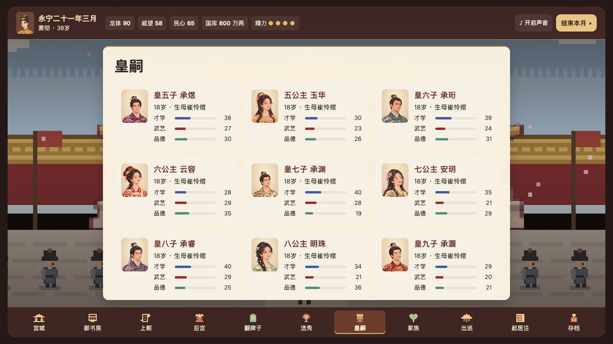
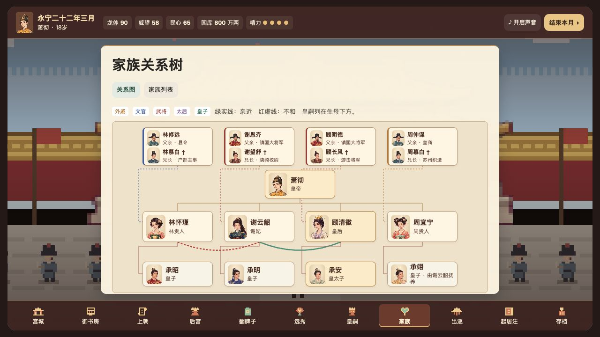
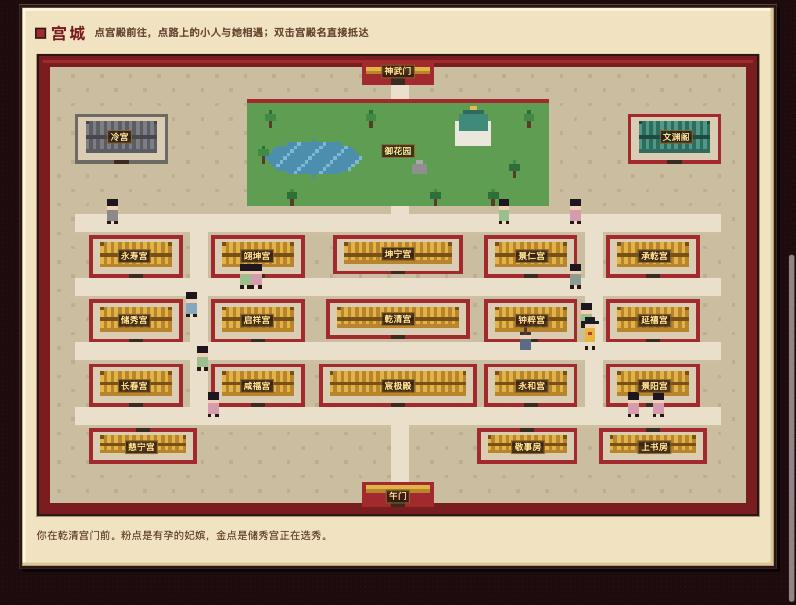
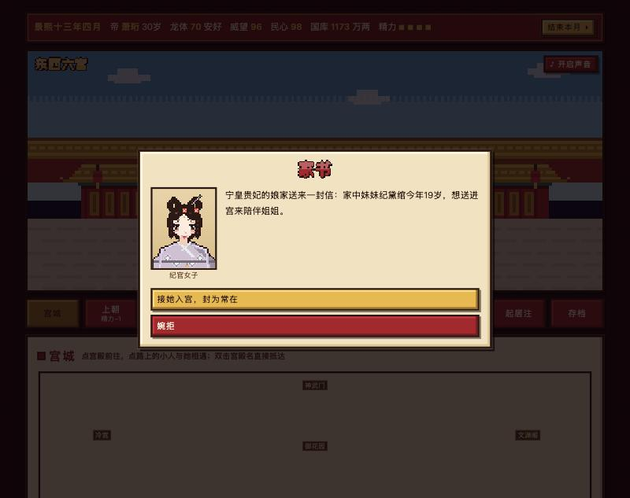
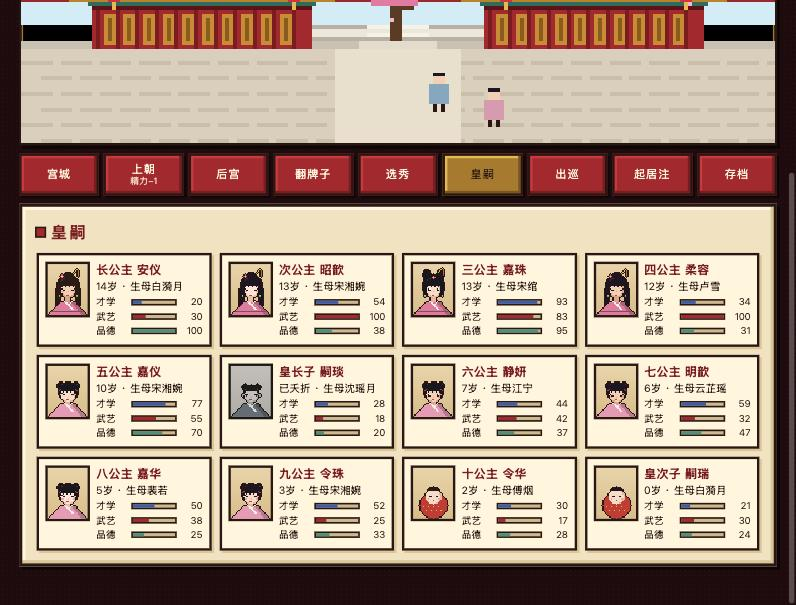

# 宸宫纪 · Forbidden City

像素风中国古代宫廷养成游戏：当皇帝、选秀纳妃、生儿育女、代代传位。

**▶ 在线试玩：https://aubreykuang.github.io/Forbidden-City/**

游戏使用原生 HTML、CSS 和 JavaScript，直接部署在 GitHub Pages。页面从 `js/` 加载各功能脚本，用 Canvas 绘制人物和宫城，用 Web Audio 实时合成古筝配乐。

## 最新版本

- **登基与选秀场景**：新开一局先进入宸极殿典礼画面，国姓、名讳、年号和性情在画面下方设置。礼部奏请时仍可看到百官朝贺，准奏后转入储秀宫场景，再查看秀女与选秀操作。
- **精细像素立绘**：以丹凤眼、桃花眼、杏眼等眼型搭配不同眉形、脸部线条和神态。服饰包含齐胸襦裙、齐腰襦裙、宋式褙子、圆领袍、窄袖骑装和三种西域舞衣。人物详情显示衣着，原有妃嫔的立绘编号保留，旧档中的西域贡女读档后会分配舞衣造型。
- **宫城场景**：重画宫殿、宫门、文渊阁和水榭的瓦面与檐柱，减少高频纹理。宫道随侍太监有帽顶、衣领、腰带、拂尘和交替的步伐。
- **代码结构**：配乐、存档、记忆、立绘、地图和各类人物行为拆成独立脚本。浏览器直接加载，无需构建。下方列出文件职责与验收命令。

- **在宫城遇见人物**：妃嫔日常去哪里取决于性情、心情、身孕和交情。才女可能去文渊阁借书，平日交好的妃嫔会去探望对方。宫道偶遇会说出她当时在做什么。宫城绿点表示正在发生的活动，御花园、上书房和文渊阁也会显示在场的人和相应活动。
- **四件有后续的史料小事**：端午结百索、中秋彩绘兔儿爷、冬至描消寒图、上书房备笔砚。到场旁观无需精力，可以选择把活动交给孩子、请母亲陪做或请孩子教同窗。一个月后人物会继续活动，母亲和孩子各自保留相处记忆。
- **人物操作和状态更好辨认**：「闲话家常」「赏赐」「召幸」等集中在有边框与按压效果的操作区。恩宠、心情和情分用细线和数值显示。
- **减少诗与状元情节重复**：「故人诗」每一朝最多安排给一位真正的才女，起始更晚，情分要求也更高。其他才情出众的妃嫔可能校书、习琴或画花谱。旧存档中的重复待发剧情会换成别的活动，既有起居记录保留。
- **御花园宴请**：可全邀在宫的妃嫔、宫人与皇嗣，由宫人分桌，也可自选宾客排座。邀约页显示在世皇子、公主的人数，妃嫔席卡分别列出亲生与抚养的皇嗣。开宴后选择投壶或画画的玩法，按宾客的特长和座次结算，投契的人两个月后可能再约，地图上可点「去御花园赴约」加入。
- **生日宴**：皇帝的万寿宴与皇后的千秋宴在各自的生辰月开放，入口在宫城、御书房和御花园。两场寿宴每年各办一次，可与普通小宴分开安排。
- **骄纵性情**：新妃嫔可能是「骄纵」型。得宠后会争份例或席次，诊出喜脉后更容易请旨。偏袒会让她下次更敢争，也可能得罪皇后或同席的人。可以照顾她的身孕并维持原定席次。
- **母亲与孩子的日常**：皇嗣分别记得与生母和养母相处的事。哄睡、做点心、读书、散步、描画和练习投壶会随孩子年龄、母亲特长及教养方针变化。孩子有心事时会找自己更信任的人。皇嗣详情可安排陪伴，并准许或暂缓生母私下探望。探望安排、相处记忆和小宴后的邀约随存档保存。
- **清亮配乐**：朝堂、后宫、花园、夜间和市井各有四句五声旋律。古筝奏出主题，箫在句尾回应，夜间留出更多停顿。配乐无鼓点，切换场景时奏完当前乐句再换曲。登基、上朝仍有轻钟提示。
- **人物主动行动**：现有 24 种行动，其中 11 种附史料出处。性格、小性子、宫中关系、真实记忆、季节和皇嗣教养方针决定谁会主动行动。每月最多一位妃嫔和一位皇嗣发起新行动，宫城会显示入口。回应和后续随存档保存。
- **家族关系树**：皇帝、妃嫔、皇嗣和妃嫔父兄都有带头像的人物卡。点皇帝、妃嫔或皇嗣可进入对应页面。皇嗣列在生母下方，有养母时另标抚养关系，家族列表仍可切换。
- **皇嗣立绘**：皇子、公主各有十套独立形象，覆盖襁褓、孩童和长成后三个年龄阶段，共 60 张立绘。公主有披发、半披发、侧辫、双丫髻与偏髻等造型。每种身份按排行分配，前十位各有不同的眉眼、发饰与衣纹。长大、册立太子和读档时沿用同一套形象。
- **减少重复**：同名月末随机事件至少间隔四个月，主线与必发事件照常结算。小性子和心境事件只有进入队列才开始冷却；同一人和同一类主动行动也有独立冷却。
- **宫廷游戏画面**：标题叠在宫殿场景上。开局后，宫城占据主画面，皇帝立绘、年号、国库与精力显示在朱漆色御案。底部指令使用宫门、奏折、玉牌等像素图标。敬事房保留竖排绿头牌。人物详情与场所面板叠在宫殿场景上，剧情从画面下方打开对话框。
- **宫女事件降频**：御花园偶遇、长街、奉茶和贴身宫女随机事件共用四个月冷却。月末合并为一次抽签，冷却结束时有 12% 概率进入候选。御花园的宫女偶遇概率降至 10%，冷却中会改为正常游园。已触发的承恩、怀孕和生育剧情继续推进。
- **人物详情**：近况、家族、人际、教养及宫务直接显示。桌面把相关分区并排，手机按顺序排列。故事默认展示最近两条，较早记录和「处置」按需展开。切换人物时从资料顶部开始。
- **太后荐人**：族女长期失宠或尚未生育时，可再次推荐同族堂妹。家族、姐妹关系和各自的 NPC 记忆随存档保存。
- **亲子标签**：即使由他人抚养，亲生皇子和公主也会保留亲生身份标签。
- **验收**：24 项自动回归测试和 60 个月流程模拟通过。桌面浏览器验证登基、配乐开关、地图行走、手动存读档、旧存档导入及立绘加载。375 px 下检查宫城、宴请和人物详情，三个页面均无横向溢出。另验证登基两条选秀分支、家族树键盘导航与横向滚动，以及皇子、公主的立绘跨年龄、册立和读档时的分配。

以下是实机截图，使用演示存档。







## 代码结构

```text
├── index.html                 页面骨架和脚本加载顺序
├── palace.css                 宫廷界面、地图布局和移动端样式
├── palace-portraits-b.webp    当前人物立绘与凤冠图集
├── palace-buildings-b.webp    当前宫殿、宫门和水榭图集
├── palace-coronation.webp     宸极殿登基与礼部奏请的场景
├── palace-selection.webp      储秀宫选秀场景
├── palace-family.webp         原有四组皇子与妃嫔父兄的立绘图集
├── palace-descendants.webp    新增皇子、公主的三阶段立绘图集
├── js/
│   ├── data.js                位分、出身、性格、人名和通用文本
│   ├── game.js                游戏状态、人物生成、事件队列和月份推进
│   ├── main.js                启动游戏、绘制首屏和绑定键盘入口
│   ├── audio.js               古筝、箫、场景配乐及 Web Audio 音效
│   ├── saves.js               浏览器存档、导入导出、旧档迁移和岁首快照
│   ├── npc-memory.js          NPC 主观记忆的写入、检索和长期归纳
│   ├── portraits.js           立绘分配、服饰标注、图集裁切和像素绘制
│   ├── scene.js               宫殿、御花园、夜景和四季背景
│   ├── map.js                 宫城地图、寻路、人物日常和偶遇
│   ├── views.js               导航、人物详情、家族图与各功能面板
│   ├── court.js               朝政、官员、朝堂派系和积压奏折
│   ├── harem.js               选秀、后宫事件、派系、宫女承恩
│   ├── personality.js         性情、心境、心愿、闲聊、赏赐和记忆入口
│   ├── consort-stories.js     妃嫔个人剧情、才艺和剧情迁移
│   ├── heirs.js               皇嗣成长、抚养、册封和夺嫡
│   ├── family.js             母子日常、探望规则和宗族关系
│   ├── visits.js              出巡、太后荐人、节令和母亲入宫
│   ├── banquets.js            宴请、席次、投壶、共绘和后续赴约
│   ├── initiatives.js         人物主动行动、参与人、玩家回应和后续
│   └── historical-events.js  历史典故事件和触发规则
├── tests/
│   ├── game-scripts.cjs       按页面顺序加载实际游戏脚本
│   ├── *.test.cjs             NPC 记忆、太后荐人、朝堂和存档回归测试
│   └── palace-flow.cjs        开局、界面、地图、宴会、立绘和 60 个月流程
└── docs/screenshots/          游戏实机截图
```

页面按 `index.html` 中的顺序执行 `defer` 脚本，最后由 `main.js` 启动。行为脚本沿用 `game.js` 中的游戏状态和操作入口。图集由浏览器本地加载，运行时切取对应的像素格。

## 怎么玩

打开上面的在线试玩链接即可。本地试玩请在仓库根目录运行 `python3 -m http.server 8000` 后打开 `http://localhost:8000/`。点右上角「♪」开启声音。

每月有 3 点精力（勤政之君 4 点）。上朝、侍寝、闲谈、探望皇嗣、出巡各花 1 点；赏赐、晋封、选秀不花精力。用完后点「结束本月」，宫中会发生新的事：每个月末通常有 2–4 件，从妃嫔主线、后宫争斗、历史典故、小性子琐事、朝政、皇嗣、节令、太后中挑选；主线、夺嫡、皇嗣成年这类关键事件一定会出现。

## 功能

### 宫城地图
- 首页是一张俯视的像素紫禁城：宸极殿、乾清宫、坤宁宫、东西六宫、御花园、冷宫、敬事房、上书房、慈宁宫、文渊阁、神武门、午门
- 点宫殿，小皇帝（身后跟着撑伞的太监）沿宫道走过去；双击宫殿名直接抵达
- 妃嫔在自己宫里、御花园、交好姐妹的宫里、坤宁宫之间走动；路上点她即可偶遇
- 粉点表示宫里有孕妃，金点表示储秀宫正在选秀；四季有落花、落叶、飞雪，冬天屋顶积雪



### 朝政
- 上朝随机处理近 30 类事件：黄河决堤、北境告急、殿试、御史弹劾外戚、蝗灾、盐政、西域进献美人、请立储君、地震等，以及下文的历史典故
- 选择影响威望、民心、国库、龙体；妃嫔的父兄会被卷入朝事
- 民心归零会民变亡国；龙体归零则驾崩


### 选秀与后宫
- 三年一度大选，也可随时下旨（未满三年耗国库、损民心）
- 秀女有家世、性情、容貌、才情；德行与心机隐藏，需暗访
- 九级位分：官女子、答应、常在、贵人、嫔、妃、贵妃、皇贵妃、皇后，各有名额
- 翻绿头牌侍寝、闲谈、赏赐、晋封、赐封号、立后废后、打入冷宫、遣出宫
- 宫女、市井女子、太后举荐、西域贡女、娘家送来的妹妹也可能入宫


### 宫女承恩
- 在御花园、长街遇到宫女，或深夜批折子时遇到奉茶的宫女，都可以召她侍寝
- 随机遇见宫女或贴身宫女主动来见后，至少隔四个月才会再触发这类随机事件。玩家仍可直接在后宫找已认识的宫女互动。
- 第二天由你决定：封为答应或官女子；留在身边做**贴身宫女**（不进位分、不卷入派系，随时侍奉在侧，翻牌子时也有她）；或打发回尚衣局当差
- 贴身宫女会替你补朝服、打扇、记得你喝茶的火候；随时可以册封、调回或放出宫嫁人
- 宫女有孕后，可以册封她、仍留在身边，或者压下不声张；宫女生的孩子会提示按旧例交给高位妃嫔抚养


### 母亲入宫
- 成全「再见母亲一面」的心愿、准许思亲的妃嫔接母亲进宫，或在详情页直接点「接母亲入宫」（每两年一次）
- 母亲会在宫里住两三个月。妃嫔详情页会显示母亲的立绘、名号和还剩几个月出宫，后宫卡片上标「母亲在宫」
- 母亲在宫期间，女儿每月心情都会好一些；母亲可能求见谢恩，你也可能在窗外听见母女夜话，知道女儿入宫前的往事

### 人物性格
每位妃嫔除了主性情（温婉、骄矜、城府、痴情……），还有：
- **小性子**（18 种）：嗜甜、怕雷、爱猫、路痴、好胜、念旧、嘴硬心软、爱哭、贪睡、护短、记仇、好读史、信佛、擅厨艺、直言、擅舞、畏寒、擅骑射。每种都有专属对白和宫中琐事，比如怕雷的人会在雷雨夜派人来请你，嘴硬心软的人会偷偷给你送参汤还不认账，好读史的人会拿汉武帝杀钩弋夫人来问你。
- **喜好与忌讳**：赏赐时可以挑十种礼物，送中她的心头好效果翻倍，送了她不喜欢的反而扫兴；多闲谈才会知道她喜欢什么。
- **心愿**：情分到 50 后，她可能对你说出一个心愿（再见母亲一面、学骑马、养一只猫、看一场烟火、要一首你亲笔写的诗……），可以在详情页成全她。
- **往事**：情分到 65 后，她可能说起入宫前的事（幼年丧母、替嫡姐入宫、未婚夫早逝、家道中落……），与她的家世相符。
- **记忆**：她会记住你做过的事，第一次侍寝、被降位、被放出冷宫、生辰你记不记得、病中你来没来……之后闲谈时会提起。记仇的人会说「臣妾可一直记着呢」。

闲谈会把这些拼在一起：她此刻的心情和在做的事、她的小性子、她对哪位姐妹好或不好、孩子的近况、她记得的往事，再加上偶尔吐露的心愿和秘密。好读史或直言的妃嫔，还会点评你最近上朝的决定。


### 妃嫔主线
每位妃嫔按出身和性情分到一条专属剧情，情分越高推进越快，各有多个结局：

| 主线 | 谁会遇到 | 梗概 |
|---|---|---|
| 边关烽火 | 将门女 | 父兄拥兵自重，信任、削权还是平叛 |
| 故人诗 | 每朝至多一位才女 | 新科状元是她入宫前的旧识 |
| 宫中手艺 | 其他才情出众的妃嫔 | 校补旧卷、听琴辨音或整理四时花谱 |
| 旧案 | 宫女出身 | 她是罪臣之女，入宫为父翻案 |
| 续命汤 | 体弱 | 心疾难医，寻药或陪她下江南 |
| 驼铃 | 西域贡女 | 母国以她母亲为人质，逼她做细作 |
| 凤位 | 城府深 | 步步为营，觊觎后位 |
| 金玉其外 | 贪财 | 兄长打着国舅旗号敛财 |
| 纸鸢 | 活泼、骄矜、淡泊、善妒 | 断线的纸鸢、宫外的灯会 |
| 鸳鸯帕 | 其他 | 一方绣歪了的鸳鸯帕，危难时见真心 |

部分结局有长期效果，例如「同心」「知己」之后她的恩宠不再衰减。


### 历史典故

节令行动借用史料记载的器物和习俗。角色、宫中互动和玩法结果属于游戏演绎。

| 节令行动 | 游戏内条件 | 原典 |
|---|---|---|
| 端午结百索 | 五月，温婉、骄纵或护短的母亲与孩子 | [故宫博物院·端午服饰与佩饰](https://www.dpm.org.cn/Uploads/File/2020/05/18/u5ec225b518cc8.pdf) |
| 中秋彩绘兔儿爷 | 八月，活泼、才女、念旧或爱猫的母亲与孩子 | [故宫博物院·泥制兔儿爷](https://www.dpm.org.cn/collection/sculpture/233282.html) |
| 冬至描消寒图 | 游戏中的冬月，淡泊、聪慧、畏寒或好读史的母亲与孩子 | [故宫博物院·数九消寒](https://www.dpm.org.cn/curriculum/246428.html) |
| 上书房备笔砚 | 游戏中的二月，习读的八至十五岁皇嗣与信任的母亲 | [故宫博物院·上书房](https://www.dpm.org.cn/court/culture/157157.html) |
| 端午画扇 | 五月，才女或喜爱字画的妃嫔 | 《东京梦华录》卷八·端午 |
| 查点冰票 | 六月，聪慧或体弱的妃嫔照顾需要冰的熟人 | 《燕京岁时记》·赐冰 |
| 七夕种生 | 七月，活泼或念旧的妃嫔与满三岁的亲生或抚养子女 | 《东京梦华录》卷八·七夕 |
| 重阳摆菊 | 九月，淡泊或喜爱花草的妃嫔邀好友布置花山 | 《燕京岁时记》·九花山子 |
| 重阳分糕 | 九月，擅厨艺或嗜甜的妃嫔向好友分糕 | 《东京梦华录》卷八·重阳 |
| 太液池练冰嬉 | 十二月，满八岁且武艺、体魄达标的习武皇嗣 | 《燕京岁时记》·溜冰鞋 |
| 腊八分粥 | 十二月，温婉、信佛或擅厨艺的妃嫔 | 《燕京岁时记》·腊八粥 |

原文可在行动面板点开，也可查看[《东京梦华录》卷八](https://zh.wikisource.org/wiki/東京夢華錄/卷八)与[《燕京岁时记》](https://zh.wikisource.org/wiki/燕京歲時記)。
近 30 个事件改编自中国古代真实史事或民间传说，弹窗下方会注明「典出」：

| 类别 | 典故 |
|---|---|
| 后宫 | 班婕妤辞辇、赵飞燕掌上舞、一骑红尘妃子笑、周幽王烽火戏诸侯、陈皇后长门赋、冯媛挡熊、金屋藏娇、袁盎却坐、武则天感业寺、卫子夫平阳府献歌、毛延寿画像、狸猫换太子、壬寅宫变、梃击案 |
| 朝政 | 商鞅立木为信、海瑞《治安疏》、杯酒释兵权、康熙擒鳌拜、隋炀帝开运河、郑和下西洋、王安石青苗法、文字狱、帝王服丹、魏征《十渐疏》、包公铡美案、昭君出塞 |
| 皇嗣 | 曹植七步诗、孔融让梨、司马光砸缸、汉武帝立子杀母 |

很多典故的后果会延续：烽火点了，诸侯从此不信你；运河开了，此后每月多一笔漕运收入；金丹吃了，几个月后会丹毒发作；狸猫换太子里丢失的皇子，多年后可能被陈州少年认回。后宫和皇嗣类典故，同一个 4 年内不会重复；朝政类典故混在上朝的事件池里随机抽取。


### 心境
妃嫔遇到事情后会进入一种心境，持续一段时间后慢慢淡去，你的陪伴也可能把它化解：

| 心境 | 常见起因 | 她会怎样 |
|---|---|---|
| 欢喜、感激、释然 | 晋位、得了心爱之物、生子、被放出冷宫、心愿得偿 | 会请你去看她新裁的衣裳，或熬夜给你绣寝衣 |
| 思念 | 情分深却被冷落 | 托人送来写着「一日不见，如三秋兮」的香囊 |
| 委屈 | 被冷落、被训斥、被降位 | 掌事姑姑会来求你去看看她 |
| 惶恐 | 被查、被揭发、同族获罪 | 脱簪待罪，在乾清宫外跪一夜 |
| 嫉恨 | 对手独得圣宠、晋了位分 | 宴上「失手」把酒泼在对手身上 |
| 怨恨 | 被冤枉、被重罚、孩子被抱走 | 恨你的会称病推掉侍寝；恨别人的会在佛龛下压一张写着对方生辰的黄纸 |
| 悲恸 | 小产、孩子夭折或丢失 | 求你准她请僧人做法事 |
| 心如死灰 | 冷宫里待久了、长久悲恸 | 求你准她剪发出家 |
| 野心 | 儿子被立为太子 | 频频召娘家人入宫，打听朝中大臣的喜好 |

心境显示在后宫卡片和详情页上（注明起因和持续了几个月），会改变闲谈的开场白；怨恨和心如死灰还会让她的恩宠涨得更慢。闲谈时有机会化解，恨得越深越难解开。九条主线的结局也会改变她的心境。

### 派系
- 妃嫔两两之间有好感与敌意，随争宠、晋封、侍寝、派系立场变化
- 妃嫔会依附皇后或高位妃嫔结成派系，出现派系倾轧、投靠、姐妹情深等事件
- 设计陷害（香囊藏麝、巫蛊、推人小产、毒害太子）会专挑仇人下手；受害者人缘好，更容易查出真凶


### 家族
- 底部「家族」页集中显示家族关系树，按需展开家族分支，可直接进入妃嫔和皇嗣详情。
- 每位妃嫔属于一个家族，按姓氏和娘家区分，比如「纪氏（书香门第家）」；宫女、寒门、西域贡女等出身没有家族
- 同族妃嫔共享家族势力：一人晋位全族沾光，一人获罪同族惶恐
- 选秀时可能来一位宫中妃嫔的亲妹妹或堂妹；受宠妃嫔的娘家也会来信，想把家里的妹妹送进宫陪伴姐姐
- 姐妹多半同心，也有约三分之一嫡庶不和、从小不对付
- 家族事件：嫡庶之争、姐妹同心求恩典、外戚坐大被御史以汉代吕氏霍氏为戒上疏、娥皇女英
- 妃嫔详情显示她的家族、势力与同族姐妹；后宫页列出在宫中有两人以上的家族



### 人际
- 妃嫔详情中的「家族与人际」与皇嗣详情中的「宫中关系」显示个人往来。
- **妃嫔之间**：随争宠、晋封、派系、家族、心境变化
- **妃嫔与皇嗣**：生母天然亲近，养母朝夕相处越来越亲；孩子生母的好友会疼爱孩子，仇人会冷淡；自己也有皇子、心机深的妃嫔，会把别人的皇子当对手
- **皇嗣之间**：同母或同一位养母带大的格外亲近；两位生母的恩怨会传到孩子身上；年长皇子野心越大越不和，太子与其他皇子天然有嫌隙
- 相关事件：别宫娘娘常把孩子叫去教描红；有妃嫔当众奚落「宫女生的孩子」；孩子背着摔伤的弟弟回宫；兄弟俩为一匹小马打起来；孩子说更喜欢别宫的娘娘，生母一夜没睡

### 生育与皇嗣
- **怀孕**：侍寝有约 18% 概率受孕（风流之君、护国寺祈福更高；年老、体弱更低）；产后三个月内不会再怀
- **喜脉**：受孕后到下个月末，太医诊出喜脉，可加派人手照料、晋位或赏赐
- **孕期**：害喜、被人推下石阶等事件；有人照料或亲自守护可降低小产风险
- **分娩**：十个月后临盆，皇子或公主各半，由你亲自赐名；体弱的母亲有难产风险
- **天赋**：才学、武艺、品德、体魄、野心由生母属性与皇帝性情决定
- **养育**：三岁起按教养方针成长（均衡、读书、习武、修德、放养），六岁起可延请太傅加速
- **事件**：幼年染病（高热、出痘、积食、风寒）、太傅夸赞、顽皮闯祸（爬假山、偷溜出宫、把太傅画进课业……），还有七步诗、让梨、砸缸等典故；可亲自探望，增进父爱
- **立储**：皇子五岁起可立为太子；群臣会上书请立储君
- **成年**：公主十五岁议婚（下嫁重臣、和亲、自择驸马）；皇子十六岁封亲王留京或就藩
- **夺嫡**：皇子十岁后积累朝臣支持（受野心、养母或生母家族势力、品学影响），可能结党、争储，甚至逼宫
- **抚养与过继**：任何皇嗣都可以交给一位贵人以上的妃嫔抚养，选的时候能看到她的德行、才情和膝下有无子女。养母德行高孩子品德长得快，才情高孩子才学长得快，心机深孩子野心大；争储时倚仗的是养母的家族。生母会伤心或生恨，之后可能偷偷去看孩子、在廊下和养母撞见；你可以准她探望，也可以把孩子抱回生母身边。宫女或低位妃嫔生子、生母难产去世时，会提示按旧例交给高位妃嫔抚养





### 传承
- 皇帝驾崩时按威望、民心定庙号与谥号，生成一段本纪
- 有太子（或年长皇子）可传位，以新帝身份开启下一朝；生母成为太后，历代皇帝记入起居注
- 逼宫成功会被迫禅位，你将以篡位皇子的身份继续

### 记录与存档
- 每位妃嫔、每位皇嗣有自己的故事时间线；全朝大事记入「起居注」
- 三个手动存档位 + 每月自动存档（浏览器 localStorage）
- 「存档」页可导出、导入存档码，用于换浏览器或分享进度


### 手机


## 全部由代码生成

- **立绘**：80×100 像素。浏览器从图集切出对应人物，按年龄选择皇嗣和皇帝的画面，册后时叠加凤冠。图集尚未加载或缺失时，会显示原有的程序绘制立绘。
- **衣饰**：衣服按位分分五档色系（官女子、答应偏素净，皇贵妃用正红、宝蓝、绛紫，皇后明黄），同位分的妃嫔也各穿各的颜色，赏一批绸缎她会换一身新衣；款式有交领襦裙、对襟褙子、立领盘扣，将门女与擅骑射的穿圆领袍；纹样有祥云、缠枝花、团花、折枝梅、竖条、素面镶边，内衬颜色各异；春装偏亮，夏装轻薄浅色，冬天领口和下摆镶毛边。贴身宫女穿统一的宫装，母亲是头发花白、系抹额的中年妇人


- **场景**：宸极殿、六宫、御花园、京城街市、夜景五种横版场景，以及俯视宫城地图
- **字体**：标题、界面和宫殿名牌使用系统中文字体，像素画由画布渲染。
- **声音**：Web Audio 现场合成。古筝用 Karplus-Strong 拨弦算法从噪声生成；五种场景各有两段交替的五声旋律和箫声。钟、木鱼和钱币声用作操作与剧情提示。

## 测试记录

以下测试均在浏览器中用脚本自动驱动游戏完成，没有真人试玩。

截图来自脚本模拟出的演示存档（快进 8–16 年，期间保底龙体、民心与国库以免中途驾崩）。其中「旧案」坦白、分娩赐名、公主议婚、逼宫、辞辇这几张，是直接调出对应事件截的；公主议婚和逼宫两张为了凑条件，手动调高了孩子的年龄（逼宫还调高了野心和朝臣支持）。闲谈那张是连续闲谈 40 次后挑出的内容最丰富的一段。

**已测试并通过**
- 长局模拟：多次连续跑 200–600 个游戏月，随机点选所有事件选项、切换所有页面、在地图上行走，全程无脚本错误
- 两种结局与传承：正常驾崩并传位到第三代；民心归零触发亡国
- 九条妃嫔主线均能走到结局，结局分布较均衡（如：同心、知己、昭雪、尘封、赎罪、思乡、回头、抄家、知音、成全、诗绝、回春、怨怼、摄六宫、大义、君臣相得）
- 夺嫡：人为设定条件后，结党、储位之争、逼宫事件均能触发；逼宫失败后禅位并以新帝身份继续
- 生育：一局 13 年的模拟中出现 58 次喜脉、52 次分娩，皇嗣成长、染病、顽皮等事件正常
- 地图：点宫殿会走到并打开该宫页面；点路上的妃嫔会走过去并触发偶遇
- 旧存档兼容：缺少新字段的旧存档读入后自动补齐（派系关系、主线、朝臣支持、地图位置）
- 存档码：导出再导入，进度一致
- GitHub Pages 线上版：开局、选秀、侍寝、结束月份、手动存档、自动存档、读档均正常
- 手机宽度（375px）：无横向溢出，地图与弹窗可用
- 音频：离线渲染五种场景各 8 秒（含全部音效），样本突跳为 0，峰值不超过 0.47，没有削波爆音
- 事件频率：20 年模拟中，每个月末平均 2.8 个事件（240 个月里，2 件的 78 个月、3 件的 115 个月、4 件的 41 个月）；26 种历史典故全部出现过
- 人物系统：20 年模拟后，32 位妃嫔中 22 位说出心愿并被成全、23 位说起往事，共积累 162 条记忆；闲谈抽样文字因人而异
- 心境、宫女、过继、人际、家族、母亲入宫：20–25 年模拟中，香囊、委屈、嫉恨、怨毒、称病、青灯、新衣、寝衣、奉茶、天明、贴身宫女、抚养、生母探望、别宫的娘娘、奚落、手足、阋墙、童言、嫡庶、姐妹同心、外戚、家书、母亲入宫、谢恩、母女夜话等事件都触发过，全程无脚本错误。没有触发过的：「惶恐」「超度」「野心」三个心境事件，以及要求一对姐妹同时很受宠的「娥皇女英」

**测试中发现并已修复**
- 心境刷屏：「思念」一度占到约 22% 的时间，香囊来得太勤，触发概率减半；「青灯」25 年里出现 22 次，改为心如死灰持续半年以上才会求出家；同一条心境不再在「她的故事」里重复记录
- 奉茶宫女曾因月末事件优先级过低而未出现。当前与长街、贴身宫女共用一个月末事件池，并与御花园偶遇共用冷却。
- 宫女出身的同姓妃嫔被当成一个家族（如「卢氏（宫女家）」），现在宫女、寒门、西域贡女等出身不算家族
- 同姓同位分的妃嫔重名（两位「乔答应」），现在重名时会加上名字里的一个字
- 随机给孩子起名会撞名，现在推荐名字会避开已有的
- 尚未入宫的秀女在弹窗里被显示成「某官女子」，现在显示全名
- 同一种心境再次触发时，原因没有跟着更新
- 历史典故与小性子事件刷屏：「辞辇」20 年里出现约 36 次。现在同一典故 4 年内不重复，同一位妃嫔的小性子事件 10 个月内不重复
- 心愿与身份矛盾：已有封号的妃嫔仍许愿「想要一个封号」；户部侍郎之女的往事却是「出身低被嘲笑」。现在心愿和往事会按家世筛选，得到封号即视为心愿已成全
- 皇嗣事件重复：同一个孩子会反复「幼时一场高热」「打碎太傅的端砚」，文字完全一样（截图时发现）。现在同类事件对同一个孩子 18–24 个月内不重复，并增加了多种病情与顽皮情节
- 皇嗣详情的「朝臣支持」标签折行，改为「支持」
- 本地打开中文乱码：缺少编码声明
- 音乐刺耳：拨弦起音太亮、音域过高、钟声泛音过尖
- 受孕率过低（11% → 18%），且未提示需要等太医诊脉
- 国库与龙体数值失衡：国库能攒到八千多万两，或者十年内就被打穿
- 大多数妃嫔分到同一条主线，重复感强（新增「纸鸢」分流）
- 御驾亲征排在第一项且失败扣龙体过多，导致皇帝早逝
- 皇后被分到争后位的主线，会永远卡在第一幕
- 地图上宸极殿与两侧宫殿重叠

**未测试 / 已知限制**
- 没有真人试玩，节奏和难度还需要实际体验调整
- 音频只做了数值检测，音色没有实际试听
- 只在 Chromium 内核中测试，Safari、Firefox 未测
- 手机小屏上，宫城地图的宫殿名牌会遮住部分建筑
- 只有中文界面

## NPC 记忆系统与测试

既有剧情的 remember 入口接入分层记忆。御前争执双方根据裁决分别形成记忆，人物间记忆影响阵营选择，闲谈可以读取新记忆及旧存档中的 mem 回忆。

记忆由确定性 JavaScript 规则生成，无需 LLM 或 API 密钥。客观事件与角色主观记忆分开存储，记忆引用来源事件 ID，并记录情绪、确信程度和获知方式。连续事件序号用于拒绝重复处理和检测序号缺口。

每位 NPC 最多保留 32 条短期记忆、50 条长期记忆。重要程度由统一权重计算，同类重复经历可合并为长期印象。当前人生摘要选取最多 8 条长期记忆。记忆随现有 LocalStorage 存档保存，旧存档在产生新记忆时初始化相关数据。

### 运行回归测试

在项目根目录使用支持内置测试运行器的 Node.js（本次验证使用 Node.js 22）运行：

```sh
node --test tests/npc-memory.test.cjs
```

记忆测试覆盖入口脚本语法、主观视角与信息隔离、事件去重与序号缺口、结构化记忆合并、短期容量和来源保留、确信程度、20 次 JSON 保存读回，以及该游戏的实际互动函数入口。测试调用实际代码，并模拟所需的渲染、计时器或其他外部依赖。

### 当前边界

- 这是基础记忆版本。Working Memory 继续使用既有角色运行状态，尚未实现完整的当前行动恢复。
- 长期记忆超过 50 条时按重要程度和时间截断，人生摘要也有上限，尚不能保证所有重要人生经历永久保留。
- 事件记录支持记忆来源追踪和去重，尚未实现世界状态的事件重放。
- 已实现 LocalStorage 主档、上一有效快照回退、v1→v2 版本迁移和最近四年的岁首快照。IndexedDB 尚未实现。
- JSON 往返测试验证结构化数据保留，下方记录本轮浏览器流程验收。关闭浏览器后重开、地图位置恢复与更长游玩流程尚未覆盖。

## 界面与太后荐人更新

- 界面改为黛绿、朱砂、米白的轻量卡片布局，保留像素场景与立绘；标题和事件标题使用清晰的系统字体。
- 太后母家固定姓氏与家族。族女入宫满 24 个月后，若连续 12 个月恩宠低于 20，或尚未生育，可再次推荐年轻堂妹；族女有孕或在冷宫时不荐人。接受后冷却 24 个月，婉拒后冷却 12 个月，无终身次数限制。
- 候选事件未实际展示时不消耗冷却；接受后才建立双向堂姐妹关系，并通过现有 NPCMemory 保存两人的不同经历。旧存档缺少入宫时间时从加载月开始观察，不编造过去的冷落记录。
- 亲生孩子无论好感或过继状态，显示「亲生皇子／亲生公主」；非亲生关系仍按好感显示。
- 回归验证：`node --test tests/*.test.cjs`，当前共 24 项测试。包含重复推荐、冷却与序列化、剧情条件、旧存档迁移、亲子标签和真实 NPC 记忆入口。另可运行 `node tests/palace-flow.cjs`，用完整游戏脚本和模拟 DOM 验证开局、十个页面、两次荐人、过继后的亲子标签、记忆存读档及连续推进 60 个月。
- 浏览器验收已通过。通过界面验证开局、选秀、导航、过月及存读档。使用测试存档验证太后在请安时推荐失宠族女的堂妹，入宫后两人归入同一家族，亲生皇子即使由他人抚养也保留亲生标签。375 px 下宫城和荐人弹窗无横向溢出，复验未捕获控制台错误。上文历史截图保留当时版本的样式。

## 朝堂与家族关系更新

- 「御书房」新增外戚、文官、武将、太后和皇子五方势力。影响力根据家族势力、民心、武略、太后状态、皇子支持度及议政历史计算。每月可花一点精力和国库预算采纳一项建议，获得相应治理收益并改变各方支持。
- 家族关系树位于底部「家族」页，可从家族进入妃嫔和亲生子女详情。若皇嗣由他人抚养，树中保留生母归属，并单独标注养育关系。
- 保留新宫城界面、按剧情条件重复推荐同族堂妹、以及亲生皇子和公主的身份标签。新版存档继续读取旧档，在主档损坏时尝试恢复上一有效快照。

```sh
node --test tests/*.test.cjs
node tests/palace-flow.cjs
```

本轮通过 18 项回归和 60 个月流程模拟。Chrome 验收包含登基、选秀、家族树、采纳文官建议、刷新后读取自动存档，并确认同月无法重复议政。

## 父兄、派系事件与人物关系图

- **父兄是有名有姓的人**：每位妃嫔都有一位父亲（姓名、官职、年纪）和一位兄长（姓名、职位、功绩）。妃嫔详情的「家族与人际」会写出“父亲：郑伯庸（镇国大将军）　兄长：郑伯言（副将）　立场：武将”。
- **妃嫔有政治立场**：立场由父亲的官职决定。内阁首辅、吏部尚书、翰林学士、书香门第等属于文官；镇国大将军、两江总督属于武将；皇商属于外戚；太医院院判属于太后一派。娘家势力大的妃嫔也会被看作外戚。在御书房采纳某一派的建议后，同派妃嫔心情变好；与之相争的一派（外戚↔文官、武将→文官、太后↔皇子）会不痛快，并记进她的故事。
- **五大集团会主动发起事件**，每件都落在具体的人身上：
  - 外戚请封：某位父亲请擢儿子入京，可以准、驳回或外放历练。
  - 科场案：某位文官父亲的门生涉嫌舞弊，可以严查、从轻发落，或交三司会审，有一定概率还他清白。
  - 边关捷报或失利：武将家的兄长在雁门关等地立功或中伏，胜算与陛下的武略、兄长的功绩有关。
  - 慈宁宫：太后借用膳暗示陛下多去某位妃嫔宫里。
  - 国本之争：两位皇子生母的父亲各领一派上疏请立储。
  - 每个选择都会改变各派影响力、妃嫔心情、娘家势力、皇子支持度和妃嫔之间的关系。
- **父兄会变化**：武将家的兄长按陛下武略积累功绩；父亲每年正月长一岁，年过六十六有可能病故。病故时妃嫔会悲恸，并记进故事和起居注。
- **人物关系图**：「家族」页默认显示图形化的关系图。上排是各位妃嫔的父亲，用颜色标出所属派系；中间是陛下；下面是妃嫔和她们的皇嗣，养子女会标注“养于某某”。妃嫔之间亲近用绿色实线、不和用红色虚线，线越粗关系越深。鼠标悬停可看详情，点名字进入人物页。原来的家族列表仍可切换。
- **离宫积压的奏折**：读档时如果距上次存档超过 1 小时，御案上会积下 1–3 份奏折，下个月末作为必看事件一并呈上。
- **起居注纪念卡**：起居注页可以把上个月的记录导出成一张像素风 PNG。
- **存档 v2 与岁首快照**：旧版存档会照常读取，缺的父兄和立场在读档后自动补上；比当前版本新的存档会拒绝读取。每年正月自动留一份快照，最多四份，在「存档」页可以回到任何一年的岁首。

```sh
node --test tests/*.test.cjs   # 23 项，新增 tests/palace-court.test.cjs 5 项
node tests/palace-flow.cjs     # 60 个月流程
```
