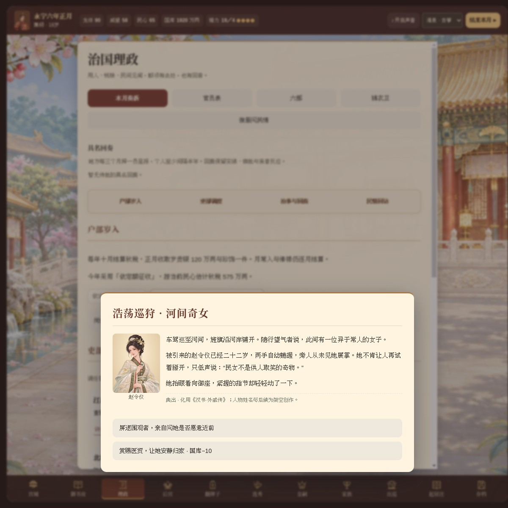
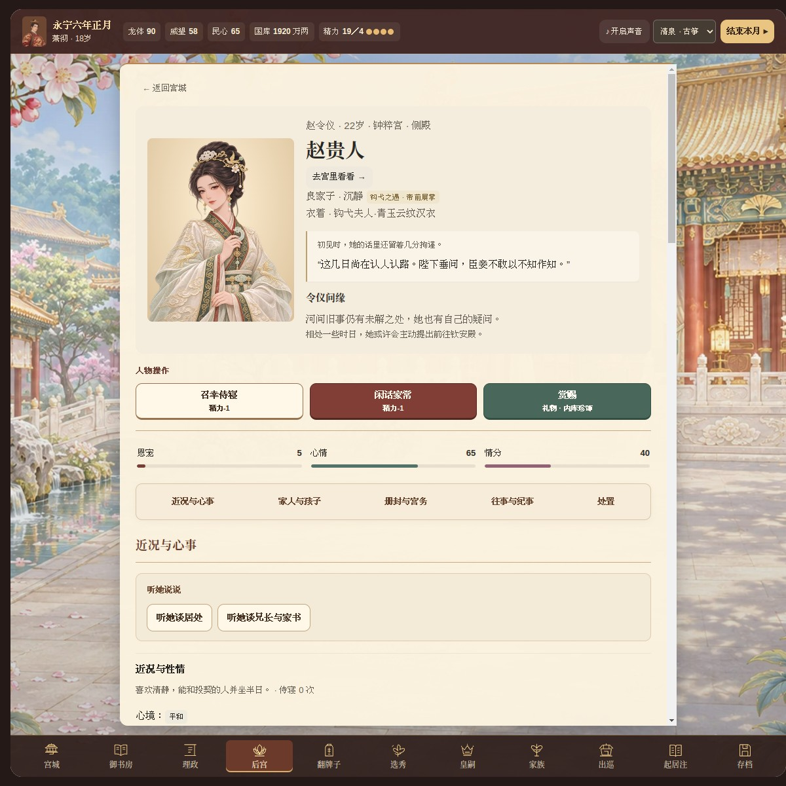
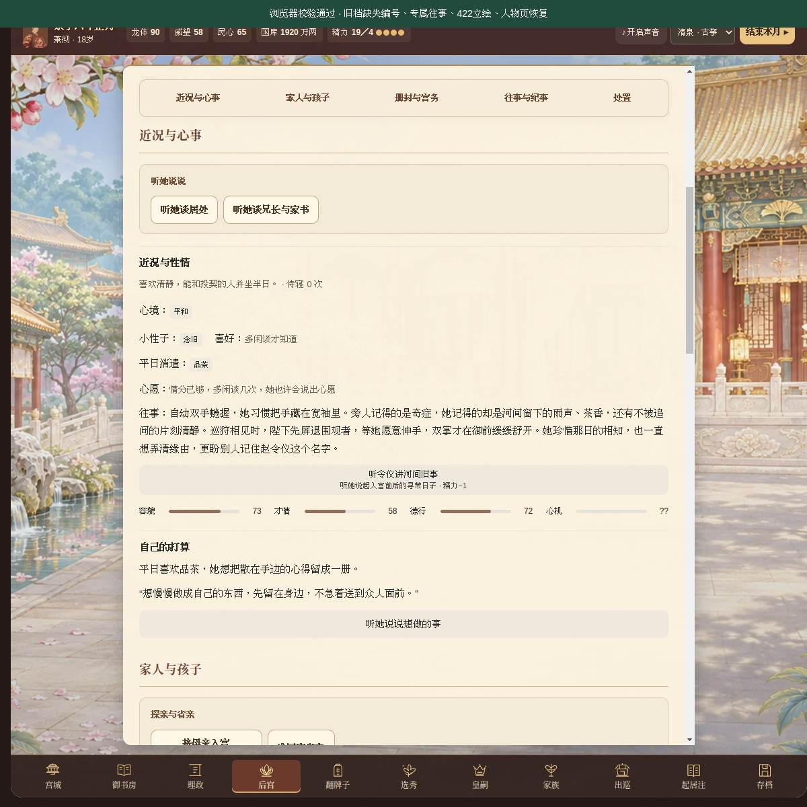
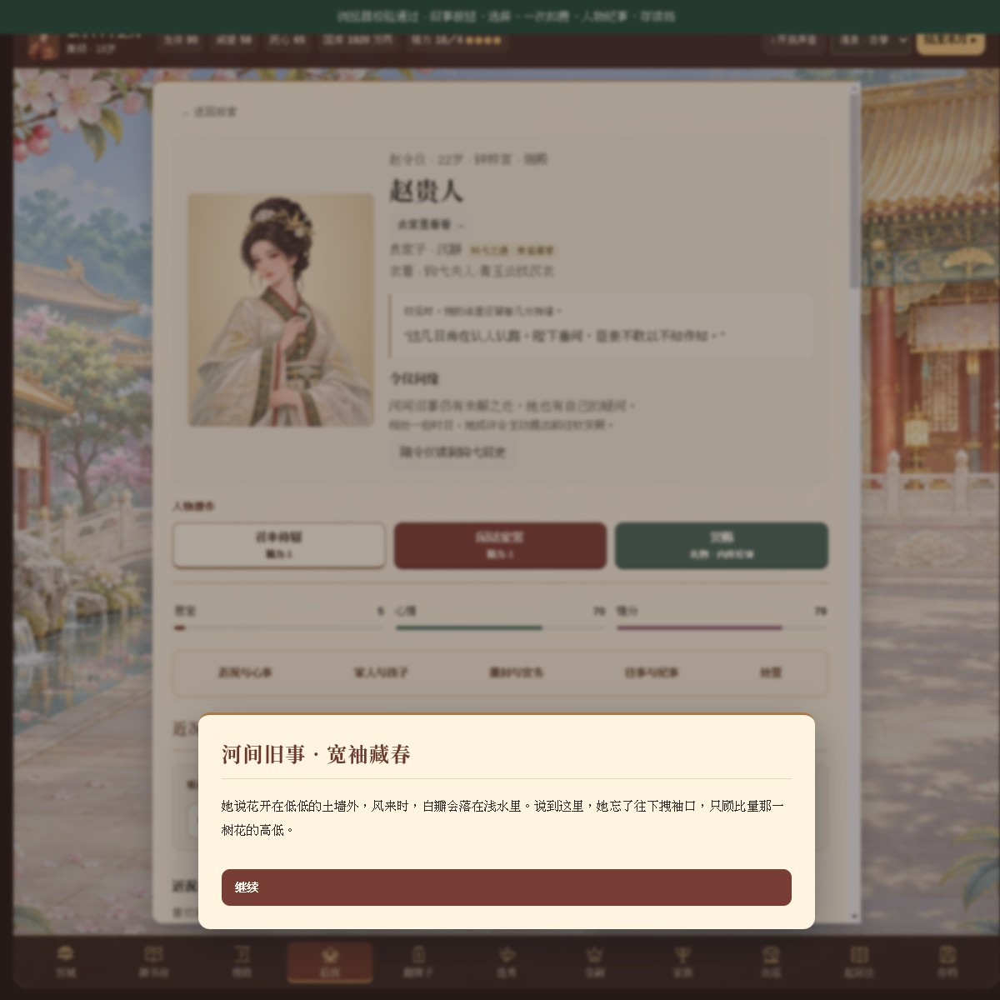
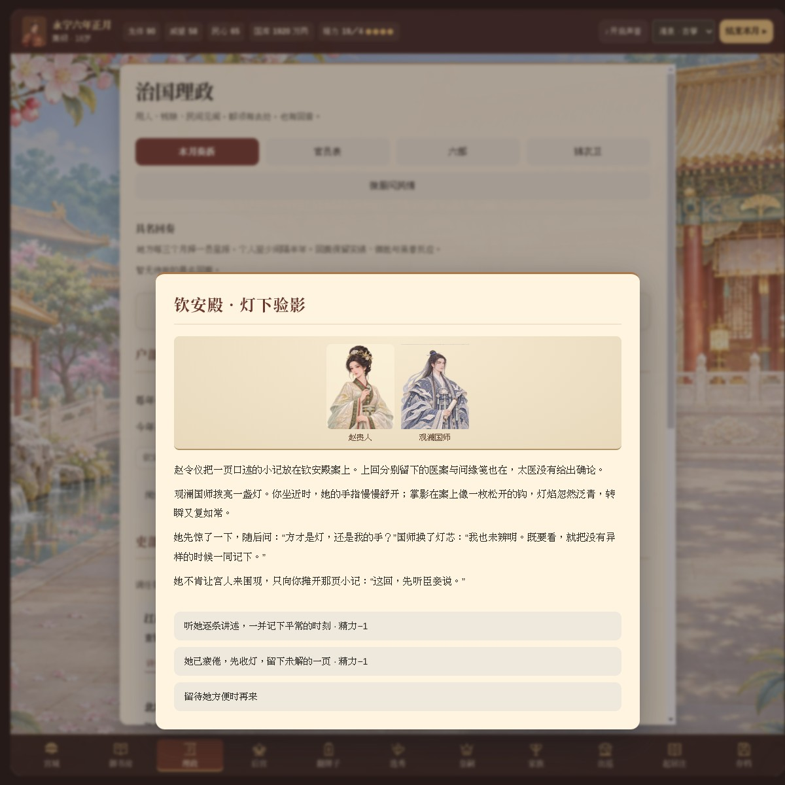
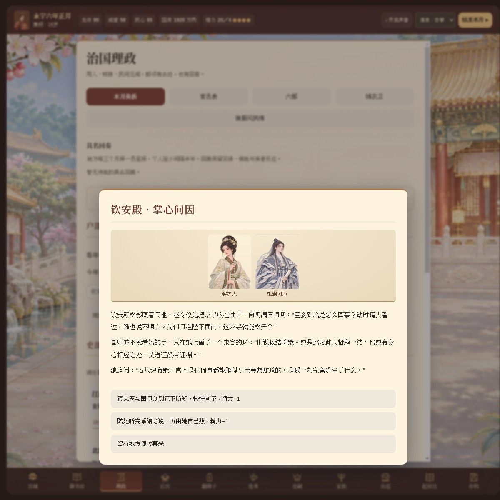
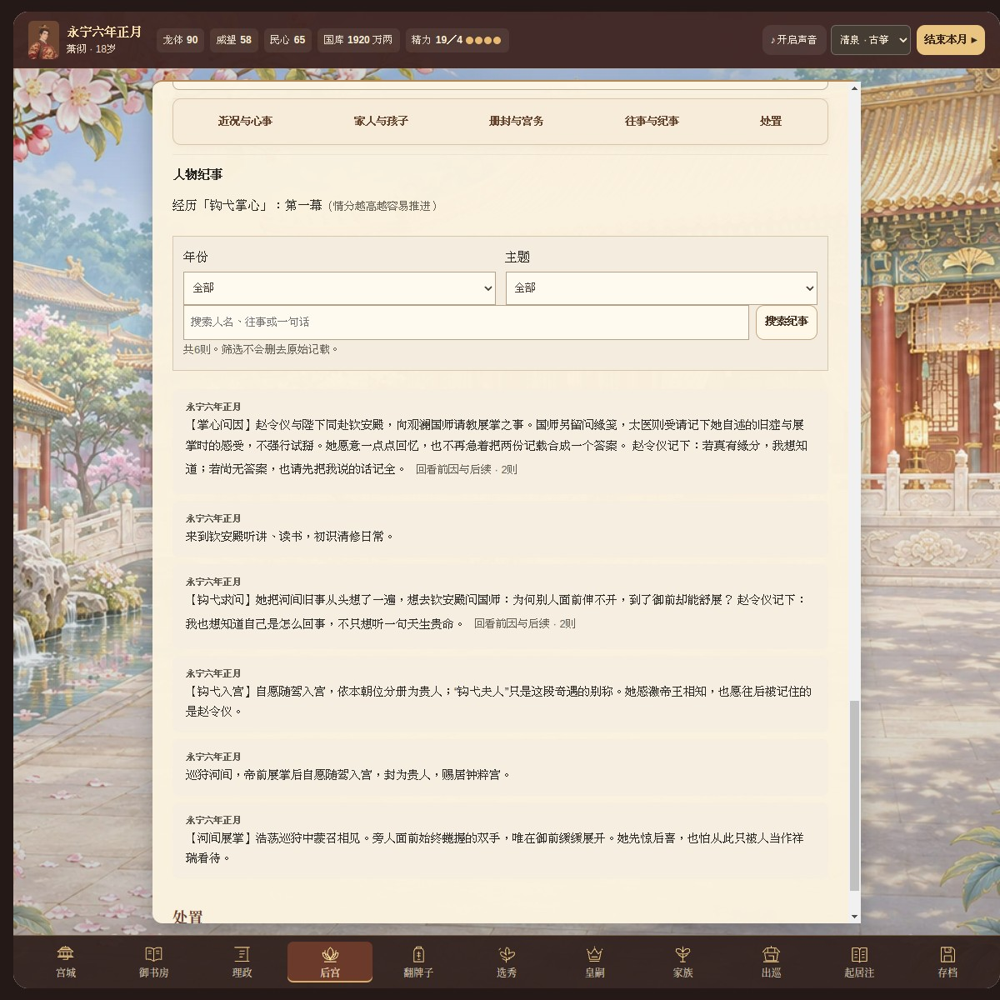
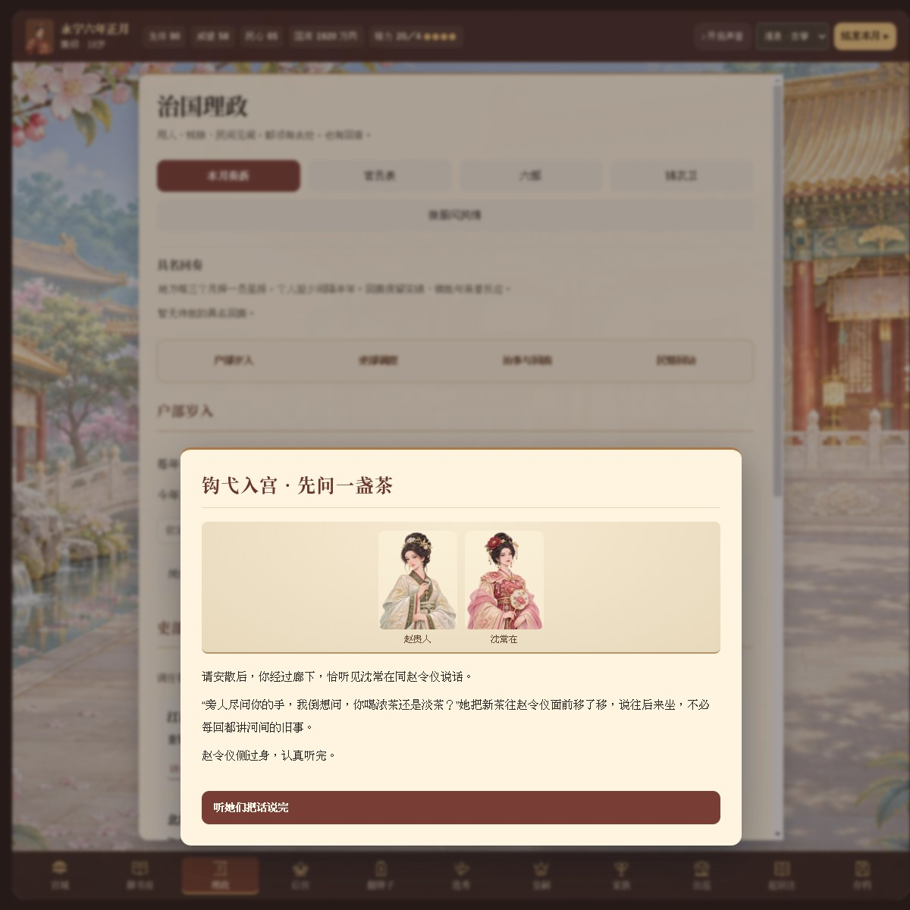
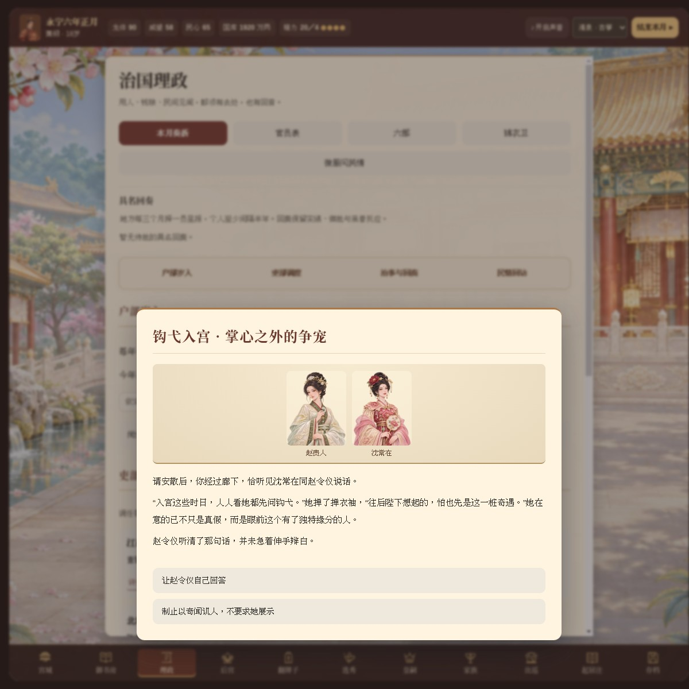
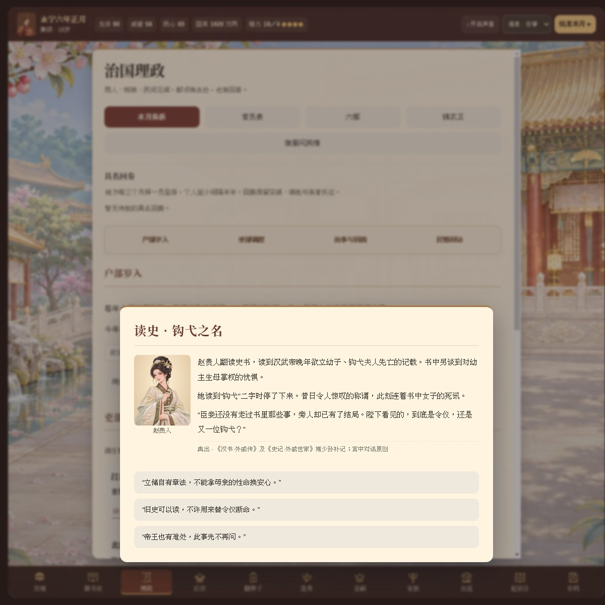

# 具名朝臣、姻亲家书与钩弋之遇

[返回内容索引](README.md) · [验证情况](../qa/court-family-life.md)

家族立场与个人职业分开：将门子弟可以读书应举，未授官时仍是书生；后来任知县、编修，就按文职安排差事，不会因为娘家依附武将而被派去领兵。人物页明确标注「家族立场」，避免把家世当成本人的官职。历史依据可参阅黄谋军[《明代官籍再探》](https://wym.gnnu.edu.cn/info/1021/1343.htm)：武官家庭子弟可参加科举，军籍与本人仕途并非同一概念；张居正以荆州卫军籍中进士只是具体例子，并非说所有朝代制度都一样。

## 朝臣有名字，也有家事

官员档案和官员表显示实际官职、正从品级、在任／外任／致仕／阵亡等状态。科名、营生、候补缺不冒充实授官职。文武按不同品序升贬，达到最高或最低阶后不会越界；换了现职的旧折仍可归档，不能借旧折连续升官。

地方回奏有具体任务和核验数，例如十二段河堤修好多少、六百户赈粮发到多少。成功可嘉奖、升任或记档；有疏漏可申斥、降职或记档。原报告全文、批复及前后官职留在承办人的纪事。既有父兄可承办，也有独立于后宫的地方官。

新姓名使用两百余个单字／双字名，并在生成时避开已登记的完整姓名。同届三甲还避开相同的名字部分，不用数字后缀凑人名；旧人物保留原名。24 张新官员立绘编号为 **398–421**，按文武、年龄使用；父兄、科举官员和锦衣卫共用对应职业池，已有立绘不换脸。

实际兄弟可以写信指点、举荐。举人或进士须核验功名才可授候补；已任官者只是进入考察，不因有兄长便直接越级升官。双方都留下纪事，无宫中姐妹的外朝家族也适用。

## 内外家书

血亲依据家族身份，姻亲依据双方真实婚配，远房旁支依据明确谱系；同姓本身不算亲属。父兄会关心女儿／姐妹受宠、冷落、怀孕、分娩、降位、出冷宫与去世，消息写进两边纪事，近期召见与闲谈也能接续。

小门户女子的父兄真实升任后，两年内本人再有至少两次晋位，可能招来不亲近的骄矜、善妒或城府人物议论。有人感叹自己没有得力兄长，有人拿“鸡犬升天”、杨氏门户和《长恨歌》说酸话。皇帝可制止门第羞辱、追问说话者的心事，或暂不接话。酸话不等于徇私已被查实；不自动处罚涉事父兄。孤高者不被强行拉来搬弄口舌，真有兄长或已故兄长的人不会随口自称“自幼没有兄长”。

皇后在皇长子为他人所生、或多年无亲生皇子的处境下，会按性情失落、冷淡或妒恼，并影响与生母的交情。亲生儿子、实际长幼与先前反应都有记录，不反复将同一出生当作新事。

孕妃可盼望第一个皇子或公主，但须本朝从未有过该性别子女；已故长子女仍计入出生史。愿望不是保证胎儿性别，出生后的回音对应同一次孕程。

## 姐妹成婚之后

探花指婚连接真实的新科官员。钦点三甲后，若有合适对象，礼部续呈婚事；日后也可从探花本人档案进入。人选是十八岁以上、年岁相称、未婚未定亲的公主，或在宫妃嫔实际的姐妹。先问双方心意；有人不愿就不能直接赐婚。公主、姐妹、探花和家族各有记录，配偶头像与人物链接对应同一个人，驸马仍保留原官职。

姐妹嫁与已知官员后，有自己持续的心绪。丈夫领差、回奏、升贬都会成为她的牵挂、欣慰或惶恐。夫妻可能两情相悦、相敬如宾，也可能尚有隔阂；妻子与丈夫的亲近程度并不完全相同。

婚后可有九个月的孕程，生男或生女；临近产期暂停入宫远行。孕中探亲可以找姐妹宽慰。极少数生产会遭遇产厄：母亲姓名与死因保留在家族中，孩子保留真实父母身份，丈夫和宫中姐妹留下哀伤。已怀上的遗腹子仍可出生，丈夫去世后不会再凭空受孕。概率和月份都是游戏平衡参数，不是历史或医学统计。

丈夫阵亡或去世后，妻子守寡，原有赐婚不会消失。有无子女都能依探亲规矩入宫求安慰，家族入口显示住在哪一宫、何时归家。皇帝可赐银照料生活，不设贞节牌坊；半年后可听本人愿望，准其重新议亲。许可不会立即产生新丈夫：丧偶至少十八个月、许可至少半年后，才有低概率在旧友聚会等场合认识新人。可先作朋友，也可慢慢相看；旧婚姻与思念仍留在纪事。

## 门第与性情的小日子

八类家世各四篇，合计 **32 篇日常纪事**：贵女的礼器衣缘、书香的旧注校书、农家的雨声桑叶、商家的织物与账、医家的方笺药香、将门的衣物地图、异乡人的语言曲调、小门小户的修补与乡味。同一小事随性情有不同感受，寒门不只被写成穷苦、异乡人也不共享一个模板。

全局至少三个月才可能出现一篇，仍有概率；同一人物至少一年，同篇至少三年，不每月刷屏。成年、健康、身处宫中和丧亲处境都参与筛选。宫外姐妹通过真实家书传来自己的日常。

真实姐妹／堂姐妹交好时，可以跨宫串门、分食或各自看书，双方留记、交情缓增；关系不好时会私下抱怨。地图进宫才可能偶遇姐妹在场，名册点人仍直接找本人。未在场的人不会自动知晓私下抱怨。

## 锦衣卫巡访密札

已设立且指挥使在任时，至少间隔四个月，才有概率从未破旧案或真实的失绩回奏中带回线索。同一条线索一年内不重复；待阅线索未处理、已有出查任务时，不继续塞新密札。

皇帝可出资循线查证、继续留意或暂封存。领案、出查、未果、复核与御批进入指挥使纪事，密札保留来由。涉及现有官员的查实结果写入其履历并传入真实亲眷的家书；秘密查访阶段不提前让所有家属知道。疏漏不自动等同贪墨，传闻不直接定罪。旧案原定的真相不会在查访时重抽。

## 固定剧情妃：赵令仪／钩弋夫人

入口为 **出巡 → 浩荡巡狩**，每年一次，耗一点精力与八十国库。符合新妃事件节奏时可遇见河间女子；一局只遇一次，不会在她死亡后重新生成。

赵令仪二十二岁，沉静、念旧，愿被记住自己的名字。她在旁人面前两手蜷握，唯在皇帝面前舒展；皇帝可接她入宫为贵人，贵人名额已满则封为瑞常在，也可资助归家。入宫依通常宫室规制，“钩弋夫人”是故事别称，不替代本朝实际位分。

**固定立绘 422，`STORY_CONSORT_PORTRAITS.gouyi`；不进随机池。** 三幕「钩弋掌心」写她练字、对国师祥瑞之说的疑问，以及相知后的日常。若有实际可相见的幼子女，最后一幕会出现亲子相伴；没有孩子就对弈，不凭空创造子女。丧子等紧急心事会暂停轻松剧情。两种结局为「掌心有温」「旧谶归尘」。

姓名固定 **赵令仪**，主性格 **沉静**，小性子 **念旧**。新生成的她保留一致的河间往事与品茶爱好，不混入随机穿越身世，也不占用其他稀有个人经历的名额。年龄会正常增长，其他人物与相处结果仍随游戏发展。

她的亲生儿子被册立为太子后会有三次东宫弹窗。读完册立结果，先处理「从前的名字」，决定如何留住孩子熟悉的称呼或陪他读新礼。下一月遇见「太傅第一问」，可留给他自行温书的时间，或准老师照常批改。再过两个月，「河间旧闻入册」请皇帝决定怎样存放这段传闻。回应记入太子、实际参与的赵令仪与起居注。储位变动时后续暂停，复立可接续，已答过的情节随存档保留。读入较早的存档时，已在位的太子可在下一次月结进入这段剧情。

以下为真实游戏页面的浏览器截图，使用彼此独立的演示存档；不表示所有分支发生在同一局。点击图片可查看原图。[截图来源与验证范围](../qa/gouyi-life.md)。

人物页：固定姓名、性情与 422 号立绘

### 河间旧事：她自己的日常

人物页的往事栏按赵令仪的剧情身份读取固定背景，兼容往事编号缺失或已失效的旧档。不会重置她的情分、立绘、掌心剧情和国师问缘进度。

情分达到 65、人在宫中且身体与心境适宜时，可点「听令仪讲河间旧事」。每段有两种回应，另可暂缓；正式相谈消耗一点精力，每段至少间隔三个月，全部听完可以免费重读。

| 往事 | 她说起什么 | 陪伴留下什么 |
| --- | --- | --- |
| 宽袖藏春 | 小时候藏起双手，也记得河间的杏花 | 问她看见的花，或允许她把未说完的话留住 |
| 窗下候茶 | 不被围观的雨天、窗前小几与茶香 | 陪她喝茶，或听她安排自己的清静时辰 |
| 车驾之后 | 展掌后随驾入宫，欢喜之外仍怕只被当作奇遇 | 珍重寻常日子，或按她自己的记忆留存旧事 |

对白、回应、内心感受均写入人物纪事，并留下后续闲聊回忆。这些日常为原创，不冒称史载。

### 令仪问缘：钦安殿与国师

入宫至少两个月后，每月有 35% 概率提出第一问；完成一段后至少间隔四个月，再按月尝试。未处理的求问会留在人物页和钦安殿入口，不因刷新重抽，不要求当月完成。每次正式相谈消耗一点精力，暂缓不消耗。

| 经历 | 她与国师的对话 | 会记住的选择 |
| --- | --- | --- |
| 掌心问因 | 她追问为何唯在帝前舒掌；国师提出解结之喻，她不肯只以一句有缘作答 | 分别留医案与问缘笺，或先听解结之说 |
| 灯下验影 | 掌影与短暂青焰令人疑惑，她带来自己的小记，要求先听自己说完 | 一并记录平常时刻，或累了便收灯；承接前次选择 |
| 旧谶辨字 | 她指出抄本虚添掌中玉钩，国师查其来历，不拿传闻预定荣辱 | 附上本人自述，或收存抄本停止求谶 |
| 归还一问 | 她仍愿求解，也能珍重没有答案的日常；国师承认尚未解尽 | 收作私笺，或依本人口述留存问答 |

这是独立于原三幕的连续经历，不要求生育。只在有孕的实际状态下提起腹中孩子；不修改健康、受孕或储位，不把祥瑞解释变成世界定论。未成年、死亡、离宫、冷宫、病弱、紧急亲子悲恸等状态不安排到殿。孕二月及以后沿用钦安殿普通出行限制，求问保留到方便出行时。求问、到殿、选择、内心感受与释然均进入可追溯的人物纪事，后续闲聊会回忆实际回答。

第一问：为何唯在帝前舒掌

展开人物纪事：从初遇到掌心问因

### 后宫反响

相隔至少三个月才尝试一次宫中反应，每月触发概率 35%，每位在宫成年妃嫔只承接一次初闻反应。皇后优先考虑宫规；孤高或沉静者偏向守礼；善妒等性格在位分或受宠形成威胁时可能视她为对手；另有疑心、好奇、友善邀茶。并非所有人都喜欢她，也不会全宫同时议论。

实际同场的人分别留下自己的心声与纪事，影响彼此关系。皇帝可以制止讥讽，也可以听她自己回答；保护她不等于消除双方嫌隙。未在场者不凭空获得记忆。双方短期闲聊可提起这次相见，后续关系若已变坏，也不会继续把旧时照应说成当前亲密。

另一种反应：将她视为争宠对手

### 读史时，宫里已经有了一个钩弋

赵令仪入过宫之后，「好读史」不再照旧问一句“该不该杀钩弋夫人”。读史者会想到本朝这位具体的人：友善者替她担忧，关系不好的善妒、城府者可能借题试探；她在冷宫、暂时离宫、永久离宫或已经去世时，说辞各不相同。传代后也会认出这是先朝人物，不冒充与新帝的河间初遇。

赵令仪本人也可能读到这一页，追问自己的命运；只有实际有孕或已有孩子时才会提起母子忧虑。她的人物页可进入「陪令仪读到钩弋旧史」，念旧事件中也有概率提起。可以明确答复不因母少子幼而预先罪人、阻止用旧史影射她，也可以回避；回避会留下不安，而不会自动触发死亡或改变储位。若先前曾说“该杀”，如今改口会承认并收回旧话，旧纪事仍保留。

私下谈话只进入听者的纪事。选择将答复传给仍在宫中的令仪，她才会收到明确的话与对应记忆，不会自动知道旁人私下的试探。已去世者不会新增收到旨意的记事。

史料措辞也作了区分：《汉书》先记赵婕妤受谴忧死，后记其子立为太子；《史记·外戚世家》的褚少孙补记则详述“主少母壮”的解释。本作不把两种叙述简化成“先立子、再杀母”的固定顺序，更不将同一个别称变成赵令仪必须经历的结局。

## 材料与改编边界

- [《汉书·外戚传上》钩弋赵婕妤原文](https://ctext.org/text.pl?if=gb&node=68220&show=parallel)：巡狩河间、两手握拳、帝前展掌是故事母题。赵令仪之名、年龄、国师对话及全部后续为原创；不强制历史人物的死亡结局，不将传说当医学诊断。
- [《史记·外戚世家》褚少孙补记](https://ctext.org/text.pl?if=gb&node=7076&show=parallel)与[《汉书·外戚传上》](https://zh.wikisource.org/zh-hant/漢書/卷097上)：读史事件保留典故，区分史书中的人物与游戏中赵令仪自己的经历。
- [白居易《长恨歌》](https://zh.wikisource.org/zh-hans/長恨歌)：杨氏家门显贵和生男生女的感叹，用于人物带有嫉羡的议论，不作为价值结论。杨国忠是杨贵妃族兄，游戏不误说成亲兄，也未冒称某电视剧原台词。
- [故宫《品级山》](https://www.dpm.org.cn/Uploads/File/2018/11/09/u5be524d3bd0a3.pdf)：正从九品的参考。本作保留架空官名、将清制品序与游戏职务衔接，不是完整复刻某一朝铨选制度。
- [故宫《御制耕织图》](https://www.dpm.org.cn/ancient/hall/161234.html)：稻作、蚕桑与织作的日常素材，转写为人物记忆。
- [沈阳故宫《宫中有佳人——清宫后妃的雅致生活》](https://www.sypm.org.cn/zhanlan_3/116.html)：器物礼制、衣饰与书画生活素材，未推定每个贵女都有同样的能力。
- [宁夏文物考古研究所《考古所见丝绸之路宁夏段上的乐舞艺术》](https://www.nxkg.org.cn/xueshuyanjiu/591.html)：异域乐舞交流的启发，人物的故乡小调、语言和记忆为原创。

自由再嫁、探花指婚与不同阶层交往按本游戏的架空制度设计，并非宣称历朝均如此。叙事区分亲历、家书、流言和查实结果。
