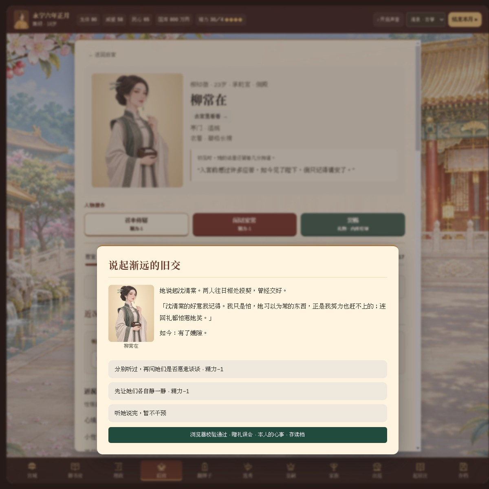
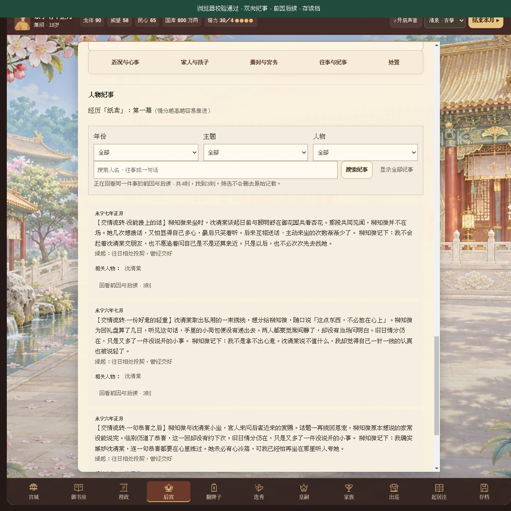

# 交情流转：从交好到渐远

这条线记得她们曾经好过。高门与寒门可以一直相交，也可能因一件没有说开的事有了隔阂；同样的门第，也会因恩宠、性情与日常往来生出嫉妒。家世影响她在意什么，不替她决定最终如何待人。

## 四种具体的小事

| 事件 | 怎样才会发生 | 两人的心事 |
| --- | --- | --- |
| 一句恭喜之后 | 真实旧友之间，一人受宠、一人冷落 | 失落者原想说的家常没说完；得意者后来才想起自己没有听完。善妒者会坦承嫉妒，骄矜者更在意自己的体面 |
| 一份好意的轻重 | 一方家中用度宽裕，另一方当前仍为额外花用盘算 | 分一束私用绣线本是好意，“不必放在心上”却让认真准备回礼的人觉得自己的心意也被说轻了 |
| 没能接上的话 | 对方近期确实与另一位在宫妃嫔有过日常交往 | 新朋友的见闻让旧友插不上话；交新朋友的人并没有存心排挤她，双方记得的却不一样 |
| 小事留下的旧结 | 两人确实发生过同宫争执 | 作息可以安排好，那几句硬话却还在心里。不是每次争吵都能靠一次劝解恢复亲近 |

例如同一件赠礼小事，送礼的人会记下：“我说不用放在心上，是怕她为回礼为难。”收礼的人可能记下：“她的好意我记得。我只是怕，连回礼都怕惹她笑。”骄矜者会更直接地说，自己一针一线的认真也被说轻了。

这些是游戏原创场景，不把某位妃嫔固定写成安陵容、沈眉庄或甄嬛。

## 怎样变化、怎样回看

系统只为已经真正交好的两个人保存来历。若有实际共同赏花、同宫共读或宫门旧识，就保留这段具体来处；没有具体记录时，只说她们曾相处投契，不编造往事。

**有了嫌隙 → 渐渐疏远 → 旧交决裂** 是可能的走向。一件事不会直接把亲密好友变成仇人；反复未解的委屈和实际交情一起决定走到哪一步。她们也可以重拾交情。

- 在妃嫔详情的 **家人与孩子 → 家族与人际 → 交情流转**，能看见对方姓名、曾经交好的来历、近来的变化和她本人的感受。
- 点 **听她谈与某人的旧交**，听当事人自己说。未在场的另一人不会被画成一起出席。
- **闲话家常** 的人际话题会提及这段交情，即使关系还没恶化到“交恶”，也能说自己和谁渐远了。
- 双方的 **人物纪事** 分别记事实与各自心事，并进入人物记忆。可按“人与人之间”或对方姓名筛选，点“回看前因与后续”连续读这段关系。
- 有隔阂时，不会继续自动出现“姐妹情深”的亲密宴请；同宫碰面仍可守礼，住得近并不自动修好。

## 可以干预，但不强令和好

分别听过两人的心意，消耗一格精力，询问她们是否愿意再谈。积怨尚浅时，她们会约好过些时日私下再坐一回；三个月后，双方能够正常相见才接上后续。肯听解释会让交情恢复一点，是否重拾亲密仍看实际关系。深怨或明确敌意尚在时，可以拒绝共坐。

也可让她们各自静一静，一年内不追加这条线的争执。原来的委屈与旧情仍保留。暂不干预不收费。

同一对朋友的干预至少间隔半年，已约好后续时不重复安排。读档、重复点选或人物状态改变，不会重复扣精力。朋友去世后取消未赴的约，由仍在世的人记下没说完的话，不给逝者继续写新日常。

新摩擦低频发生：每月有 20% 的尝试机会，全宫至少隔三个月、同一对至少隔半年、同类原因至少隔一年；每次最多一对。冷宫、离宫、病重、急切家事与丧亲悲恸时不安排这种闲日小事。孤高者不会因为同住就被强行纳入亲密姐妹线。

## 游戏画面

| 同一份好意，不同的感受 | 连续回看交情的前因与后续 |
| --- | --- |
|  |  |

## 文学参考

借鉴用户提出的《甄嬛传》人物关系写法：曾经的情分、境遇变化、好意与感受之间的落差，以及没说出口的委屈。具体剧情和台词均为原创，不照搬角色结局，也不把门第差距写成必然仇恨。

参考何珮甄《[〈后宫甄嬛传〉的对比性人物叙事——以甄嬛为核心](https://nhuir.nhu.edu.tw/bitstream/987654321/27052/1/4022001204.pdf)》，用于思考同一人经历前后的变化，以及同一处境下不同人物的不同理解。这是文学叙事参考，不是历史后宫行为的史料证明。

[返回人物经历索引](README.md) · [验证记录](../qa/friendship-arcs.md)
