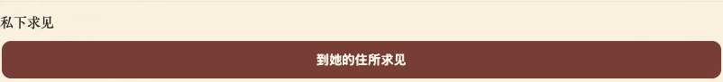
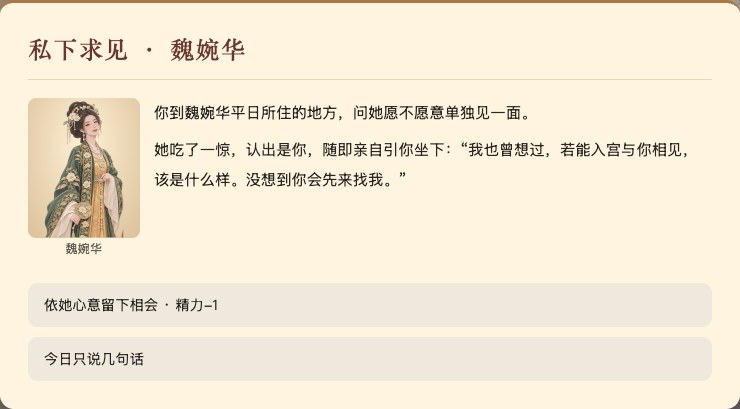
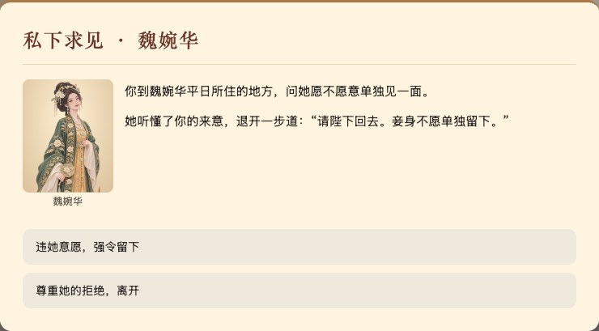
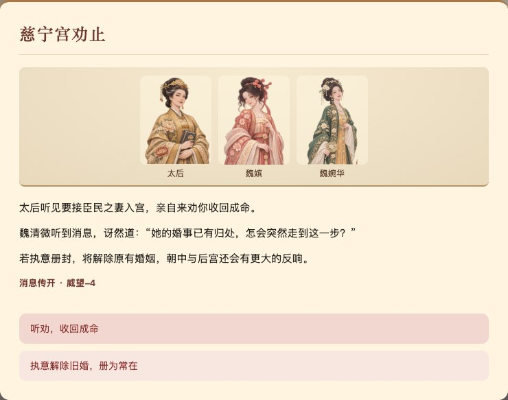

# 已婚姐妹的私下求见

[返回游戏介绍](../../README.md#娘家手足与探亲) · [人物经历图鉴](README.md) · [孩子出生后的身世剧情](outside-parentage.md)

## 在哪里点

1. 从底栏打开「家族」，在关系图或家族列表里展开妃嫔的娘家，点开她的姐姐或妹妹本人。也可以从妃嫔档案里的娘家名单进入。
2. 在姐妹档案的「私下求见」一栏，点「到她的住所求见」。如果她此刻进宫探亲，那里会改成「在宫中私下求见」。从同一页的「探亲相见」进去，也能点「请她到偏厅单独说话」。

## 触发条件

- 她须年满 **18 岁**、仍在婚且配偶在世，宫中有她可来往的妃嫔姐妹。宫中服丧时暂缓求见。未婚、已守寡或已经册入后宫的人有各自的互动。
- 点求见先打开对话，得知她是否愿意。她答应后，选择「她愿意，私下承宠」才进入私情，花 **1 点精力**。选「今日只说几句话」就只交谈。同一人本月承宠一次后，按钮会显示「本月已经见过」。
- 实际承宠后，若符合孕育条件，单次有 **28%** 概率怀孕。只求见或交谈不会触发受孕判定。孩子出生后随原家入册，可能带「身世未明」标记。后续调查、认回与留在原家的分支见[宫外子女身世](outside-parentage.md)。

以下为游戏实机截图。不同分支使用各自的演示存档。

她拒绝时，可以直接离开。若违背她的意愿，游戏会再次确认。执意强留会伤害她、损及威望和民心，此后她会谢绝私下求见。

## 她何时会请求入宫

她自愿相会累计至少三次，且当时没有怀孕，就可能问你能否接她入宫。拒绝会让她失落。答应后，原在宫中的姐妹会震惊，太后在世时会出面劝阻。可以听劝收回，也可以在常在有空位时执意册封。坚持会解除旧婚并牵动威望、民心，以及新常在和皇后、高位妃嫔之间的关系，相关人物的纪事会留下各自的反应。

