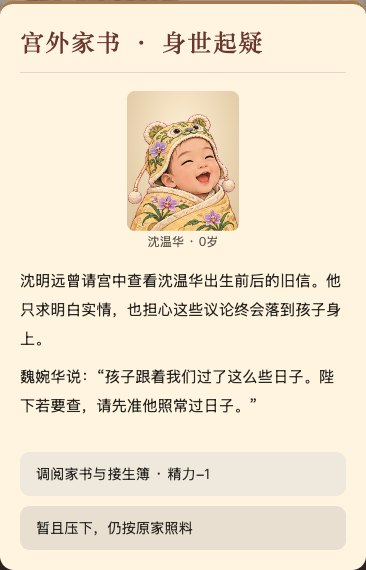
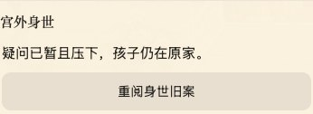
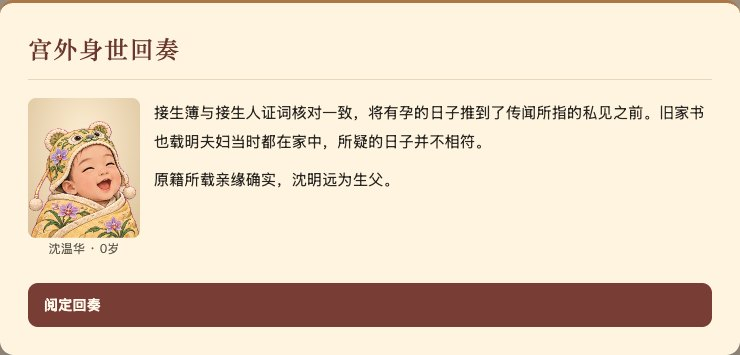
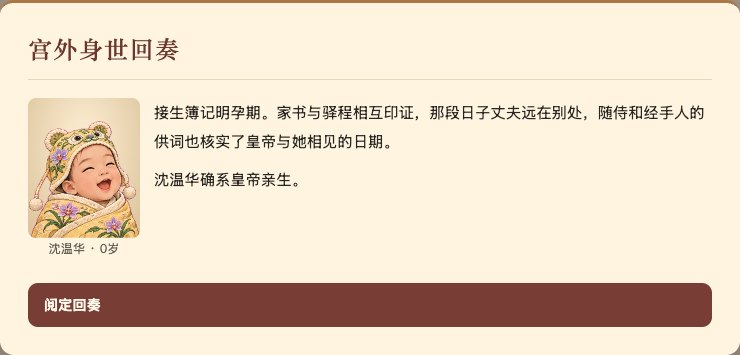
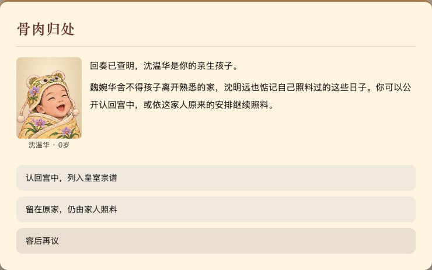
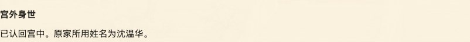

# 宫外子女身世

[返回游戏介绍](../../README.md#娘家手足与探亲) · [人物经历图鉴](README.md)

已婚姐妹在宫外生下带有「身世未明」标记的孩子后，孩子先按婚籍入家谱，在原家生活。生母会收好旧信，亲自过问孩子的照料。丈夫若对孩子出生前后的日子有疑问，可能私下递来家信，请皇帝查证。

「身世未明」会随本人入宫。应选、留牌后仍可在她的名册和档案看到这个标签；认回为皇子或公主时，「身世未明」作为出生记录，与「宫外归宗」及原有特质并列。密查的生父结论仍在原案中。

## 锦衣卫查明生父后

三个月的密查若证实孩子是当朝皇帝亲生，回奏里可选「认回宫中 · 选择孩子的归处」。也可以先保密，日后从「家族 → 孩子档案 → 宫外身世」继续办理，旧存档同样可用。

公开认回后，孩子以原姓名和年龄列入宗谱；未满十五岁、尚未成婚且太后在世时，可选「认回宫中，由太后抚养」，孩子档案会显示居住在慈宁宫。若选择留在原家，家人仍按原来的安排照料孩子。

### 慈宁宫探望

从慈宁宫点「给太后请安」，原有的谈话结束后可选「顺便看看」仍住在这里的孩子。每个孩子每月可探望一次，随请安一道办理。太后会说起孩子的饮食、游戏或功课；有时孩子也会想念生母。探望后，太后和孩子记下这次相见，健在的生母收到近况，在宫的姨母也会记下外甥或外甥女的消息。

孩子入宫后的次月起，即使皇帝没有去请安，在宫且身体允许的姨母也有机会自己去慈宁宫。符合条件的月份有四分之一的机会发生一次探望，两次探望至少相隔三个月。孩子可能只是想找姨母下棋，也可能惦记娘亲，托她捎句只有母子俩懂的话。健在的生母在宫外收到口信，也会记下自己的反应。

### 姨母求恩

皇帝请安探望、姨母自己去看孩子，都可能听出孩子想娘。近十二个月里有两个不同月份这样念过娘，姨母便可向太后请求，让仍在宫外的生母进慈宁宫看看孩子。准许后，母亲当日入宫、当日返家；暂不准许，她会托姨母递一封家书。两种答复都写进姨母、孩子、生母和太后的纪事。再次求见须相隔至少半年，并有两个月新的思念。

生母告别时，婴儿可能在熟悉的小调里睡熟，也可能一直攥着她的衣袖。年长些的孩子会送娘出门，或悄悄央她再走几步。年龄和性情都会影响反应，四人的相见纪事也各自记下这一刻。此后皇帝或姨母探望时，安心的孩子较少想娘，难舍的孩子较常想娘。与平常相比，当月及随后三个月的概率相差二十个百分点，第四至第六个月减为十个百分点，第七个月恢复如常。

### 初知身世

认回入宫时，皇子和公主的答复会显示在安置结果和孩子的「初知身世」纪事里。好奇的孩子想亲眼看看自己的名字怎样上了宗谱，内敛的孩子则可能等人散了才敢说想家。未满三岁的孩子只从声音、新衣和身边人感受这场变故。

## 孩子长大以后

三岁学系披风、七岁写大字、十二岁第一次自己写家信，孩子与尚在世的生母分别留下纪事。宫中姨母在家书里认出熟悉的眉眼和小动作。外甥若是男孩，她尤其担心他的身世被人拿来议论储位。已经归宗的孩子，姨母则盼宫里也听听孩子自己的心意。每段经历只记一次；身世查清为丈夫亲生后，这条相貌疑虑便告一段落。

孩子档案按查证进展显示黄色标签：未定时为「身世未明」，查实亲生而仍在原家为「宫外皇嗣」，认回为「宫外归宗」。姨母的印象不会替代查证。

## 触发条件

1. 从「家族」打开妃嫔的已婚成年姐妹档案，可在她的住处求见。她入宫探亲时，也可请她到偏厅单独说话。她若同意相会，并符合有孕条件，之后有可能生下带有「身世未明」标记的孩子。
2. 若丈夫在孕期已经起疑，孩子满三个月后，月结时便可能收到「宫外家书 · 身世起疑」。若此前没起疑，孩子满六个月后还有一次 **8%** 的起疑机会。孩子和丈夫在世、且仍是同一朝时，这封信才会送来。

以下实机截图使用演示存档，分别展示不同分支，含结局剧透。

## 暂压疑问与重阅旧案

- 选「暂且压下，仍按原家照料」，孩子继续留在原家，档案上的「身世未明」标记保留。
- 以后可到「家族」，展开生母的子女分支，点开孩子档案，在「宫外身世」里选「重阅身世旧案」。重阅时仍可选择继续封存。

## 调阅家书与接生簿

选「调阅家书与接生簿」消耗 **1 点精力**。礼部核对旧信、接生簿与证词，推进到**下月**即可听取「宫外身世回奏」。次月也可从孩子档案的「宫外身世」打开已到的回奏。

| 回奏结果 | 后续 |
| --- | --- |
| 核实丈夫为生父 | 阅定后撤去「身世未明」标记，原籍和照料照旧，案子办结。 |
| 核实皇帝为生父 | 阅定后撤去「身世未明」标记，进入「骨肉归处」，由皇帝决定安置。 |

## 骨肉归处

| 选择 | 结果 |
| --- | --- |
| 认回宫中，列入皇室宗谱 | 孩子以原有年龄和名字入宫，保留旧纪事。原家家谱中仍可从生母的子女分支打开同一份档案。 |
| 留在原家，仍由家人照料 | 孩子继续按原家身份生活，档案保留查证结果和婚籍所载的亲缘。 |
| 容后再议 | 孩子暂留原家，日后可从档案点「决定孩子归处」。 |

查证与安置会分别写入孩子、生母、丈夫的纪事和皇帝的起居注。若认回宫中，丈夫送孩子离家，生母交代孩子用惯的物件，孩子的纪事则保留原家照料过他的来历。

