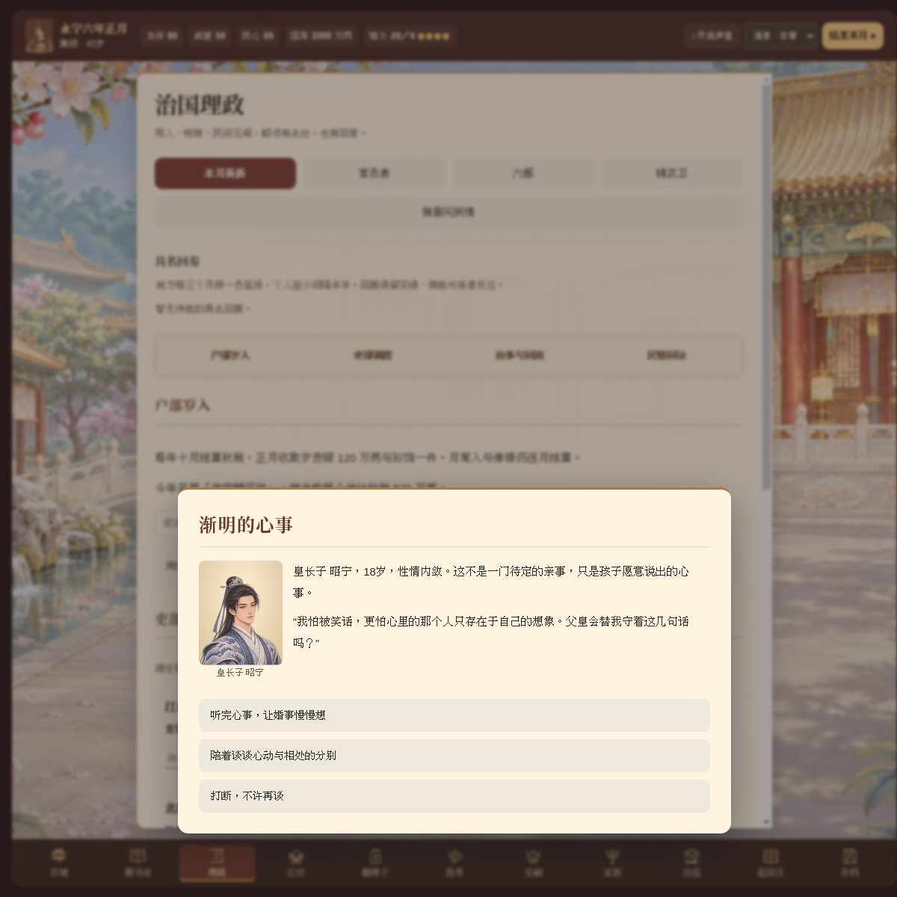
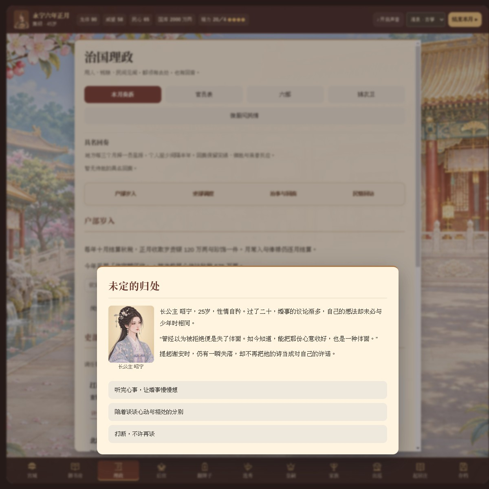
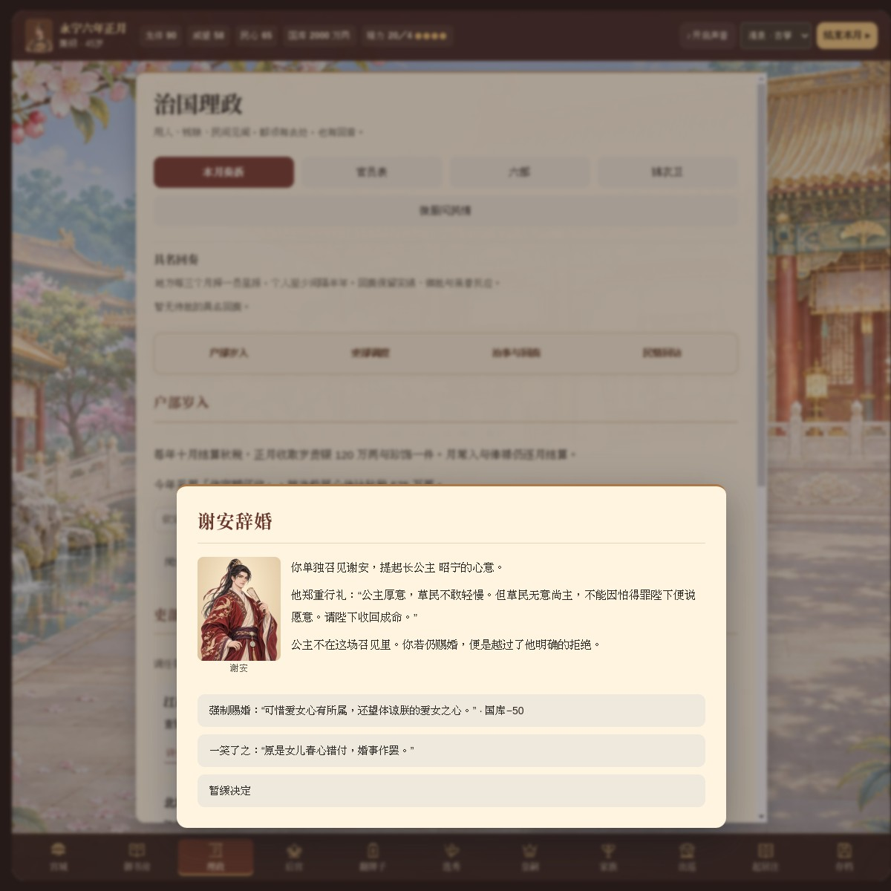
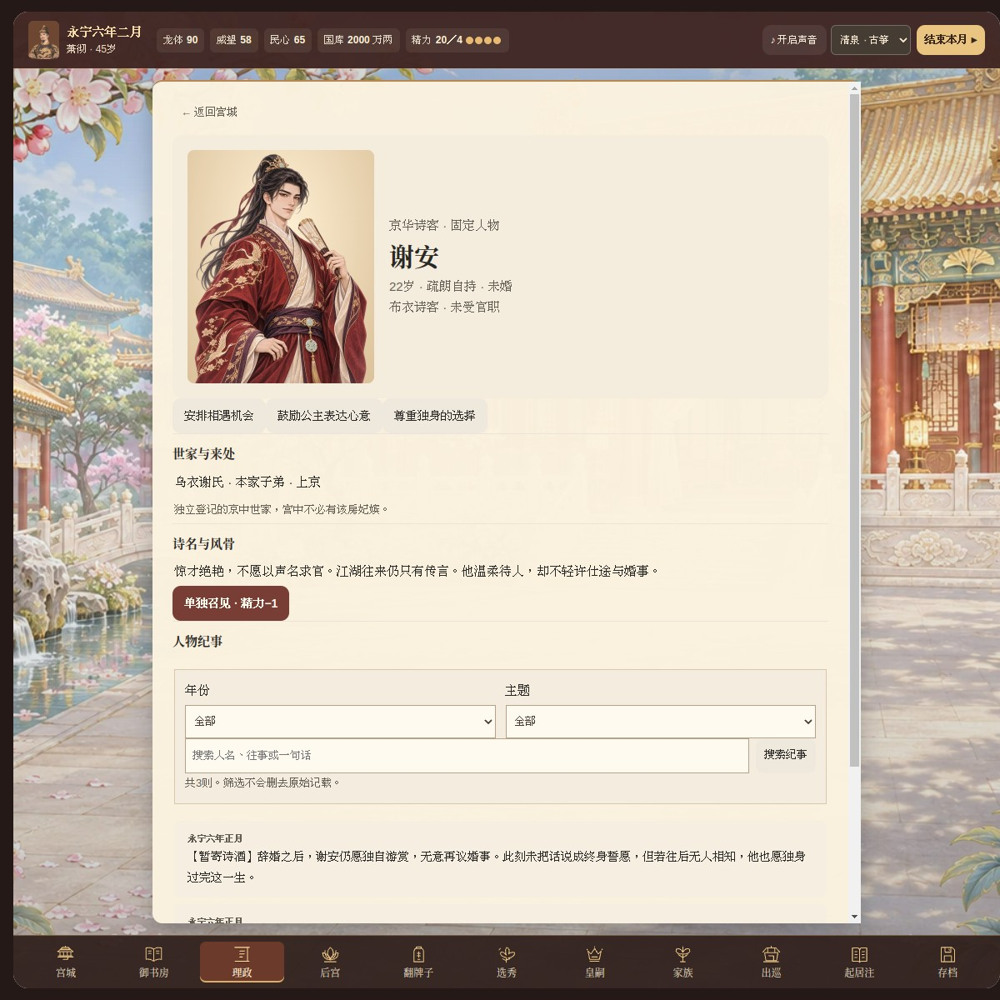
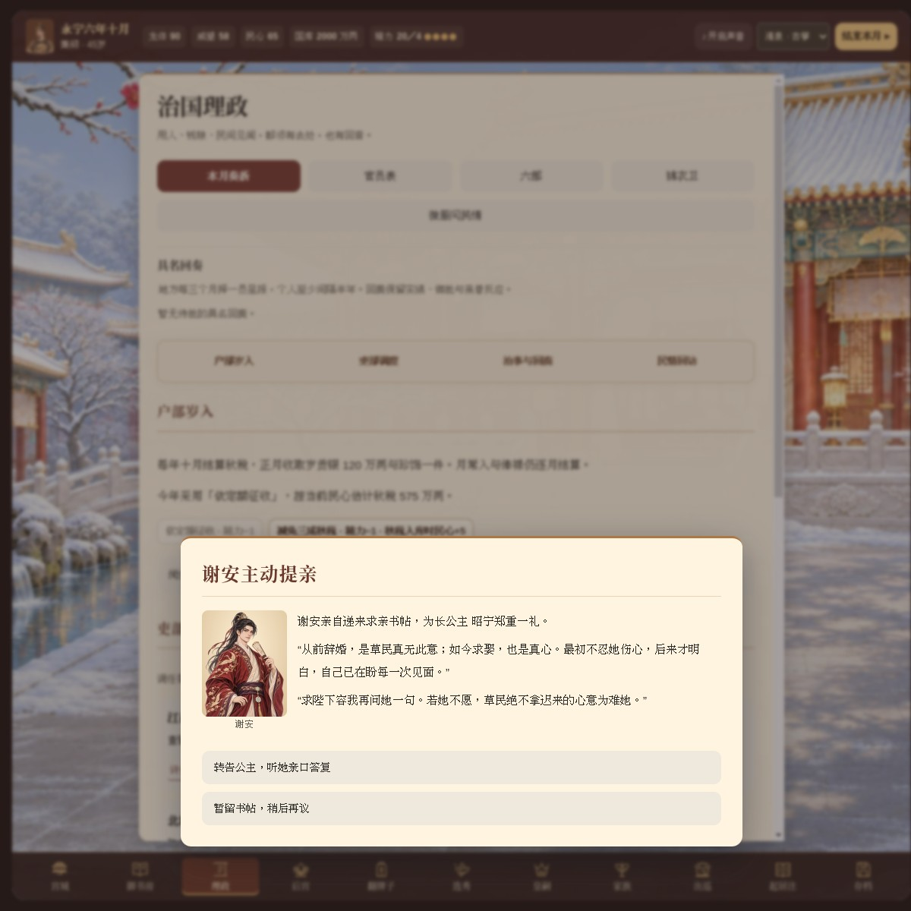
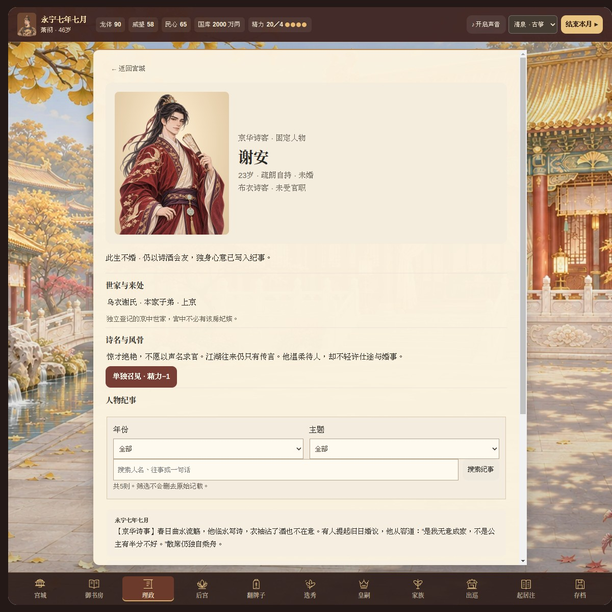
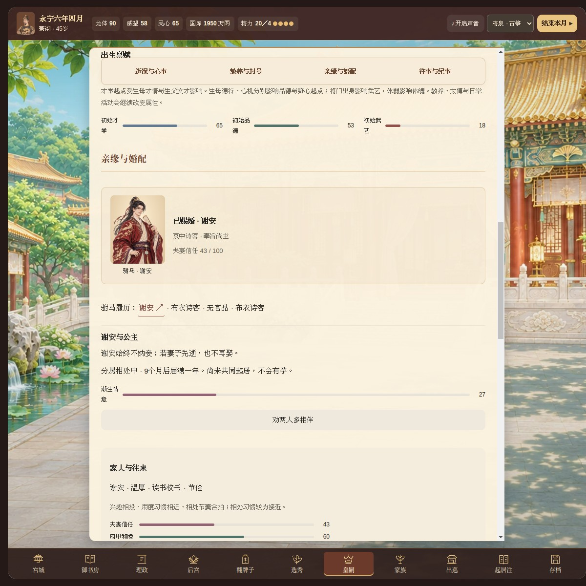
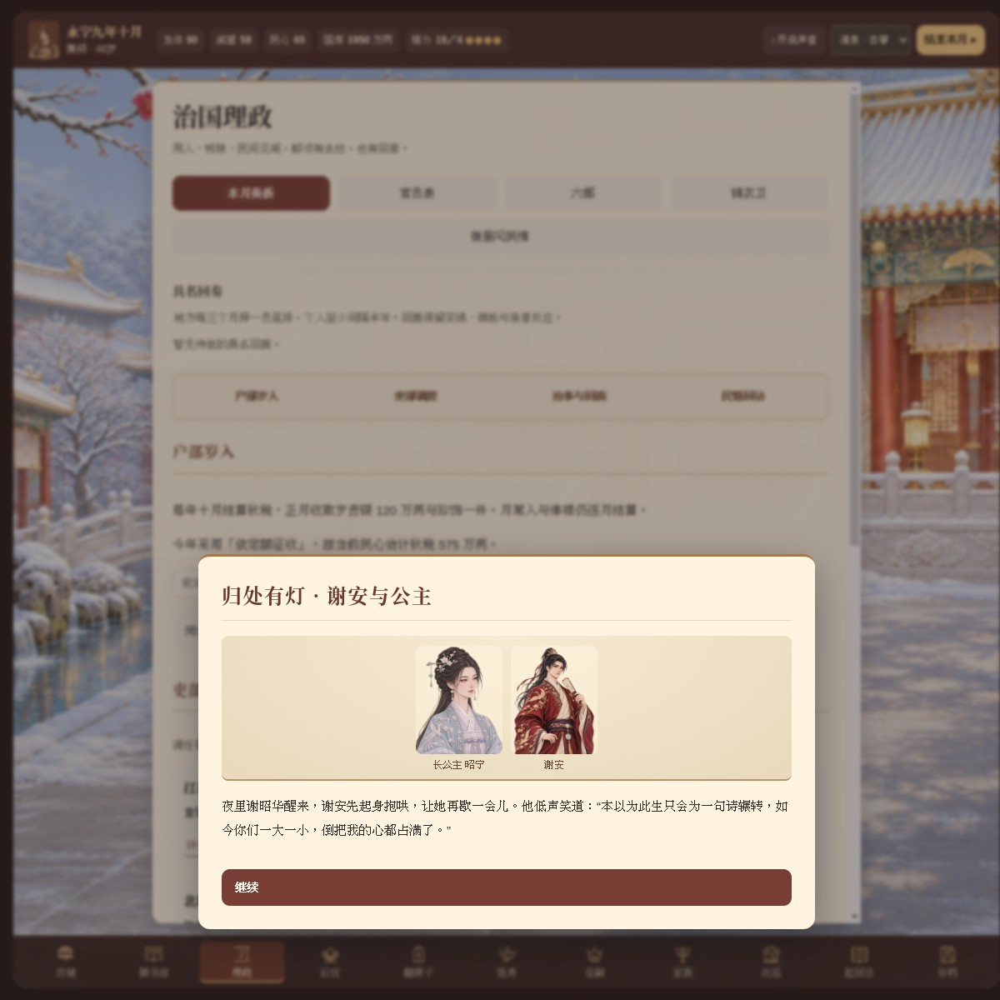
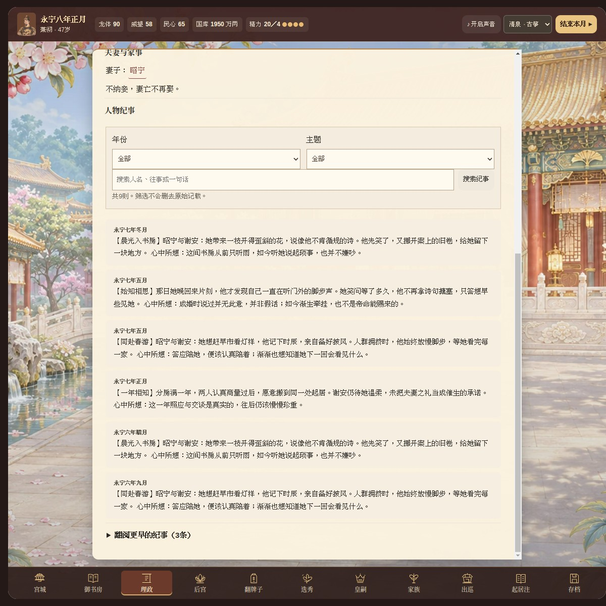

# 皇嗣心事与京华诗客谢安

[返回内容索引](README.md) · [验证情况](../qa/royal-heart.md)

## 从憧憬到自己的选择

十二岁起，未订婚、未婚的皇子与公主可能说起心中所想。**八种性情 × 三个年龄阶段 × 两段心事，共 48 段**：十二至十五岁偏向书中相逢、欣赏与知己；十六至十九岁渐渐分辨心动与相处；二十岁后转为择偶、自由、相处责任及外界催促。三十岁后引入年岁渐长的语境，不继续使用“少女初动心”的说法。

| 性情 | 年少时的侧重 | 长大后的思考 |
| --- | --- | --- |
| 好奇 | 想认识传闻背后的人 | 容纳彼此变化，也想看看天下 |
| 好胜 | 想与欣赏的人较量、并肩 | 不把成婚早晚当输赢 |
| 仁厚 | 被待人的温柔打动 | 体谅别人，也希望自己被照顾 |
| 内敛 | 未寄出的笺、想被认真听见 | 安静相伴，沉默不等于随谁都好 |
| 爽直 | 愿直说喜欢，也听得了拒绝 | 不为怕寂寞而将就 |
| 灵动 | 看灯、同游和热闹中的相逢 | 热闹散后，平常日子仍愿相伴 |
| 审慎 | 看守约与小事，不只看诗名 | 婚前谈清家用、住处与志向 |
| 自矜 | 希望被珍重的是自己而非封号 | 面对拒绝仍保有体面，不以出身压人 |

每月至多尝试一次，全局至少间隔四个月、同一人至少十个月；同阶段已经说过的心事不重复抽取。暂未听完的心事可从人物页进入。生病、外出、囚禁、清修等不便相见时暂停；订婚、成婚或跨入下个年龄阶段后，未完成的旧场景失效。已经说过的话仍留在纪事里。

皇帝可以认真听、陪着分辨欣赏与相处，或打断话头。父爱与后续对白会记住实际回应，私谈不会自动变成母亲的记忆。二十岁后若曾对谢安动心，还会回想诗名与知己的区别。

以下为真实浏览器页面的独立演示存档截图，各分支不代表同一局自然发生。

二十岁后：自矜公主如何看待曾经的失落

## 谢安：诗名满京，心意不售

**固定姓名谢安，初见二十一岁，固定立绘 433。** 他是本作架空剧情人物；疏朗自持、才情出众，温柔待人，但不把谦和写成有求必应。存档中已经登场的谢安继续按原年龄长岁。

- **相遇**：微服出宫有概率在书肆、茶楼听见诗会声名与江湖传言。同一月反复出门不会反复抽取；至少隔四个月再尝试。宫中已有适龄未婚皇嗣时，月结也有较低概率听闻。每局只生成一位，正常长岁，传代后继续保留同一人。
- **世家**：随机登记京中世家，可为独立谢氏家门，也可绑定已有贵族家族的同宗旁支／母族外亲。绑定写入明确谱系，不凭同姓认亲，不把不同姓的外亲误称亲兄弟。
- **入口**：官员表下方的「京中名士」进入专属人物页，可单独召见、论诗、提出授官、问起江湖往来。未受官职时另列布衣，不伪造进士功名或官品。
- **辞官**：可拟授翰林院编修。他自称“酒囊饭袋”，拒绝以诗名冒领官声；再次劝仕仍会辞谢。未实授便不显示官职，实际答复进入他的纪事。
- **声名**：曲水诗会、题诗而不轻许情意、交往江湖旧友、世家劝仕等低频更新。传闻始终是传闻，不直接确认为门派身份。

## 公主的心意与他的拒绝

新追求线可在公主 **12—25 岁（含边界）**时开启，须未订婚、未婚、可相见，并符合亲缘限制。多位公主可以欣赏他的诗，只有一位开启主动求亲与追求线；优先更大胆的爽直、灵动等性情。第一次实际询问婚事就绑定追求者，此后即使她放弃、另嫁或去世，也不会换一位公主重复这条故事。皇子仍有自己的心事，不套用尚主剧情。

在宫中或已在京城开府的公主都可在转月时抽到「诗名与心意」，旧存档里的京城府邸也适用。已开府可从「出巡 → 公主府 → 婚事与心意」查看，辞婚后仍可安排诗会并继续来往。

谢安**明确拒绝尚主**，皇帝可坚持旨意、以“女儿春心错付”作罢，或暂缓决定。事件打开之后若有人订婚、成婚、离开或去世，旧选项不能继续执行。订亲／赐婚消耗五十国库，不会把他的拒绝改写成谢恩倾心。

| 处境 | 实际结果 |
| --- | --- |
| 公主 12—14 岁，强制或自愿议定 | 双方登记订婚，各居原处，没有夫妻家庭；满 15 岁且两人可相见时才成婚 |
| 公主已满 15 岁，强制促成且尚未相爱 | 成婚后分房一年，从实际婚礼日期计时 |
| 公主已满 15 岁，两情相许，或定亲后已经生情 | 成婚后共同生活，不设一年分房 |

订婚会在公主和谢安的档案、婚配栏及双方纪事中显示，不会同时成为另一门赐婚的人选。订婚期间可低频在亲友同席的诗会上交流，增加相知。若一方去世，终止婚约并记录旧事，不虚构已经成婚或丧偶。

## 辞婚之后，帝王可以怎样撮合

辞婚获准后，谢安会有两种自然倾向：暂寄诗酒、独身自处；或听闻公主伤心，愿意真正认识她。**怜惜只促成了解，不直接变成爱情或婚约。** 初次干预至少隔一个月，此后每三个月可做一次；两人可相见且没有待答的场景时，双方档案会出现操作。

| 操作 | 作用 |
| --- | --- |
| 安排相遇机会 | 精力 −1，邀请两人在亲友同席的诗会相识，后续从档案继续 |
| 鼓励公主表达心意 | 精力 −1，让她写自己的志趣和心意，谢安认真回信，推进了解 |
| 尊重独身的选择 | 结束婚议，留下明确的告别与终身独身纪事；不再强行撮合 |

暂寄诗酒的倾向可以被一次真正的相识改变；若一年半未再相知，他也会认真选择终身不娶，继续曲水诗会、灯夜、江湖会友等低频纪事。风流写的是文采与风度，不是假意许诺女子。

重新相识、渐识性情之后，谢安才可能亲自递上求亲书帖。八种公主性情各有不同的交流：灵动者带他看纸鸢，好胜者与他论文章，仁厚者照顾旁人，审慎者问起真实生活，内敛者慢慢说出想法，自矜者敢于直言。他说明当年的拒绝与如今的动心都是真实的，公主可以接受、婉拒，或再考虑。

这条已开始的故事可以随公主长大继续，不会到二十六岁突然失忆；**二十六岁后不会新开启追求线**。她已有其他婚约或成婚后，谢安停止追求；暂时离宫、生病等则暂停相见。所有干预、相识、提亲、答复与收束分别写入双方纪事。

从辞婚走向主动提亲，或独身诗酒

## 婚后：礼数之外，渐有牵挂

谢安认为帝命并非公主的过错。即使婚初没有相同心意，也温柔照应、分担家事，不让妻子因他的拒绝受冷落。**永不纳妾；妻子先逝后永不再娶。**

| 公主性情 | 婚后相处 |
| --- | --- |
| 灵动、爽直、好奇、好胜 | 花枝进书房、同赴春游；她的明亮渐渐改变独处的习惯，情意增长较快 |
| 仁厚、审慎 | 灯下温茶、一起回家书；先从体谅与负责开始，相敬如宾 |
| 内敛、自矜 | 各读一卷、雨夜理谱；尊重独处，珍惜安静中的理解与直言 |

至少间隔三个月才概率更新一次夫妻片段。两人分别记下同一件事的感受；情意渐深后，另有一次「始知相思」，承认当年的拒绝与今天的依恋都是真实的。孕信、添丁等已有家庭事件也同步写入谢安的纪事。

**一年分房仅限强制促成、成婚时尚无感情的夫妻。** 分房期间所有家庭受孕入口关闭，不会因信任值高或普通月结绕过。一年后，实际仍可共同生活的夫妻商量合居，再恢复通常条件。自愿成婚和已经相爱的定亲者不设这一等待；一般家庭原有的年龄、健康与时间条件仍生效，共同生活不等于必然有孕。

仍在分房的夫妻，婚后三个月起可在公主家事中「劝两人多相伴」，每三个月可劝一次。增加相知与信任；两者达到条件、双方愿意后，才提前结束分房。一次鼓励可能只增加相伴，不保证立即合居，更不保证怀孕。

妻子去世，谢安收好旧物、料理家事并明确拒绝再娶；不会被回收到未婚人选中。传代后保留旧夫妻与旧纪事，新帝不会被称为公主的父皇。

## 情深之后：不期而遇的归处

婚满一年、确已相爱且情意深厚，原有低频夫妻片段会进入更亲近的阶段；也可从两人档案「听他们说说家常」，每半年一次、精力 −1。不是刚奉旨成婚就套上深情台词。

“我原以为，一生有诗酒便够了。你是不期而遇的意外，却成了我往后每一日的盼头。”

“从前满城风月，哪里都可停舟。如今知道你在等，便觉得归路总不够短。”

活泼的妻子来借大诗人的工夫，他会搁笔陪她；安静的妻子不必找好话题，他也会为她留一个位置。有真实在世、在家的孩子时，才写抱哄婴儿、蹲下听幼儿说话、陪学龄孩子改习作，或尊重长大孩子的志趣。孩子已经去世、外出或并非两人的亲生子，不会被误写进这些专属片段。相关家常同步保留在夫妻纪事，涉及孩子的还会进入孩子自己的纪事。

夫妻纪事：当年的拒绝与后来的相知都留下来

## 文学材料与原创边界

取意于[《世说新语·排调》](https://zh.wikisource.org/zh-hans/世說新語/排調)中东山高卧、征召与名士自持的文学形象。这里的年轻诗客、固定家世机制、酒囊饭袋自称、江湖传闻、拒婚与全部夫妻故事均为原创，**不宣称历史上的东晋谢安有这些经历或婚姻设定**。
