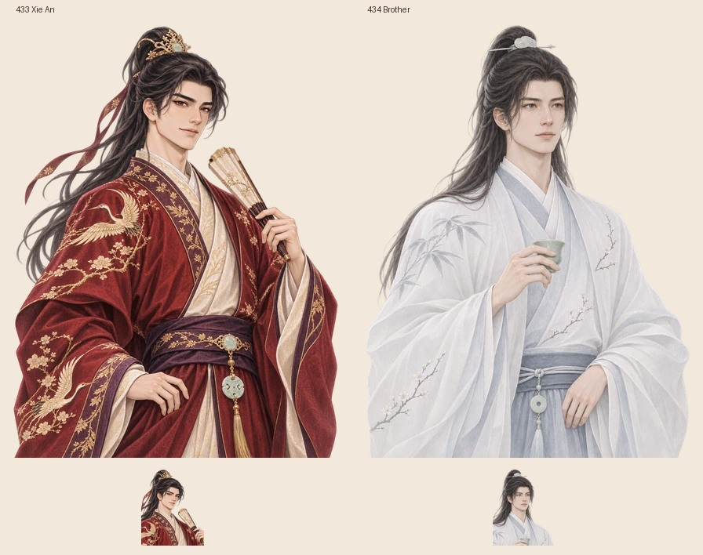

# 谢安与白衣兄长立绘核验

- 用户批准红衣谢安为专属立绘 **433**；清淡白衣版改作妃子兄长 **434**。
- 两张来源原图分别记录在 `../capital-noble-portrait-source.json`，均为真实透明背景。每张图集为 1792 × 560，第一格 448 × 560 有人物，其余三格透明。
- 433 不进入任何随机人物池；实际 `storyPerson === 'xiean'` 直接使用 433，也支持通过 `portraitOverride = STORY_NPC_PORTRAITS.capitalNoble` 固定绑定。434 仅新增至兄长生成池，包含二兄、三兄等；原人物升官、年龄变化不更换已保存的立绘。
- 兄长新图从行动版本 21 启用；使用修改前捕获的 v19 与 v20 登基存档验证未完成事件可以恢复，人物立绘一致，事件结束后启用新版本。
- 合并主分支最新谢安剧情、将兄长新池隔离至行动版本 21 后，全量 **1433 项测试全部通过**，其中包含旧事件重放、谢安本人身份绑定、官职变化及存档恢复。
- 已核对头像和半身裁切、冠簪位置及透明边缘。下图为按实际渲染坐标制作的离线检查图，并非浏览器截图。
- 本机 Chrome 启动以 SIGABRT 退出，无法完成本次浏览器实机验收；采用资源检查、游戏 VM 渲染与存档回归核验。

