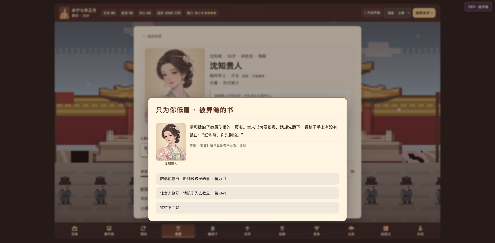
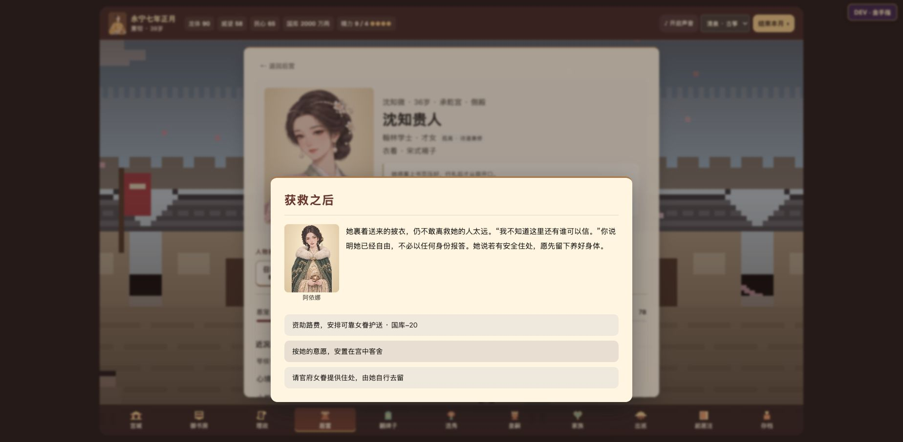
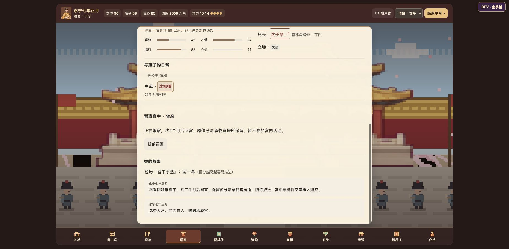
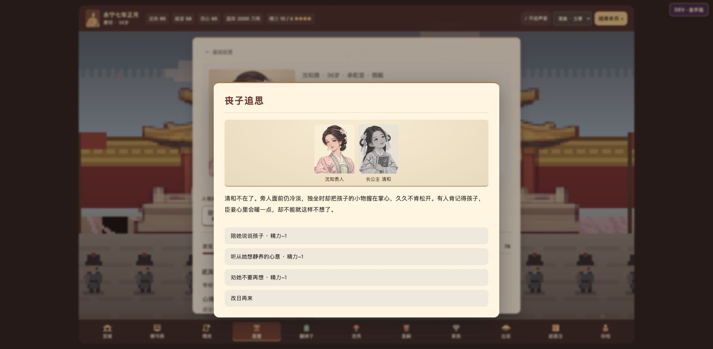
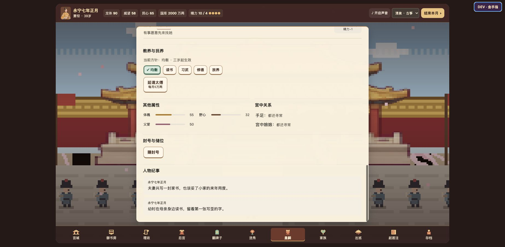

# 人物长卷、母子牵挂与省亲验证

实现版本：[5e8b956](https://github.com/AubreyKuang/Forbidden-City/commit/5e8b956602d20eacbfa14eb5f1e198e69ec5c134)，合并于 [PR #9](https://github.com/AubreyKuang/Forbidden-City/pull/9)。功能与条件见[个人经历图鉴](../character-experiences/README.md)。

## 自动回归

```sh
node --test tests/*.test.cjs
node tests/palace-flow.cjs
node tests/character-journeys-fixtures.cjs /tmp/palace-character-fixtures
```

- 23 个测试文件中的 **533 项用例通过**，另通过连续 **60 个月**游戏流程。
- 十三条三章长卷覆盖 **104 种完整选择组合**，验证人物绑定、前次选择、结局、章节间隔、精力与奖励防重复、存档恢复。
- 十九种主要性情与孤高气质各有幼儿、儿童、少年、分离、丧失的母子文字。检查实际年龄、生母与养母、抱养探望、出宫、失散和死亡，不把分离写成丧子，也不以另一个孩子代替绑定人物。
- 长期分离的孤高母亲可闭门或依原有信念诵经、问道；重逢会改变当前状态，既有经历保留。普通赏赐和心境衰减不能立即抹去丧子之痛。
- 集市救助覆盖三种安置、客舍探访、信任与册封、核实寻亲、离开；获救者身份不会生成虚构的本朝父兄，特殊往事也不会随机分配给其他妃子。
- 门第事件验证不同性情、实际在场者、关系与信任后果、全宫与个人间隔；该部分为自动回归，未计作线上手动情节覆盖。
- 省亲检查离宫条件、真实缺席、原宫室保留、按期回宫与提前召回；病母事件提供派医赴家、准假探病或书信回应。
- 皇嗣婚后事件在原有人物纪事中只出现一次，新事在上；家庭信息和操作保留。

## 线上浏览器验证

在已部署的 [测试入口](https://aubreykuang.github.io/Forbidden-City/dev.html)中，通过「存档 → 选择备份文件导入」载入专门场景，随后点击真实界面。测试入口与正式存档隔离。场景固定了年龄、关系与资源，用于重复检查具体功能，不代表自然游戏中的触发频率。

| 场景 | 实际操作与结果 |
|---|---|
| 只为你低眉 · 第一章 | 选择前刷新并读自动档，仍为同一章；选择修书后精力从 10 降至 9，结果页刷新恢复后仍为 9，无二次扣除；继续后进入章节等待期 |
| 只为你低眉 · 第三章 | 从独立第三章场景选择尊重孩子的交往，抵达「门内有春」结局，人物页保留原孩子与三章记录 |
| 丧子追思 | 显示具体孩子清和与孤高母亲的反应；尊重静养后保留「静室问道」与牵挂，不被一次陪伴消除 |
| 两个月省亲 | 人物页显示「娘家 · 暂离宫中」，无召幸与闲谈按钮；后宫单列回家省亲者，母子日常显示无法相见；刷新读档后仍在娘家；提前召回后恢复宫内操作 |
| 集市救助 | 救下成年阿依娜后显示三种安置；选择客舍后，在出巡页可看到「尚未册封」与探问近况入口，探访可以实际推进信任 |
| 异乡归信 | 信任达标场景可开启第一章，选择核实地名与旧物；尚未确认的家乡不会被写成已经找到，后章遵循间隔 |
| 成年公主人物纪事 | 只显示一个「人物纪事」；夫妻家书出现在幼年读书记录上方，没有独立的「成长记」或「婚后家事」记录区，没有重复条目 |

上述操作期间浏览器日志未发现警告或脚本错误。页面确实加载了人物长卷、母子牵挂、家世与省亲模块。功能版本的 GitHub Pages 部署成功后才进行以上验证。

## 实机截图

### 孤高者难得的温柔



### 获救后的去留



### 省亲期间无法宫内相见



### 失子后的牵挂



### 成年后的统一纪事


