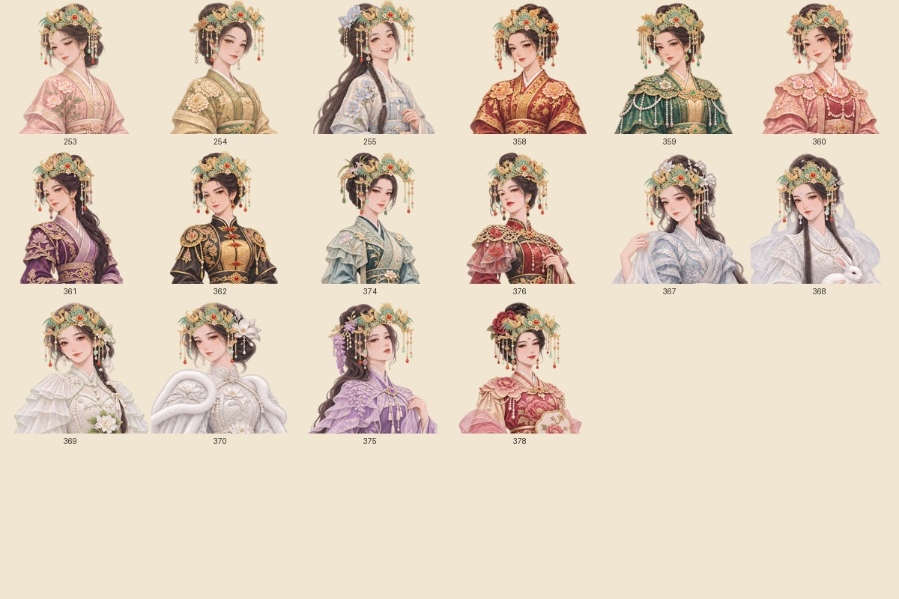
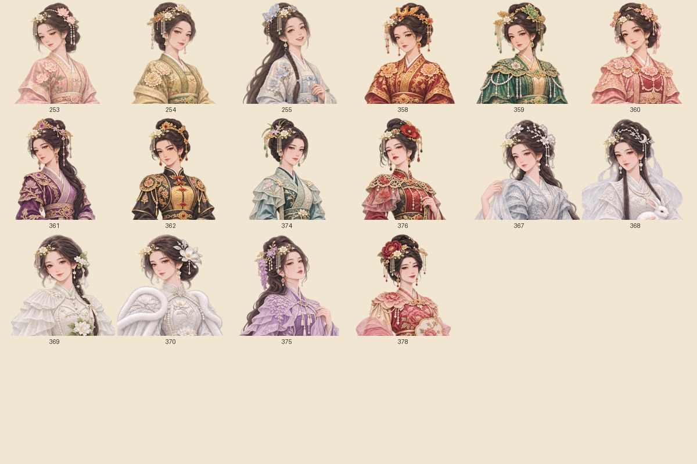

# 妃子半身补画验收

用户已确认 82 张补画全部采用，并要求调整首饰位置。6 组现有配对素材直接复用。

## 素材与定位

- 88 组近景/半身对应关系完整，82 个新图集格位无重复。
- 7 张新 WebP 图集均为 1792×1680、RGBA、真实透明背景。
- 原始图集与人物编号保留；钩弋夫人仍为 422，锦衣卫仍为 423–428。
- 为 82 张新半身图逐张记录头部中心、眉线和宽度。
- 校正 363–366、377、379 的已有半身头部位置，直接惠及对应近景编号的详情画。
- 半身头部的小型簪饰向头发内部移动，避免原大头布局缩小后悬在发髻外侧。
- 按游戏实际 `portraitView` 和 `fittedPortraitJewelry` 输出的坐标，用原图集与首饰图集制作叠图，逐张检查凤冠及白玉步摇。所有六类首饰均有渲染与位置断言。

下列图片是按游戏坐标生成的离线叠图检查，包含校正后的白色及花卉配对立绘；不是浏览器截图。

## 回归结果

- 全部 `tests/*.test.cjs` 在单个 Node 进程中执行：**1,248 通过，0 失败**。
- `node tests/palace-flow.cjs`：连续 **60 个月**，宴会、存档、家族记忆、史实剧情、地图与后续事件通过。
- 新增专项验证：88 组近景/半身、82 张素材、原编号及随机池、首饰叠加、晋封、存档重读、其他角色素材不变。
- JavaScript 语法检查、开发入口生成一致性、`git diff --check` 通过。
- 未在本环境完成真实浏览器端到端验收；上述视觉检查与游戏运行测试分别覆盖素材叠加和逻辑行为。

验证基于合入主分支 `4bee5405c1c5e5bb66a4fd977929d40b1c4f60a7` 后的代码。
