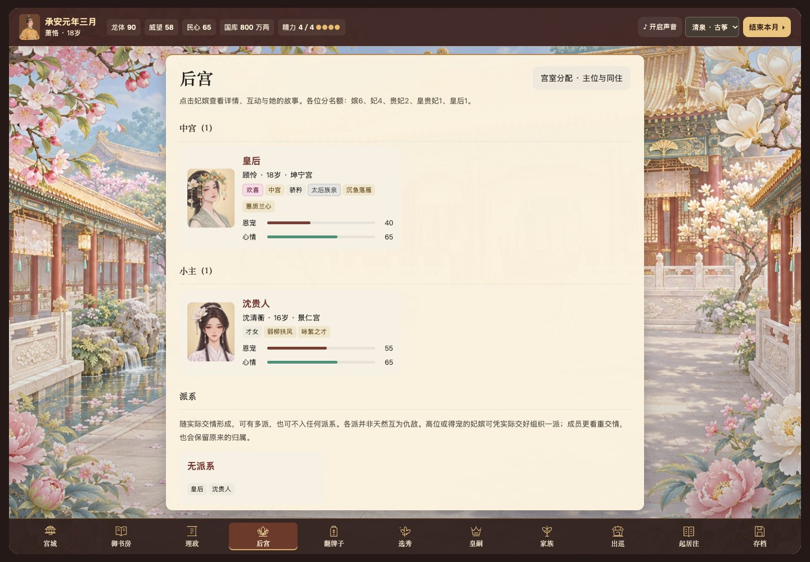
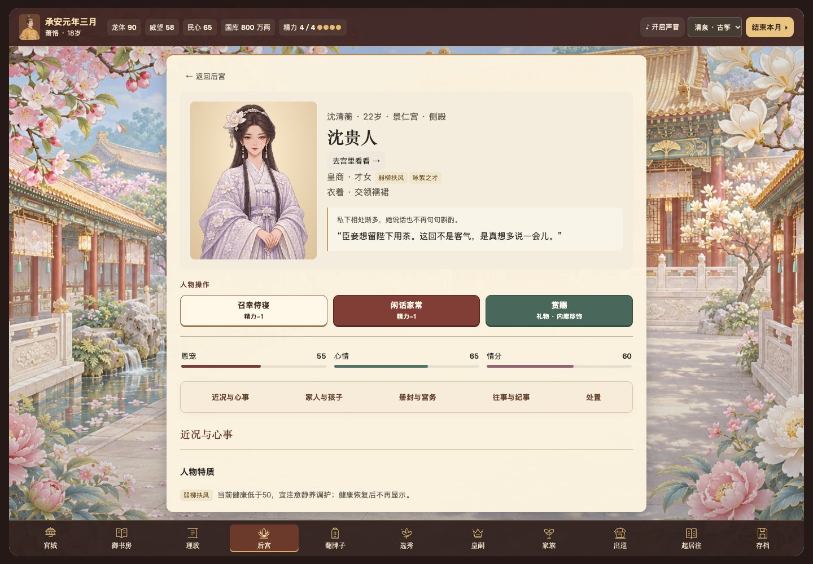
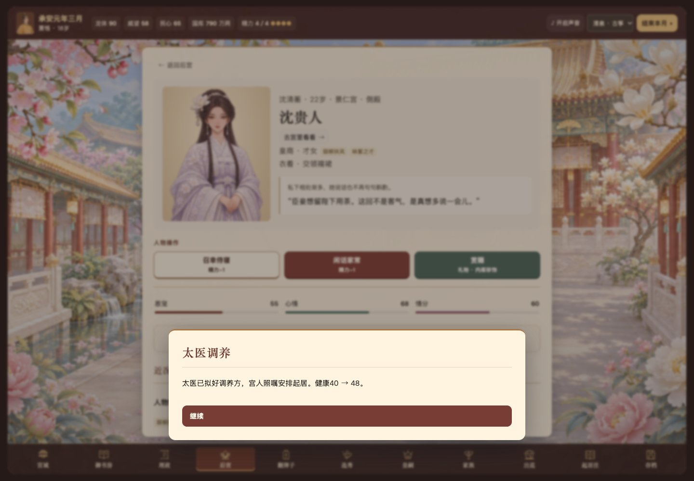
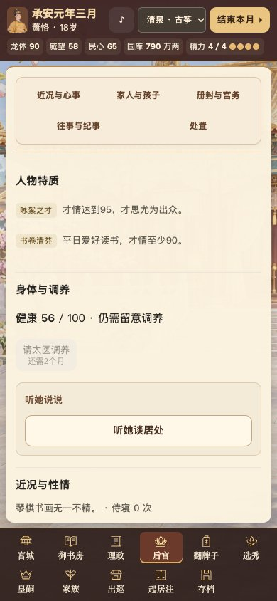
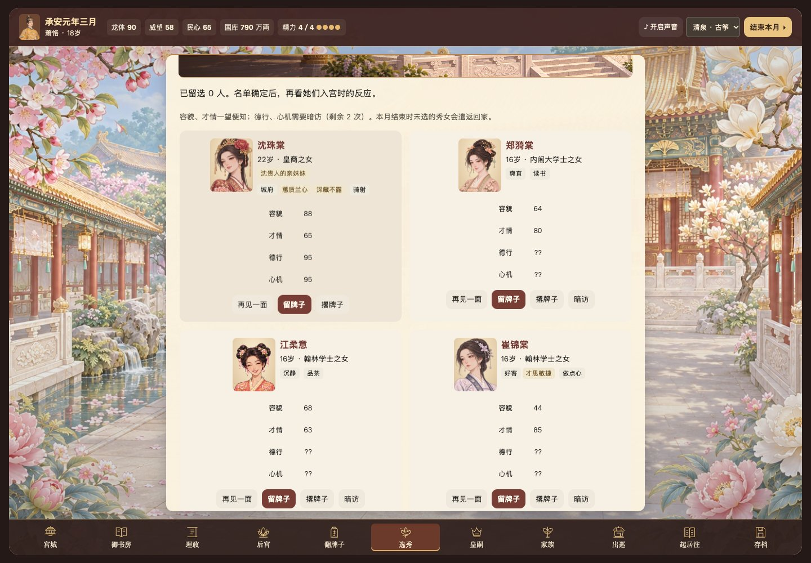

# 妃嫔特质与身体调养验收

## 范围

19 种黄色人物特质；同类择优与名册两枚上限；选秀隐藏信息；真实健康与太医调养；旧存档事件续接。粉色心境、灰色太后族亲沿用各自显示规则。

## 自动验证

- 全量回归：`node --test --test-concurrency=4 tests/*.test.cjs`。初次整合版本 `23b4424` 为 2,368 项全部通过。
- 综合游玩：`node tests/palace-flow.cjs`，60 个月、宴会、存档、家族记忆、历史场景与后续事件通过。
- 新增专项：`tests/palace-consort-traits.test.cjs`、`tests/palace-consort-health.test.cjs`。覆盖阈值边界、隐藏信息、作品成果、纪事去重、损耗与恢复、确认与取消、付款前后重建运行环境、未完旧事件和损坏存档保护。
- 分布：`node scripts/analyze-consort-tags.cjs`，18,000 名候选人。合并线上 v56 后复跑，结果与已保存的[分布数据](../design/consort-tag-distribution.json)逐字一致。
- 长线：`node scripts/playtest-consort-traits.cjs`，三组真实月度事件各走十年，中途重新读取存档。[逐年结果](consort-traits-longrun.json)。这是样本结果，不承诺所有玩法维持同一人数比例。

## 浏览器操作

使用隔离的 Chrome 测试环境；截图为演示存档，属性用于覆盖边界，不代表这些人物和数值必然在自然开局中出现。

| 场景 | 操作与结果 |
| --- | --- |
| 后宫名册 | 黄色特质与粉色心境、灰色太后族亲同时显示；人物名册最多两枚特质，详情显示其余已知特质 |
| 太医调养 | 健康 40 时打开确认框，刷新并读取自动存档，仍显示待确认的同一事件 |
| 结果刷新 | 确认后健康 48、国库 800→790；再次刷新读档，结果与单条调养纪事保留，没有重复扣款 |
| 康复 | 推进一次健康结算后为 56，弱柳扶风撤下；调养按钮保留剩余两个月冷却 |
| 手机页面 | 390×844 下健康数值、特质、调养按钮可见；页面宽度 390，无横向溢出 |
| 选秀暗访 | 未暗访时只显示清丽可人；点击实际暗访按钮后，蕙质兰心、深藏不露才可见，未探知的喜好仍保持隐藏 |

## 验证注意

多个标签可能来自同一人物，比例不能简单相加；同类择优后的比例也不等于未暗访时的实际可见率。普通妃嫔特质与皇嗣出生天象是独立系统。

浏览器检查使用隔离存档，不接触玩家存档。同时打开两个游戏标签页后若交替修改，存档冲突保护会撤回旧页面的操作；继续验收前关闭另一页并重读最新存档。
