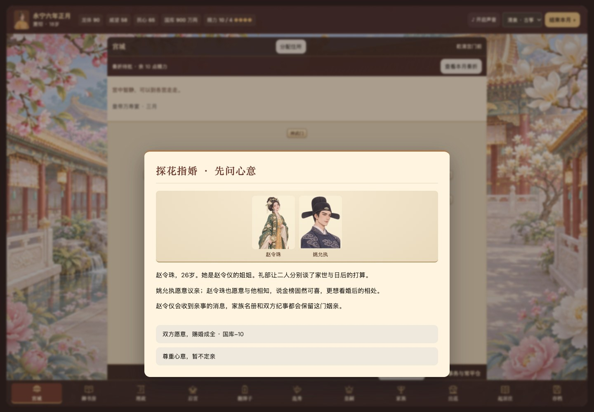

# 宫廷生活与剧情入口验收

## 自动验证

2026-11-15，Node 22.18.0：合入主线 `cc5101a` 的半身立绘和钩弋后续后，**1,369 项自动测试全部通过**，60 个月连续流程通过。

```sh
python3 scripts/build-dev.py
node scripts/build-gouyi-gallery.cjs
node --test tests/*.test.cjs
node tests/palace-flow.cjs
```

事务日志使用版本 19；主线已经发布的 17／18 版本仍保留原语义。测试包括真实旧版未完场景、恢复期、处罚后家书、宫殿到达，以及主线钩弋旧档的续接。版本 16 的三份 `court-living-*-legacy-v16.json` 来自未修改的 `4dcaf96`，不是在新存档中手改版本号。

## 浏览器范围

**62 / 62 个桌面与手机浏览器场景通过，共 192 次刷新恢复比对通过，无页面脚本错误。**

两套脚本均通过游戏实际按钮、存档导入、人物链接及刷新后读取自动存档进行验收。页面脚本只读取状态和布局，不在浏览器里改写人物或剧情。演示档由游戏逻辑在独立测试环境生成；定向事件覆盖不代表自然随机发生频率。

| 脚本 | 场景 | 关键检查 |
| --- | --- | --- |
| `official-marriage-browser-acceptance.cjs` | 13 种情境 × 桌面／手机 | 十五岁公主、皇嗣页择配、现有家族、礼部名帖、拒婚、改议、同族、已婚排除、婚后家书、独自探望、母亲陪同、幼儿照护、锦衣卫专属立绘 |
| `court-living-browser-acceptance.cjs` | 18 种情境 × 桌面／手机 | 六种查证回奏、巡察有／无收获、生产／小产调养、父系两层家谱、单／多故事直达、升职／贬职心境、获罪家书、剧情妃图鉴、姐妹探花指婚 |

目标尺寸为 1440 × 1000 与 390 × 844。每种情境检查至少两次或适用的一次刷新；比对人物、国库、精力、案件与当前剧情，确认不会重复扣费、改写身世、重复赏功或丢失纪事。婚姻组同时检查弹窗内部横向尺寸，全部页面检查文档宽度与脚本错误。家谱组实际展开列表并验证外层分支仍打开、父母指向同一个孩子。

本次实测发现并处理的边界包括：查证回奏与原身世回奏重叠、丧仪期间私情传问无法接回原剧情、家族列表展开子女导致外层收起，以及探花议婚将姐妹称为“undefined公主”。有关回归与截图均包含在上述验收范围。

结果：

- [官员婚姻与探望浏览器记录](official-marriage-browser-results.json)
- [宫廷生活与图鉴浏览器记录](court-living-browser-results.json)
- [官员婚姻截图](../screenshots/official-marriages/)
- [家谱、案卷、调养、图鉴与姐妹指婚截图](../screenshots/court-living/)

复跑：

```sh
node tests/official-marriage-browser-fixtures.cjs
node tests/court-living-browser-fixtures.cjs
python3 -m http.server 8428 --bind 127.0.0.1
# 使用已安装 Playwright 与 Chrome 的环境；PALACE_CHROME 可指定浏览器路径。
node tests/official-marriage-browser-acceptance.cjs
node tests/court-living-browser-acceptance.cjs
```

`PALACE_QA_URL` 可指向正式页面；`PALACE_BROWSER_RESULTS`、`PALACE_SHOTS` 可分别设置结果文件和截图目录；`PALACE_CASES` 可限定回归场景。

## 线上核验

游戏提交 `d8982467b047e06361d4e9ca33113b4b215918ec` 已推送 `main`，[GitHub Pages 部署成功](https://github.com/AubreyKuang/Forbidden-City/actions/runs/43774597535)。正式／测试入口、全部游戏脚本、样式及抽检立绘共 **133 项线上资源**均返回 HTTP 200，并与本地提交逐字节一致，见[资源校验记录](court-living-production-resources.json)。

正式页面另完成 **18 / 18 个桌面／手机场景、60 次刷新恢复比对**：姐妹探花指婚、剧情妃图鉴到入宫、家谱图与列表、宫殿故事直达、锦衣卫私情查证后续、小产调养、公主／姐妹赐婚及独自探望。没有页面脚本错误。线上导入使用隔离浏览器与演示存档，不接触玩家本机存档。

- [宫廷生活线上交互记录](court-living-production-browser.json)
- [官员婚姻线上交互记录](official-marriage-production-browser.json)
- [正式页面截图](../screenshots/court-living-production/)
- [正式页面婚姻截图](../screenshots/official-marriages-production/)


