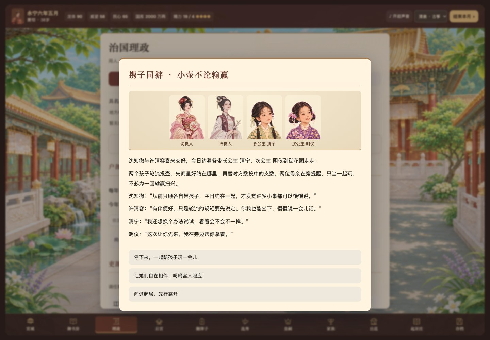
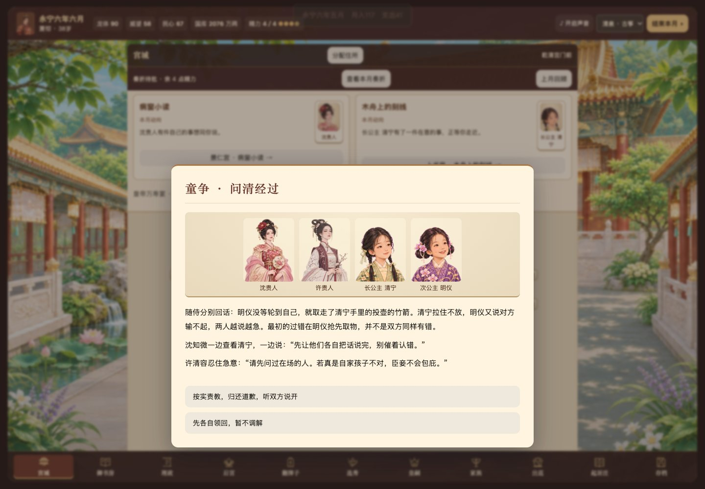
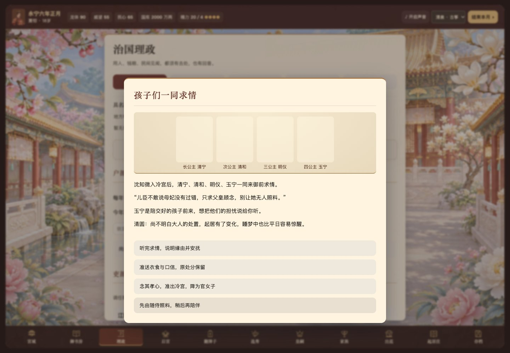
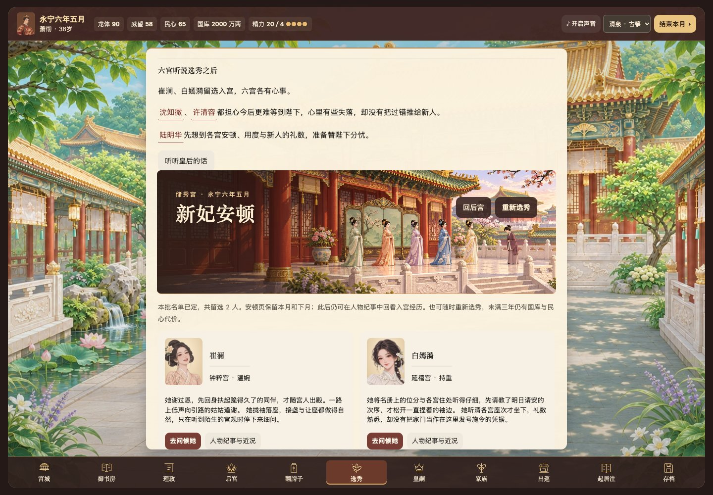
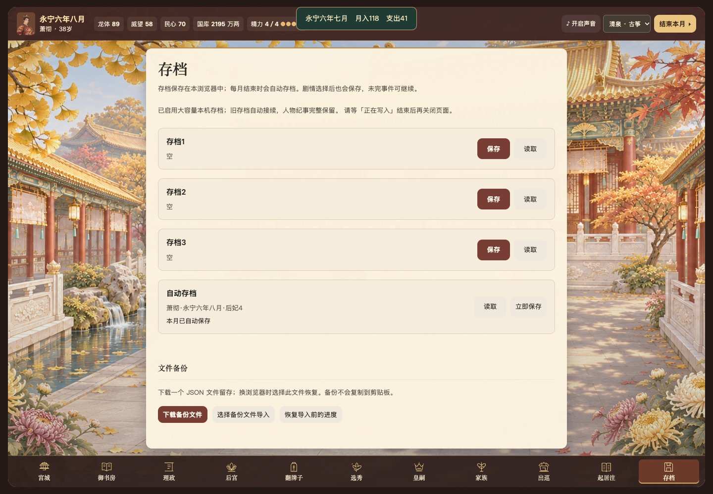
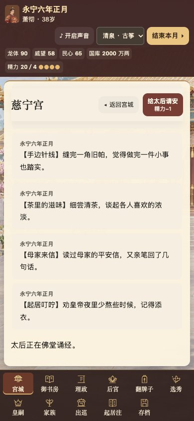

# 家庭日常、慈宁宫与存档验收

范围：内容版本 32。覆盖好友携子同游、童争及两家关系、亲子计划降频、慈宁宫连续请安、求情与选秀议论精简、旧识年龄家世条件、单一官职与月度自动保存。

## 规则与边界

| 内容 | 条件与节奏 |
| --- | --- |
| 御花园携子同游 | 实际交情至少 35，双方没有宿怨或正在疏远；游园基础入口概率 18%，与宫女的 25% 区间分开 |
| 同游主动弹窗 | 有合适家庭时每月 4%；全宫同游至少隔 3 个月、同一对母亲至少隔 8 个月，主动弹窗另隔 6 个月 |
| 童争 | 母亲原本无交集，孩子 4–12 岁、相差不超过 4 岁，孩子尚非亲密朋友；每月 8%，全宫至少隔 8 个月，同一孩子隔 12 个月 |
| 孩子自己的打算 | 合格陪伴后 20% 尝试；同一孩子半年内不重复抽取。成功后全宫至少隔 6 个月、同一母亲 18 个月、同一孩子 24 个月 |
| 亲子计划提醒 | 合格月份 20%，每阶段只自动提醒一次，全宫提醒至少隔半年；人物页主动续接仍保留 |
| 连续请安 | 第二次有不同日常；同月第三次起转为陪伴话题。普通陪伴 12 题，悲恸时 3 题；话题用完后也不紧邻重复 |
| 幼时旧识与世交 | 新生成关系年龄差不超过 5 岁，出身家世值差不超过 20。候选时相识、入宫后投契不使用这一限制 |
| 单一官职 | 各地总督、六部尚书、内阁首辅按实际父亲或官员身份占位；同父姐妹共用一人。致仕、已故者不占在任席位，奉差者仍占位 |

概率均为满足资格及冷却后的入口判定，不是所有月份或所有点击的实测发生比例。正常陪伴仍记入母子关系；同游不会额外强塞一条“孩子自己的打算”。

婴儿由乳母抱着看花，不说成人对白。疾病、产后与小产恢复、新近丧亲、出宫和冷宫会阻止不合适的游园。姨母抚养沿用“姨母”称呼。童争的起因及过错方在事件生成时确定，查问、刷新和选项不重新抽签；偏听、公平调解、分开处理分别影响四位当事人的纪事及关系。

求情弹窗以实际来求情的人及对白为主体，其他孩子同类反应合并姓名。选秀议论只交代一次新人名单，再合并相同反应。每个人的原始心事仍写入个人纪事。

## 兼容与自动保存

新增的四份 v31 未完事件档取自未修改的 `6c89473`：游园、亲子计划、求情、旧识留选。旧版本尚未处理的剧情按原逻辑续接，收束后进入新规则，不改写已经发生的旧交。慈宁宫另覆盖真实 v29 重复请安档：原来已打开的一幕先正常结束，后续请安使用当前对话。

自动保存仍在整个行动及其连带结果结算后写入，避免保存半截转月。自动槽显示实际存储月份、保存成功或未写入状态，并提供立即保存。无法续接的旧事件也会明确提示自动写入暂停，保留原档。存档使用大容量 IndexedDB，只有数据库确认写入后才显示成功；旧存储写满、大文件及跨标签页冲突见 [存档可靠性验收](storage-reliability.md)。

回归验证连续十二个月：每次转月后尚有弹窗时重启，再处理选择，核对月份、事件、结果与去重。另覆盖精力用尽自动转月、写入失败后重试。浏览器通过实际“结束本月”按钮连续转月，并在每个新月份刷新读取自动存档。未取得用户出现漏存问题的原始存档，因此不把合成场景通过当作对该特定存档的复现结论。

## 实测方式

使用真实游戏脚本生成可导入存档，通过浏览器“选择备份文件导入”进入场景。游园使用 `A.out('garden')`，月末同游及童争由 `A.endMonth()` 自然抽中并保留完整行动记录。浏览器只通过按钮作出决定；页面脚本读取状态用于断言，不直接修改游戏状态。

```sh
node --test tests/*.test.cjs
node tests/palace-flow.cjs
node tests/family-garden-browser-fixtures.cjs
node tests/court-rhythm-browser-fixtures.cjs
node tests/family-reactions-browser-fixtures.cjs
node tests/family-garden-browser-acceptance.cjs
node tests/court-rhythm-browser-acceptance.cjs
```

浏览器脚本需要可用的 Playwright 与 Chrome；支持 `PALACE_QA_URL`、`PALACE_CHROME`、`PALACE_SHOTS`、`PALACE_BROWSER_RESULTS`、`PALACE_QA_CASES`。默认测试本地 8428 端口；桌面 1440×1000，手机 390×844。

## 验收结果与截图

本地与正式站均通过家庭、选秀及存档 18 场景，以及慈宁宫、年度标签与迁宫 8 场景，共 26 场景、80 次刷新恢复。正式站报告：[家庭与选秀](family-garden-production-browser-results.json)、[慈宁宫与年序](cining-production-browser-results.json)。2029 项自动测试全部通过，60 个月完整流程通过。

大容量存储另通过桌面／手机共 12 场景、14 次刷新，包括测试版隔离与公开演示隔离。全部正式站验收合计 38 场景、94 次刷新。以下截图取自已部署正式站。

| 好友携子同游 | 查明童争经过 |
| --- | --- |
|  |  |

| 求情只突出来者 | 选秀议论合并 |
| --- | --- |
|  |  |



| 滚动后仍在上方的请安入口 | 第三次请安的陪伴对白 |
| --- | --- |
|  |  |
