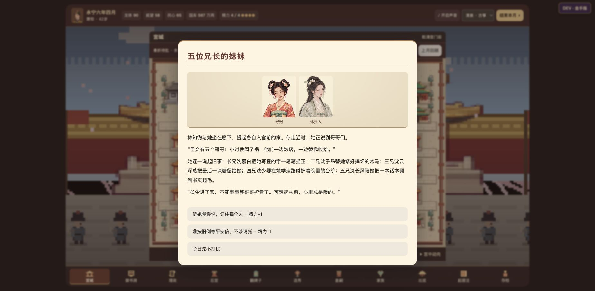
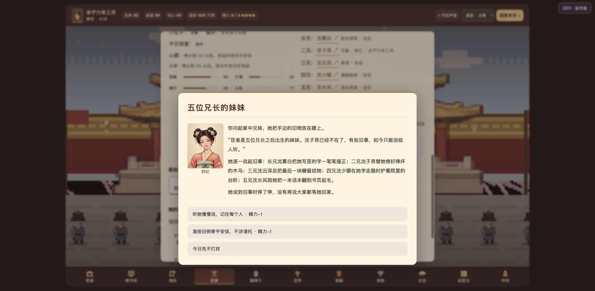

# 宫室与亲族验收（2026-11-14）

- 宫室和换婴版本 `c201742` 已通过 [GitHub Pages 部署](https://github.com/AubreyKuang/Forbidden-City/actions/runs/43548061968)。先前已提交的父兄档案也在本轮重新核对。
- **463 项回归全部通过**，另通过连续 60 个月流程；其中 14 项覆盖家谱人数、兄长独立生死、具名案情、故人诗递补与收尾，以及五兄之妹的对白、家书、人物记忆和读档。
- 在线测试入口实测父亲阵亡档案、兄长召见、家族图标记；实测指定侧殿同住、主位互换、刷新恢复迁居结果，精力只扣一次。
- 实测「迟来的脉案」及早查破、到期抱婴案真相、真实小产日期与宫外生父母；确认早先小产不提供虚构寻亲选项。本轮上述流程未捕获运行错误或警告。
- 浏览器使用演示存档验证指定条件；随机发生频率和自然月推进由回归与流程脚本覆盖。

## 五兄之妹与不同家谱：线上复验

- 更新已合入 [PR #4](https://github.com/AubreyKuang/Forbidden-City/pull/4)，提交 `d53a41d`；[GitHub Pages 部署成功](https://github.com/AubreyKuang/Forbidden-City/actions/runs/43550177954)。正式入口与测试入口均加载了新家世模块，同时保留人物经历延续模块。
- 桌面浏览器实测：沈若棠档案显示「五兄之妹 · 家中行六」，五位哥哥均有姓名和独立入口；温云舒档案明确「无兄长」，家族图与之相符。
- 「听她说起五位兄长」逐一讲出五个人的旧事；选择后精力从 8 到 7，刷新读取自动存档仍为 7，结果和冷却保留。
- 二兄沈子昂可单独召见，信任从 41 到 45，个人履历留下家中近况。阵亡演示档显示其死亡日期、雁门关死因与抚恤入口，其他兄长仍分别在任或外任。
- 用正常月推进生成并导入未完事件（固定随机种子 23），验证林知微与沈若棠在廊下谈家事，以及林知微「想家时来坐坐」的回应。
- 二兄阵亡后的对白改为追忆；平安信列出其余四位在世兄长，不再包含已故二兄。测试入口与正式入口均未捕获运行错误或警告。
- 本轮截图为线上浏览器的真实画面；演示存档用于稳定复现条件，随机生成、年龄、多人家谱、旧档和独立案件由上述 463 项回归覆盖。

