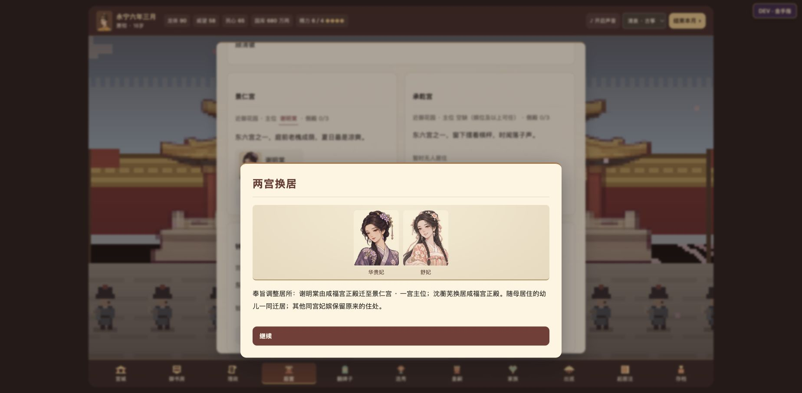

# 宫室与亲族验收（2026-11-14）

- 宫室和换婴版本 `c201742` 已通过 [GitHub Pages 部署](https://github.com/AubreyKuang/Forbidden-City/actions/runs/43548061968)。先前已提交的父兄档案也在本轮重新核对。
- **463 项回归全部通过**，另通过连续 60 个月流程；其中 14 项覆盖家谱人数、兄长独立生死、具名案情、故人诗递补与收尾，以及五兄之妹的对白、家书、人物记忆和读档。
- 在线测试入口实测父亲阵亡档案、兄长召见、家族图标记；实测指定侧殿同住、主位互换、刷新恢复迁居结果，精力只扣一次。
- 实测「迟来的脉案」及早查破、到期抱婴案真相、真实小产日期与宫外生父母；确认早先小产不提供虚构寻亲选项。本轮上述流程未捕获运行错误或警告。
- 浏览器使用演示存档验证指定条件；随机发生频率和自然月推进由回归与流程脚本覆盖。

