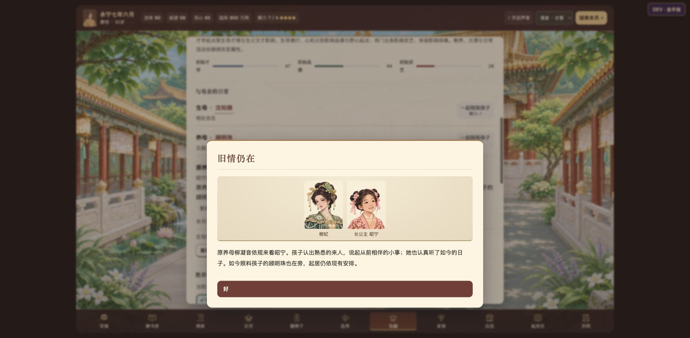
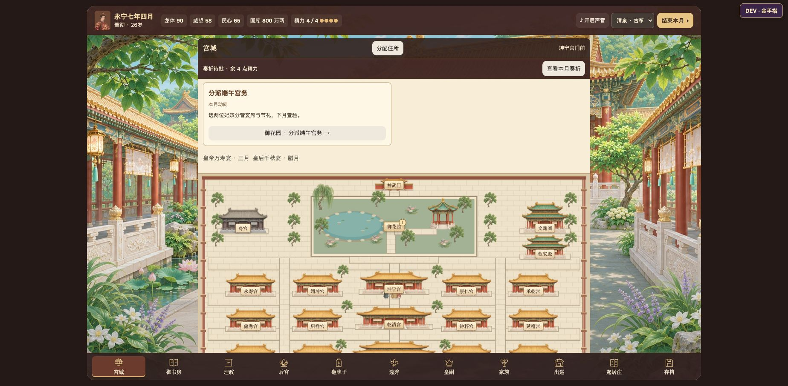

# 亲缘场景验证补记

本页补记合并于 `ddd8b82`（PR #28）的上一轮亲缘功能验证，与后续内廷人数限制分别记录。

## 已完成的线上交互

- 探望皇嗣时出现生母与养母共同在场；刷新读取自动档后继续同一场景，选择陪伴后参与母亲与孩子分别留下纪事。
- 将由柳凝音照护三年的昭宁改交顾明珠后，原养母仍能来探望；顾明珠保持现任养母，旧照护时间与情分保留，可暂停原养母探视。
- 姐妹探亲后留为常在，两人分别记下入宫、分宠与亲情的不同感受。
- 孤高者的侍寝回应与纪事相符；多个交往圈和无派系者在后宫列表下部显示。
- 宫城首页直接显示本月活动，原有常平仓事务另行展开。

以下两张为当时线上测试页使用演示存档拍摄，本轮只补入文档。

## 自动回归与范围

相关定向回归位于 `tests/palace-family-scenes.test.cjs`，覆盖共同探望、原养母关系、姐妹纪事、多派系、性格夜话、贵人以上才能主动请养，以及旧版本待办场景兼容。本轮全量 862 项测试也再次通过；浏览器记录仅对应上列亲缘场景，不代替新功能验收。
