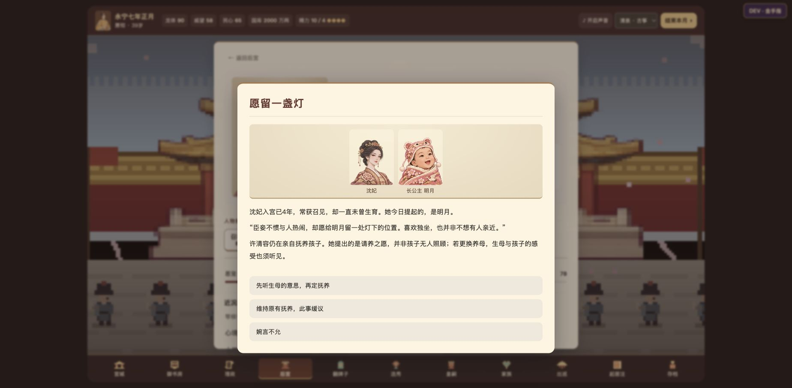
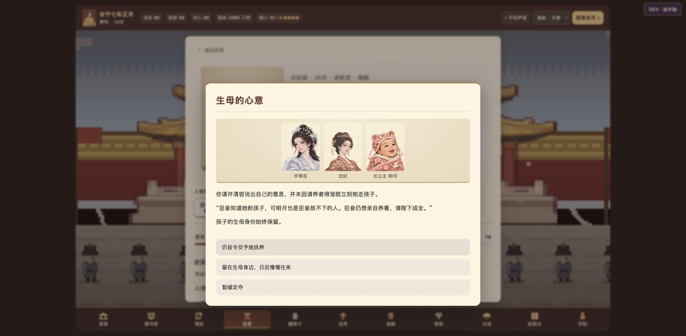

# 请养心愿与个人受孕差异验证

实现版本：[4afcc49](https://github.com/AubreyKuang/Forbidden-City/commit/4afcc49d4d9a583b2b6c86bea2bd61ba72389356)，合并于 [PR #14](https://github.com/AubreyKuang/Forbidden-City/pull/14)。验证日期：2026-11-15。

## 自动检查

- 功能发布时 27 个测试文件，共 **593 项用例通过**；连续 **60 个月**游戏流程通过。随后整合同期 [PR #15](https://github.com/AubreyKuang/Forbidden-City/pull/15) 的皇嗣成长立绘，完整回归共 **594 项通过**。
- 新增 `tests/palace-foster-fertility.test.cjs` 的 14 项检查：个体差异、固定存档、旧档补全与读取不消耗随机数；年龄与健康、孕期与产后恢复；真实召幸结算；年轻得宠者的等待年限与召见次数；原生母位分、储君、现有养母和缺席条件；候选事件只读；生母拒绝、协商同意、强制转养；未决与已决事件读档；孤高者的母子文字。
- 个体基准约 5%–33%，再由年龄、健康、体弱性情及皇帝状态等修正；这是每次实际召幸的游戏概率，不是现实医学数据。人物信息查看、赏赐、升位或读档不会重抽个人基准。
- 年轻请养路径要求至少 20 岁、贵人以上、入宫至少 24 个月、恩宠至少 70、累计召见至少 8 次，且未生育、没有在世亲生或抚养的孩子。原有年长无子路径保留。请求仍有全宫、个人与孩子的间隔，不会连续反复争同一个孩子。
- 请求遵循现存照护与双方位分，不以受孕概率低就断言不能生育。生母同意须有真实照护压力与对请养者的信任，不因对方得宠便自动同意。

## 线上浏览器

GitHub Pages 工作流 **43664327134** 成功后，在[测试入口](https://aubreykuang.github.io/Forbidden-City/dev.html)通过真实文件选择器导入测试场景，随后点击界面。测试存档使用固定年龄与关系，便于检查分支，不代表自然触发频率。

| 场景 | 实际观察 |
|---|---|
| 年轻得宠请养 | 二十六岁的沈知微入宫四年、恩宠 85、侍寝 12 次而未育，提出请养两岁的明月；孤高对白为“喜欢独坐，也并非不想有人亲近”，明确说明生母仍在养育 |
| 生母拒绝 | 选择先听生母，许清容说仍想亲自养着；沈知微的人物纪事出现「生母回应」。此时刷新、读取自动档，仍回到同一商议与三个选项 |
| 维持原安排 | 选择让孩子留在生母身边，结果与纪事明确保留原抚养，没有偷偷创建养母 |
| 协商同意 | 在双方信任、许清容健康欠佳的独立场景，生母愿意商议并要求探望；选择按议安排后，刷新读取仍显示原结果，没有再次增加情分或重复抱养 |
| 孩子详情 | 明月显示生母许清容、养母沈知微，随养母生活；「准许平日探望」处于选中状态。人物纪事保留协商安排与亲生身份，原生母和养母分别有日常关系 |

上述新场景浏览器日志无警告或脚本错误。受孕概率的数值与实际结算由自动测试验证；浏览器验证集中在请养、母亲回应与刷新恢复，未以一次随机结果声称验证概率分布。

## 实机截图

