# 贺行简 · 实机试玩记录

东厂首捕贺行简的新版立绘、初遇和两件专案，均截自《宸宫纪》正式站。下文含专案结局。

[进入《宸宫纪》](../../../) · [人物设定 Issue #36](https://github.com/AubreyKuang/Forbidden-City/issues/36)

## 新版立绘

玄色飞鱼服，暗金飞鱼纹，绣春刀入鞘。立绘沿用原来的脸和姿态，腰间保留束带。

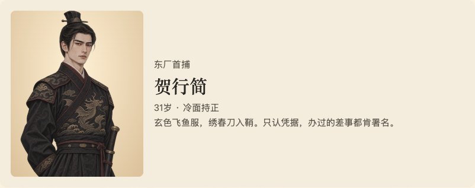

## 初遇 · 东厂附札

在锦衣卫巡察、旧案密查或御前奏折里选「阅东厂附札 · 见首捕」。贺行简呈上两份勘单，指出案中扣错了人，并亲自署名。

| 选择 | 游戏结果 |
| --- | --- |
| 收下原卷，准他听候差遣 | 贺行简进入风华人物志，锦衣卫解锁东厂专案。 |
| 先存附札，改日再召 | 附札入卷，半年后可以另行召见。 |

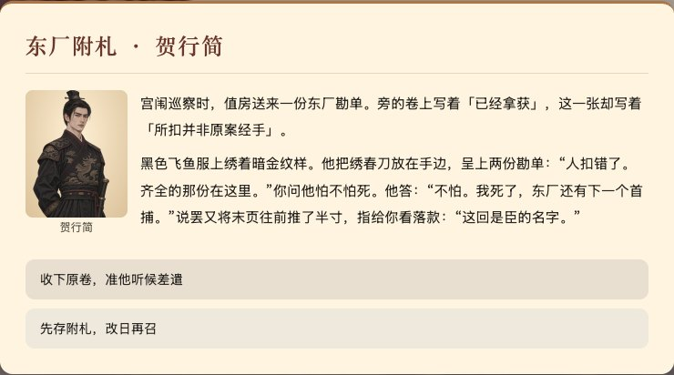

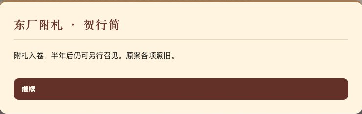

## 第一案 · 借牌的人

一车灯油失了踪，巡夜小校被指冒领。可暂缓交办，也可消耗 1 点精力派贺行简核查，**一月回奏**。回奏中，他对上领油簿和押送记录，查明原簿上的名字是后添的。

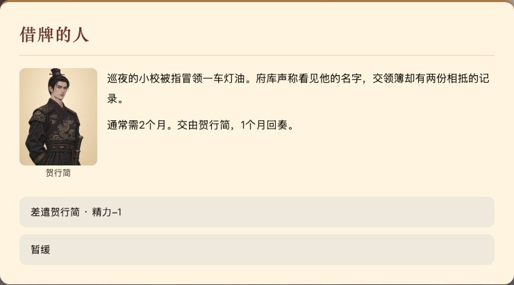

| 回奏后的选择 | 游戏结果 |
| --- | --- |
| 为小校销去原嫌，再移送有司 | 小校的名字从待查名单删去，原簿和证言随案移交。 |
| 按案卷一并请刑部复核 | 材料一并送审，先知会小校可以回去当值。 |

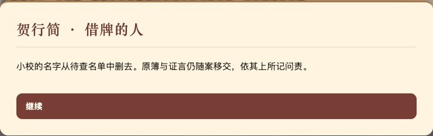

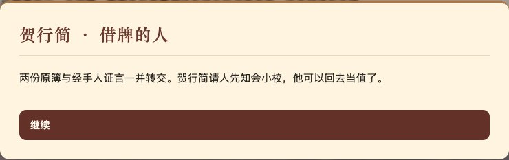

## 第二案 · 封底的签名

前案交出的旧簿里，还有人以已故书吏的名字支银。可暂缓交办，也可消耗 1 点精力派贺行简核查，**两月回奏**。他查到自己的旧上司，也把自己曾漏查一页的旧回报原样呈上。

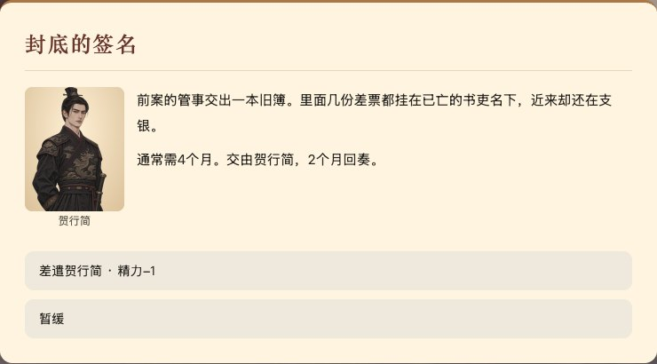

| 回奏后的选择 | 游戏结果 |
| --- | --- |
| 原卷附上旧回报，两件事都如实记明 | 贺行简在更正簿上署名，旧案与漏查之事分别交有司。 |
| 先查还死者家人名声，原卷照送 | 已故书吏洗清嫌名，贺行简把自己的旧回报一并交还。 |

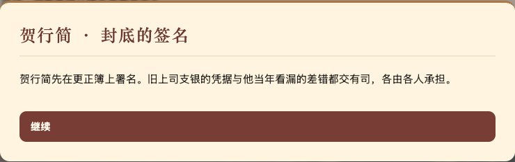

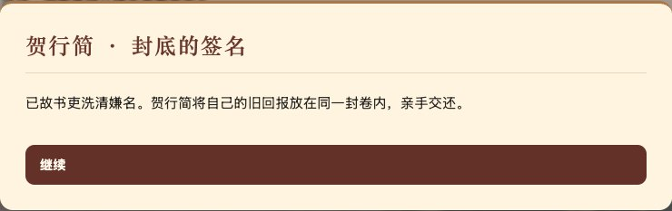

## 旧案复命

已有的锦衣卫旧案也可以交给贺行简。「香囊疑案」在当月查得原案记录的主使。实测了「传主使问话」和「记下真相，暂不声张」，分别接入原案问话和封存结果。

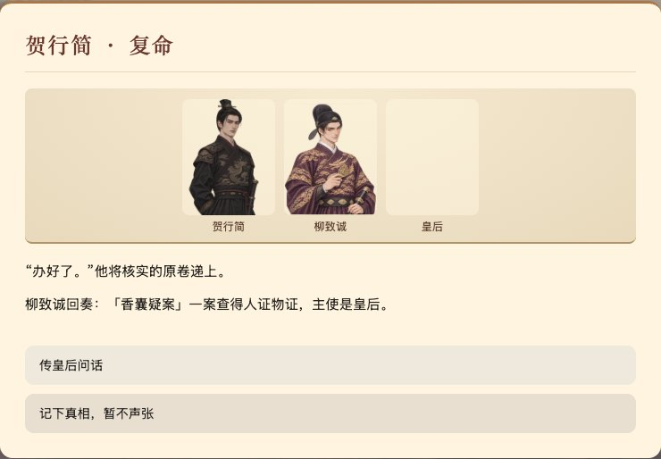

## 验证范围

用隔离存档分别进入初遇、交办和到期回奏，在正式站点实际选择并核对结果。桌面通过 16 条选择路径，覆盖三个初遇入口、两件专案全部选项和旧案的两种处理。手机通过 10 条，覆盖巡察初遇的两个选项与两件专案的全部选项。

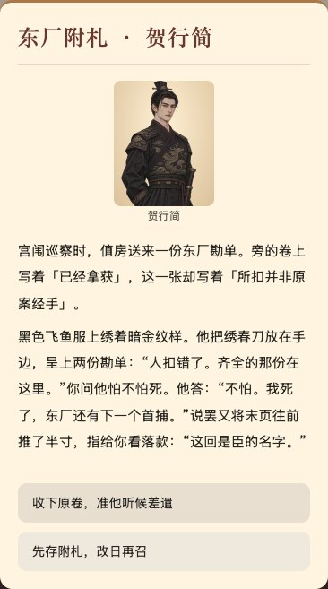
