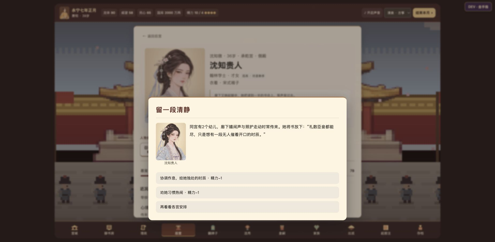
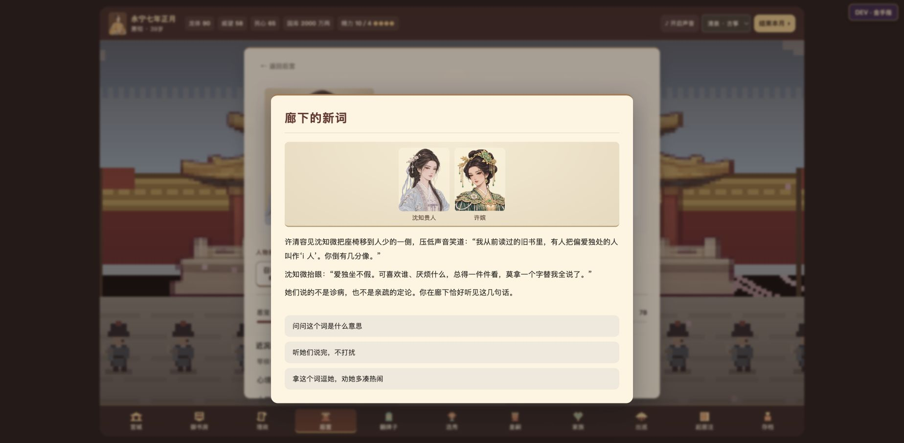
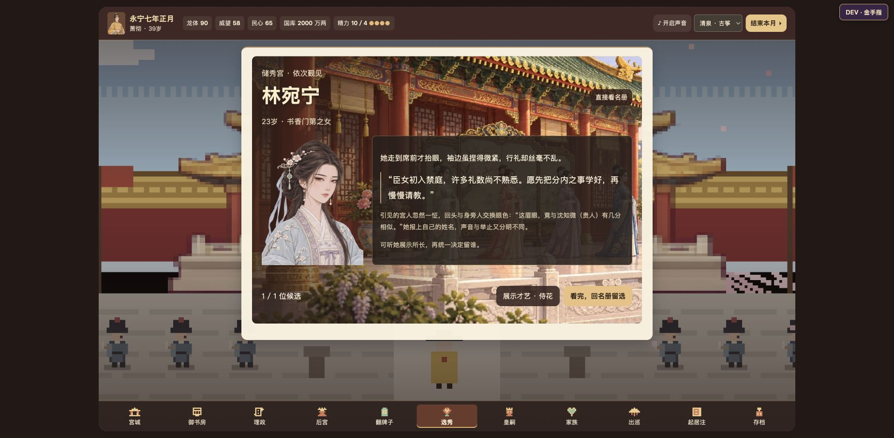
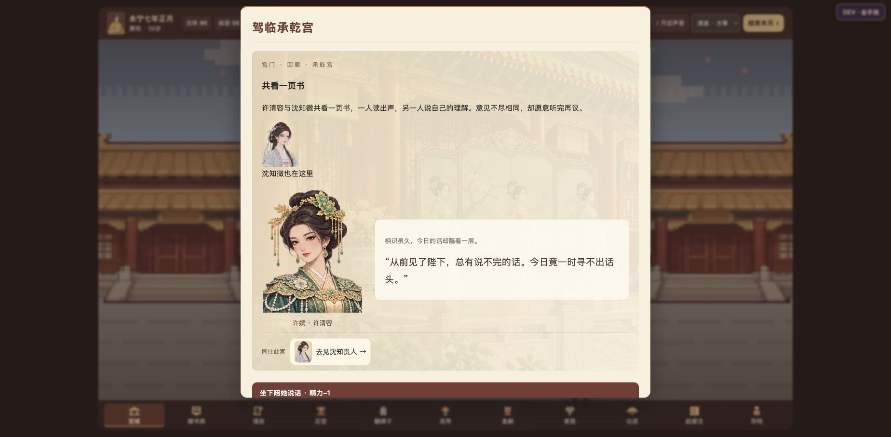

# 居处、外家与人物纪事验证

实现版本：[9274946](https://github.com/AubreyKuang/Forbidden-City/commit/92749469d0d7b0e431d717800fc0dba875cd7a02)，合并于 [PR #12](https://github.com/AubreyKuang/Forbidden-City/pull/12)。验证日期：2026-11-15。功能条件见[个人经历图鉴](../character-experiences/README.md)。

## 自动回归

```sh
node --test tests/*.test.cjs
node tests/palace-flow.cjs
node tests/character-journeys-fixtures.cjs /tmp/palace-character-fixtures
```

- 26 个测试文件中的 **579 项用例通过**，连续 **60 个月**流程通过。包含同期合入的 **142 张妃嫔立绘**及其编号检查。
- `palace-home-family.test.cjs` 的 29 项检查覆盖母亲病讯、省亲归来、朋友闲谈、父兄差事、同宫关系、迁居与容量、人物纪事。
- `palace-household-personality.test.cjs` 的 14 项检查覆盖孤高者的居处压力、清静安排、穿越者新词、实际立绘肖似、候选人渲染不改状态、冷宫与丧亲限制、事件恢复和防重复。
- 多人同宫、实际照护的幼儿与人物出席决定清静压力；孩子离世、母子分离、家中病讯等未解处境优先，不被热闹日常覆盖。孤高者不会仅因同住自动成为好友，也不会仅因孩子吵闹自动结仇。
- “i 人”事件要求真正的穿越者与孤高者同宫，双方实际可出场；有冷却间隔，不公开尚未揭晓的穿越身份。
- 肖似依据实际使用的成年妃嫔立绘编号；参照位分、入宫先后与故人身份。亲姐妹、当朝亡故者、先朝故人分别处理，亡者不被写成正在出场。
- 冷宫回归修复检查：读档不重新生成同一次皇嗣失势的起始月份；月度状态与实际行动完成时同步。

## 线上浏览器验证

GitHub Pages 工作流 **43662688295** 成功后，在[测试入口](https://aubreykuang.github.io/Forbidden-City/dev.html)通过「存档 → 选择备份文件导入」载入场景，再点击真实界面。测试入口与正式存档隔离。场景固定年龄、同宫关系及资源，用于检查分支，不代表自然触发频率。

| 场景 | 实际操作与观察 |
|---|---|
| 清静被扰 | 人物页显示同宫两个幼儿的具体缘由、心声与纪事；未选择时刷新读档，仍恢复「留一段清静」请求 |
| 协调作息 | 选择留出独处时辰，精力 10 → 9，心境变为「释然」；照护孩子仍保留。结果页刷新读档后精力仍为 9，纪事保留，不重复结算 |
| 迁宫之请 | 从清静请求进入宫室页，看到 12 个主位、36 处侧殿与待安置人数；回人物页听迁居请求，理由明确为同宫两个幼儿，准许后由承乾宫侧殿迁往钟粹宫侧殿，并记录搬离后的舒缓 |
| 廊下的新词 | 实际显示孤高者与穿越者两人的立绘；询问“i 人”的意思后，分别打开两人详情，都有本次对话及回应，孤高者保留自己的判断 |
| 选秀肖似 | 林宛宁觐见时，宫人惊讶其眉眼与沈知微相似，同时指出声音与举止不同 |
| 肖似之议 | 贵人被与更高位的嫔作比；选择唤她本名、制止混称后，人物纪事保留议论、她的反应和皇帝的回应 |
| 家书未至 | 已派太医仍显示「忧心」与等候回音；病母入宫按钮禁用并说明替代途径。听她说完后留下纪事，不把一次陪伴写成病愈 |
| 归家闲话 | 省亲归来者与好友谈一顿家常饭，好友既为她高兴又想家；询问好友牵挂后，回应接在原纪事上方 |
| 外臣回奏 | 父亲沈怀瑾的「核查地方钱粮」失利，女儿先忧心；责令说明疏漏后变为惶恐，纪事明确写出父亲姓名、差事和追责缘由 |
| 地图同宫偶遇 | 从宫城点击承乾宫，迎驾页显示许清容与沈知微「共看一页书」；可听她们说家常并消耗一次精力，活动与回应留在人物纪事里 |
| 名册直接拜访 | 从后宫名单点沈知微直接进入人物详情，没有额外迎驾弹窗；仍可翻到刚才同宫看书的记录 |

以上场景操作后的浏览器日志未发现警告或脚本错误。自动回归覆盖更广分支；未将自动检查计作逐条浏览器手动覆盖。

## 实机画面

### 留一段清静



### 廊下的新词



### 选秀时的相似眉眼



### 同宫偶遇


