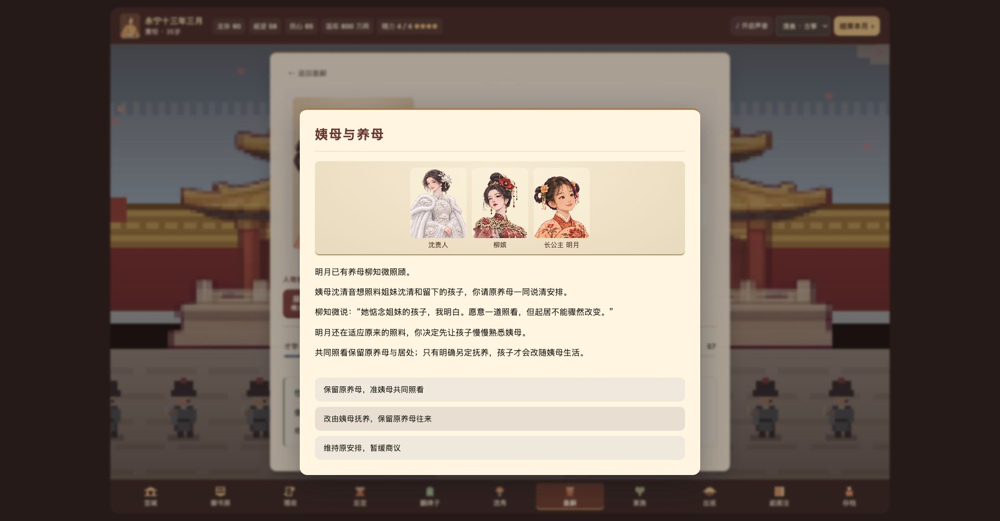
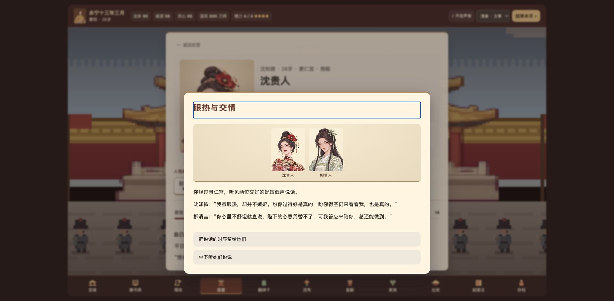
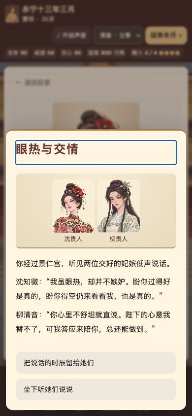

# 亲缘后续与好友谈心验证

验证版本：本报告所在提交。2026-11-15。

## 自动回归

- Node.js 22：`node --test tests/*.test.cjs`，731 项全部通过。
- `node tests/palace-flow.cjs`：连续 60 个月，存读档、家族与人物流程通过。
- `tests/palace-maternal-kin-followup.test.cjs`：12 项覆盖实际姐姐身份、晚年病逝、母亲长期出宫、十五岁孩子、已有养母、混合安置的同胞、暂缓与婉拒、直接改养和共同照看、原养母暂时省亲、称呼、三阶段冷启动读档。
- `tests/palace-friendship-dialogues.test.cjs`：8 项覆盖三种恩宠境遇、善妒性格、双方记事、前后境遇变化、出席限制、过期选择、冷却和重启。
- 旧的生产请养、太后母家、亲姐妹和堂姐妹测试继续通过。普通无子妃嫔的请养规则不因此放宽。

### 确定后续与随机事件的边界

宫中已有合适姨母时，失去生母照护的在宫孩子可在月末接上主动照料请求。生母已故或长期出宫、孩子未满十八岁且仍在宫中、家谱中有成年未婚且愿意入宫的真实姐妹时，姐妹来书列入必要后续，不参加可选事件抽签。已有养母不影响该资格。

并非每个家族都有这样的人；不会强行纳入未成年、已婚、不愿入宫、已故或已经入宫的亲属。暂缓与拒绝不会反复自动弹窗，暂缓可从档案继续。一般家门续缘仍为随机事件；已有具体姐妹后续时不会另生一封冲突的随机邀请。

## 两局自然推进

使用 `PALACE_MODES=relationships,lives PALACE_SEEDS=202 PALACE_MONTHS=60` 执行性格与记事审计。

| 玩法 | 月份 | 选择 | 月末事件 | 运行错误 | 性格被意外改写 |
|---|---:|---:|---:|---:|---:|
| 人际关系 | 60 | 340 | 122 | 0 | 0 |
| 人物生活 | 60 | 307 | 132 | 0 | 0 |

自然推进共遇到 7 次好友谈话（一冷一热或共同冷落），双方均有实际记事，无目标事件漏记。都得宠的分支由定向测试覆盖。两局未自然遇到符合条件的姨母入宫，亲缘流程使用可复现状态与实际浏览器操作验证，不把定向测试冒充自然触发。

审计另列出 24 个既有流程的漏记候选，集中于灾情背景人物、宴会分派和明确暂缓的人物计划，不能直接视作 24 个实际事件漏记。本次目标事件没有这些候选。摘要与目标谈话原文见 [试玩记录](kin-friendship-matches.json)。

## 页面试玩

由 `tests/kin-friendship-browser-fixture.cjs` 生成隔离的本地页面，完成后删除生成的 HTML，不发布测试存档。

1. 九岁明月已有养母柳知微，生母沈清和后来病逝。实际家谱里的三十五岁姐姐沈清音来书，保留姓名、年龄、立绘与父系。
2. 准入后，第一次问安明确提及妹妹和明月；原养母仍为柳知微。打开「姨母与养母」，可听见养母自己的回应。
3. 在商议中刷新页面，读取自动存档，准确恢复同一场商议。
4. 选择共同照看，明月仍随原养母，新增姨母陪伴入口。点击「陪明月一会儿」，发生读书与家中旧事的实际场景，孩子、姨母、养母都留下记事。
5. 温婉的沈知微冷落、爽直的柳清音得宠：两人分别表达羡慕与陪伴，完成后人物页与记事都能看到说过的话。
6. 390 × 844 手机视口下对白与按钮完整，页面无横向溢出；两个测试页均未出现控制台错误。

