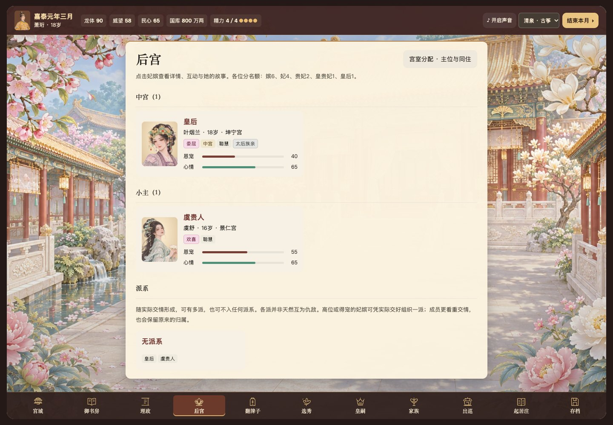
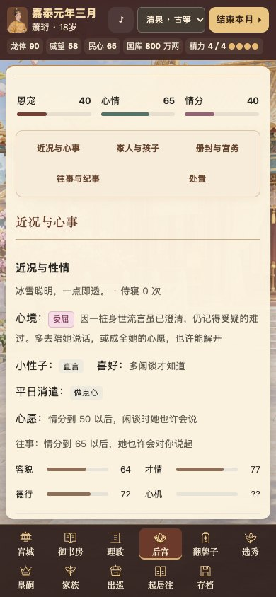

# 心境标签显示验收

2026-11-16。仅调整展示样式，不改变心境、性格、属性、事件概率或存档玩法版本。

- 后宫名册：委屈、欢喜均显示粉色 `rgb(245, 220, 231)`，文字 `rgb(133, 67, 94)`。
- 人物详情：同样使用粉色，保留心境起因及持续时间。平和在详情中也使用同一配色，名册仍不额外展示平和。
- 太后族亲保持灰色，中宫等既有黄色标签保持原色。
- 独立 Chrome 环境，桌面 1440 × 1000、手机 390 × 844 实测；刷新后读取自动存档，再进入人物页，委屈心境与粉色显示均保留。
- 浏览器没有页面异常。个人谈话、昭雪心境、人物性情和家族显示的 50 项现有回归测试通过。

| 后宫名册 | 手机详情 |
| --- | --- |
|  |  |

黄色特质标签尚处于候选阶段，见[系列、属性门槛与抽样统计](../design/consort-tags.md)。
