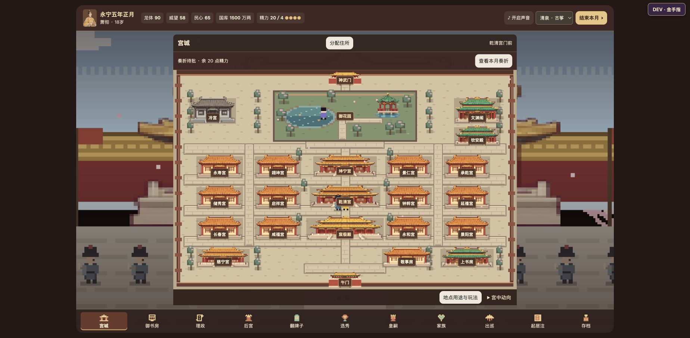
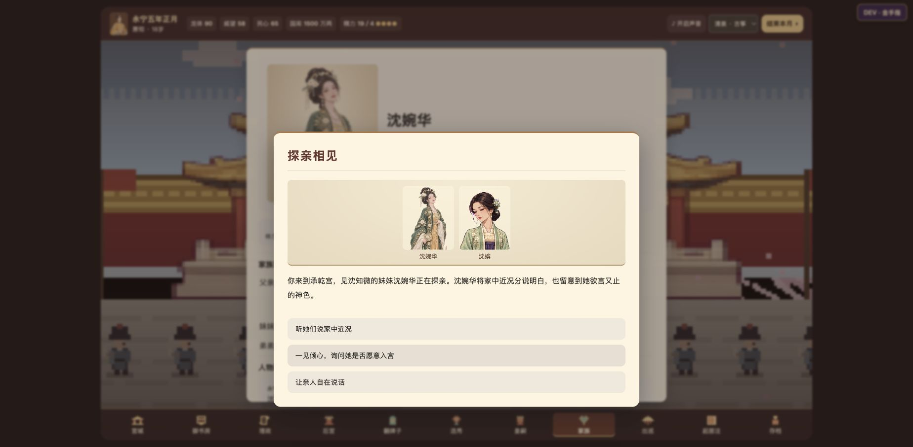
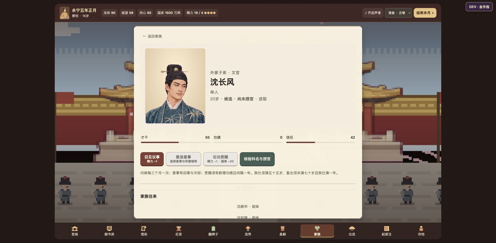
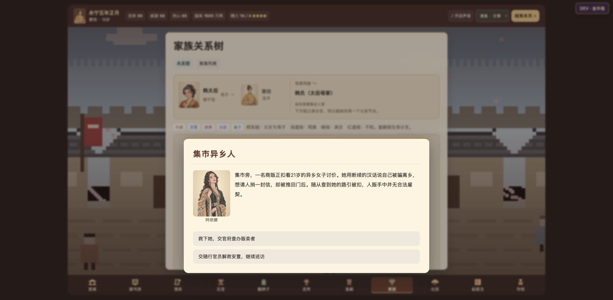
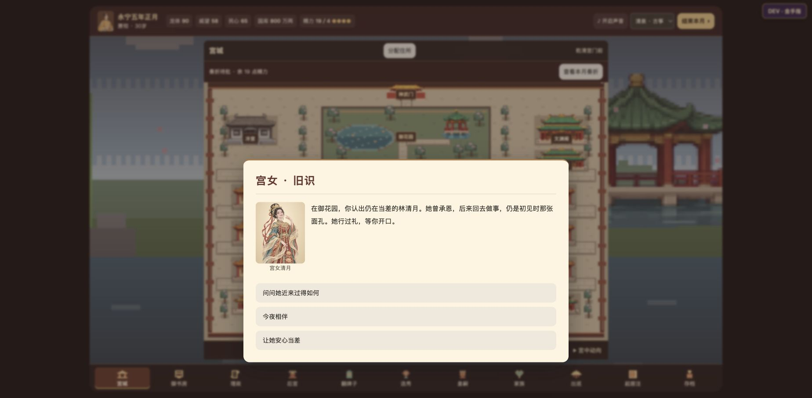
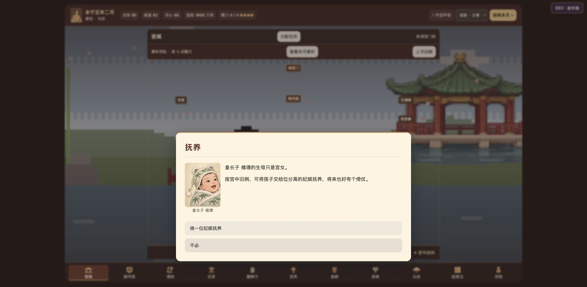

# 娘家亲属、宫女后续与住所入口验证

主体功能合并于 [PR #17](https://github.com/AubreyKuang/Forbidden-City/pull/17)，版本 [e2f1918](https://github.com/AubreyKuang/Forbidden-City/commit/e2f1918028cad02de16c30115338e64582923d47)。GitHub Pages 工作流 **43669542650** 成功后，在 `dev.html` 独立存档空间中进行实际操作；正式入口与测试入口共用游戏模块。

## 自动检查

- 29 个测试文件完整回归，共 **659 项通过**，包含亲属旧链接衔接与太后称谓回归。连续 **60 个月**流程通过。
- 整合同时发布的 [5db9081](https://github.com/AubreyKuang/Forbidden-City/commit/5db90819f0b5307b2200badf93a759b3f359586d) 人物打算、作品与母亲纪事后，重新执行 **32 个文件、703 项检查全部通过**，连续 **60 个月**流程再次通过；保留双方页面入口与脚本。
- `palace-natal-family.test.cjs` 共 26 项，覆盖真实家谱人数、整数年龄、家中添丁条件、共享家谱读档、探亲返家、未成年与已婚限制、本人拒绝与同意、身份衔接、堂姐妹反应和已故姐妹分支隔离。
- 科名与官职分开；无真实合格亲人不触发求官，已有官职旧档保留，授官前不承接差事。撤牌后所有召幸路径共用限制。体弱者受孕概率较低但仍可能生育，病重请养先调养，不能越过当前照护安排。
- 旧版虚构的「早夭弟弟」心愿有定向迁移，不删除真实亲人死亡记录。异乡女子使用对应图库；宫女承恩与册封保留原立绘，未留在身边者不另列后宫栏位；有孕可暂缓册封，生产后可选择或婉拒另定养母。
- Node 18 的多文件 `--test` 报告器在中文用例输出上发生解析错误，因此采用逐文件直接执行 Node，并核对每份用例的通过数与退出状态；不是把报告器错误当作通过。

## 线上浏览器实际操作

通过游戏的「存档 → 选择备份文件导入」载入固定人物场景，再点击真实界面。场景用于稳定复现分支，不代表自然发生频率；主要场景可由 `node tests/natal-browser-fixtures.cjs` 生成。

| 场景 | 观察到的行为 |
|---|---|
| 宫城分配住所 | 首页顶部「分配住所」进入宫室安排，显示主位 12 席与侧殿 36 席。为沈知微选择承乾宫主位，确认后扣一点精力，由景仁宫迁入承乾宫；之后的探亲地点也是承乾宫 |
| 无兄长家谱 | 沈知微家谱显示父亲沈守义、妹妹沈婉华、弟弟沈长风，没有「无兄长」占位。点击妹妹打开个人页，显示 22 岁、聪慧、家族与纪事 |
| 探亲与入宫 | 从妹妹个人页准许探亲，显示约两个月后归家；见面后可询问是否愿意入宫。刷新、读取自动档仍停在同一「留宫之意」选择；纳为常在后保留姓名、年龄、立绘、亲姐姐关系与探亲记录 |
| 撤下绿头牌 | 沈婉华人物操作中撤牌后，召幸按钮禁用并注明「绿头牌已撤」，纪事新增撤牌记录；敬事房只剩另一位妃嫔的牌子 |
| 弟弟中举与授官 | 沈长风个人页先显示「举人」「候选 · 尚未授官」，委派差事禁用；核验科名后明确授候补知县，页面改为官职、在任并开放差事，履历记录授官 |
| 病中请养 | 病重的沈知微提出想抚养明月，医者要求先调养；选择保留心愿后，结果明确乳母仍按原安排照看，未更换养母 |
| 异乡女子 | 市集救助事件中的阿依娜使用异域立绘；解救安置分支正常结束 |
| 宫女旧识 | 御花园认出仍在当差的林清月，对话明确曾承恩并保留原面孔；让她安心当差后，后宫列表只有正常妃嫔，没有「承恩宫女」栏目 |
| 宫女喜脉 | 月末报出两月身孕，选择「先安心养胎，产后再议身份与抚养」，结果明确免去劳作、医者照料、保留原身份 |
| 宫女生产与养母 | 生产后赐名维璟，再选择挑养母；月末其他事件结束后，养母名单正常接续。选择沈知微后，皇嗣列表同时显示生母林清月与养母沈知微 |
| 久候心境 | 沈知微说出入宫三年尚未侍寝、担心被遗忘的心事；留下陪她说话后，人物纪事同时记录原话与安抚，没有增加侍寝次数 |
| 太后劝谏 | 太后针对偏宠的许清容劝少些独往，推荐自己母家的沈知微；接受或保留己见均有明确选择 |

上述场景的浏览器日志没有警告或脚本错误。

浏览器检查另发现初代太后头像缺少称谓，已补充专用的太后称谓，并验证传代后仍保留原立绘。偏宠劝谏只呈现正在说话的太后，被谈及的妃嫔不再误作在场人物。

## 实机截图

