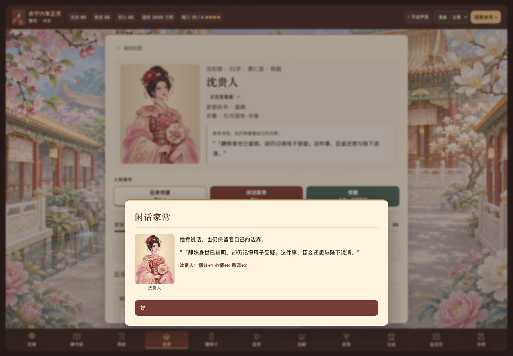
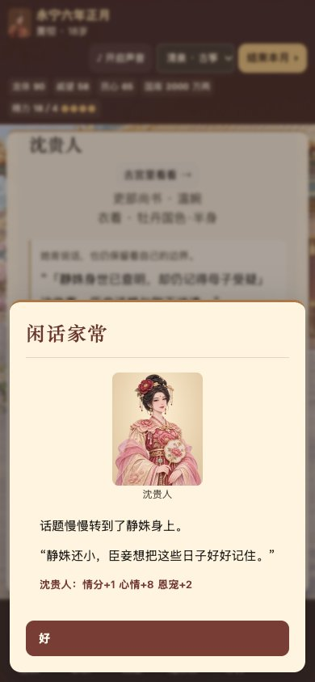

# 后宫相处与分层闲话验收

## 规则

- 醋海生波：从当月及前两个月确有闲话、侍寝或迎驾记录的人中选择受宠者；仅打开档案不算探访。皇后与其他妃嫔使用相同规则，离宫、冷宫、暂离等状态不参与。文案不把一次见面说成频繁探访，回应纪事保留具体对象。
- 相伴有凭：至少三次实际侍寝，或两次有记录的长期共同相处，才符合旧情经历要求；随机生成的高情分不作依据。最终翻旧物还须有前章亲手完成或尊重她完成信物的记录。同人章节至少隔六个月，不同人同类章节至少隔十八个月，最终许诺场景全宫至少隔二十四个月。完成后不再重复。
- 闲话家常：每月第一次普通闲话、或新心事发生后，先谈心境；后续每次只选择一个有事实依据的主题。孩子、关系、心愿优先按层次出现，也会概率穿插其他话题。未谈的话题不提前解锁喜好、心愿或往事，也不提前写入相关记忆。新月份先问心情，再继续尚未谈到的话题。
- 心境安抚只在谈心境时判定。未化解的具体心结与新近丧亲不会因换话题而被消除。
- 新动作使用内容版本 26；真实版本 25 的未完事件保留原先随机结果和选择，完成后再启用新规则。

## 自动验证

`node --test tests/*.test.cjs`：**1733 / 1733 通过**。

其中 `tests/palace-personal-talk.test.cjs` 的 19 个用例覆盖近期受宠对象、无有效探访、不可在场的人、旧情证据与节奏、心境及话题分段、刷新续聊和三个真实旧版本未完事件。

`tests/fixtures/{jealous,love,chat}-legacy-v25.json` 均由未修改的版本 25 游戏脚本执行实际操作生成，没有改写版本号伪装旧档。

## 浏览器验证

Chrome，桌面 1440×1000、手机 390×844，共 **6 个场景通过，17 次刷新读档一致，无页面异常**。完整记录见 [personal-talk-browser-results.json](personal-talk-browser-results.json)。

| 场景 | 结果 |
| --- | --- |
| 心境 → 后续闲话 | 首次只谈身世获澄清后的委屈；后续分别谈孩子、交好妃嫔、心愿，允许概率穿插其他主题；每次精力只扣一次，刷新保留进度 |
| 近期受宠者 | 历史宠爱最高却久未探访的皇后没有成为对象；对白谈沈贵人，安抚后人物纪事保留沈知微姓名 |
| 有凭据的旧情 | 曾有三次相处、完成过并蒂花笺的妃嫔提出旧情约定；回应与同心结局刷新后保留 |




复现：启动仓库静态服务器，再运行：

```sh
node tests/personal-talk-browser-fixtures.cjs
NODE_PATH=/path/to/playwright/node_modules node tests/personal-talk-browser-acceptance.cjs
```

浏览器使用独立临时上下文，从存档界面导入 VM 生成的测试存档，所有游戏操作通过真实按钮完成。`PALACE_QA_URL`、`PALACE_CHROME`、`PALACE_SHOTS`、`PALACE_BROWSER_RESULTS` 可覆盖默认地址、浏览器和证据路径。
