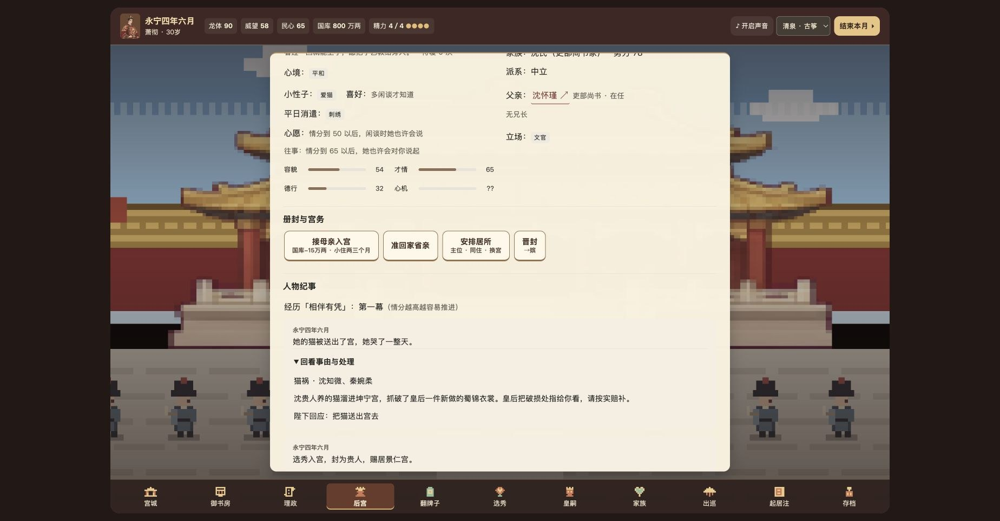

# 随机事件、性格与人物纪事验收

验收日期：2026-11-15。自然局基于 `0047ffa`，保留生育倾向、请养与成长立绘等同期内容；最终再整合 `c547a60` 的公主成长图集并执行全量回归。

目标：事件为什么由这个人触发、她怎样回应、事后能否从相关人物的纪事复盘。先随机试玩找问题，再覆盖具体分支；没有把「脚本没报错」当作所有对白都自然的证明。

## 验证范围

- 全量回归 **633/633 通过**，其中人物纪事专项 39 项。
- **19 种主性格 × 18 类小性子事件**，在满足条件的测试世界中逐一执行可用选项，共 **741 次选项分支**；检查当事人、选择记录、性格与小性子不被意外改写。另覆盖全部 10 类心境事件的回应。
- 六十个月完整流程通过，包含存读档、家庭记忆、历史场景、宫城与后续故事。
- 自然试玩使用 balanced、affection、explorer、skip、random、relationships 六种策略，各用 101、202、303、404 四个固定种子，每局上限 120 个月，正常结束的局不强行延续。

主样本共 **2,781 个游戏月、14,668 次事件选择**，其中 **9,747 次含处理逻辑的选择**，出现 **288 个不同标题**；无运行异常，无主性格或小性子意外变化。月末触发 5,645 个事件，平均每月约 **2.03 个**；24 个月没有月末事件。单局最终状态 JSON 最大约 **734 KiB**（未含浏览器多个存档槽，不能据此推断无限长局容量）。

人工复核 221 个漏记候选：

| 分类 | 次数 |
|---|---:|
| 背景或未选中的候选人物 | 122 |
| 进入调查、命名、宫室或抚养的下一步，尚未完成决定 | 65 |
| 实际漏记：首次奏折使用已注册旧函数，已修正并复跑 | 18 |
| 推迟后话，未执行新的结果 | 9 |
| 未实行交换的另一位住民；请求者已有记录 | 5 |
| 亡故或冷宫中的旧人仅为家书背景；新入宫者在其本人纪事登记 | 2 |

最后的弹劾入口修正没有改变随机抽取或数值结算。受影响的 explorer、random 两种策略共 **8 局重新完整试玩**：954 个月、6,015 次选择，36 次弹劾处理均有当事人纪事，漏记为 0，也没有运行异常或性格改写。18 个原漏记全部由同种子复跑覆盖。复跑与主样本分列，不重复计入 24 局总数。

逐局统计见 [personality-memory-matches.json](personality-memory-matches.json)。记录包含实际事件与选择，不把补出来的演示场景计入随机局；同时保留带 `hasEffect` 的实际处理数，避免把「知道了」等确认阅读按钮当作决策。

## 发现与处理

| 问题 | 现在的行为 | 验证 |
|---|---|---|
| 猫抓坏衣服时，不同对手都套用哭闹；送走猫还会把「爱猫」改成「念旧」 | 持重、沉静等人物按损伤请求赔补；爱哭者可红眼圈。送走的是猫，爱猫性子保留，缺猫时不再触发猫祸；实际重新赠猫后才恢复 | 19 × 18 矩阵、送猫与再赠猫分支、浏览器双方纪事 |
| 对弈的另一人无论性格都纠缠胜负；爽直者也一律不服 | 另一人是否好胜影响是否继续；爽直者爽快认下这一回的结果 | 选项与文本断言 |
| 记仇凭空提起不存在的酸话；闲谈拿到真实记忆后仍套用冷宫、罚站模板 | 旧账须有对具体人物的真实负面亲历记忆；闲谈复述实际记住的内容，传闻保留不确定说法 | 无记忆、亲历、传闻、非冷宫救助的回忆回归 |
| 淡泊者撒娇求位分、孕中骑射、低健康跳舞等动机或身体不符 | 求晋位按动机与性情筛选、区分口吻；急性悲恸避开娱乐小性子，有孕骑射与孕晚期舞蹈受限 | 条件边界与状态回归 |
| 不会针线的人突然绣出精细寝衣 | 巧手或刺绣爱好者亲自精制，其他人请绣娘辅助并保留不熟练的细节 | 心境事件分支 |
| 金屋与冷宫来信虚构共同往事；非中秋也说中秋；普通丧亲拿婴儿衣裳 | 金屋作为当下读书谈话，冷宫信说明当前近况，普通家宴不固定季节；悲恸语句按原因区分 | 来源复核、剧情回归 |
| 外戚请托凭空冒出「今年中举的幼弟」，忽略已在任、外出或去世的兄长 | 绑定真实家族成员、当前任职与可办差条件，委派实际差事，并保留回奏流程 | 真实兄弟、亡故与不可办差条件 |
| 许多日常只改数值；争执或照护只记一方 | 已覆盖的旧事件保留事件名、当时姓名、缘由、选择及叙事结果；已有作者撰写的纪事保留原文，可展开事由 | 选项矩阵、10 类心境、双方及三方人物 |
| 探望规则、孩子离开养母、次日赏赐与不喜欢的礼物缺乏完整记录 | 孩子、生母与养母保留相关决定；养育更换记下具体去向；礼物与次日赏赐分别留痕 | 家庭三方、送礼与侍寝回归 |
| 罚俸、暂缓查案、储位倾向及丧仪只改心情或局部状态 | 记录实际处理与未定事项；一个人守灵不会再说「靠在一起」 | 弹劾全部选择、两家母子、暂缓调查、单人丧仪 |
| 打开册立确认框可能被误当成已经册立 | 导航选择不写执行结果，确认或取消后才按实际处理记事 | 打开、取消、身份保持不变 |

人物纪事是玩家可查看的经历记录；人物的主观记忆仍由剧情按获知方式写入。没有把事件内部用于有效性检查的秘密嫌疑人名单当成知情者，也没有给嫌疑人提前补上未揭露的秘密。

## 从纪事复盘的实际样本

- **balanced / 101，永宁八年五月，生母**：柳音、婉姝、纪念；选择「准柳答应平日探望」。相关记录保留具体对象与处理，可在样本 JSON 的 `records` 中逐人对照。
- **balanced / 101，永宁九年五月，猫祸**：裴芷蓉、云清；选择「让裴芷贵人赔一件新衣」。相关记录保留具体对象与处理，可在样本 JSON 的 `records` 中逐人对照。
- **balanced / 404，永宁八年七月，护短**：楚萱念、云月晚、云霜芙；选择「赞皇后仗义」。相关记录保留具体对象与处理，可在样本 JSON 的 `records` 中逐人对照。
- **balanced / 404，永宁八年三月，太后崩逝 · 宫中举哀**：卢歌、卢柔、卢澜晚；选择「厚葬守孝，亲赴慈宁宫送别（国库-80）」。相关记录保留具体对象与处理，可在样本 JSON 的 `records` 中逐人对照。

完整的样本事件、各方新增纪事及选中人物的时间线见 [personality-memory-traces.json](personality-memory-traces.json)。按年月可以回看来由和处理，不只看到「心情降低」；固定种子与策略可复跑。

## 浏览器验收

使用 `tests/chronicle-browser-fixture.cjs` 生成本地演示页，再通过真实浏览器操作。演示人物为沈知微（巧手、爱猫）与秦婉柔（持重），不是随机局统计样本；生成的临时 HTML 不纳入发布。

1. 猫祸同时显示两位当事人；持重的皇后指出衣物损伤，请按实赔补。
2. 选择送猫出宫后，沈知微仍显示「爱猫」，其纪事记下送猫结果；展开可见两位全名、原情境与选择。
3. 刷新后从自动存档继续，皇后的纪事也保留这一场事件；重复查看不新增记录。
4. 赔衣分支在 390 × 844 视口显示完整姓名与处理。实测文档宽度 390，无横向溢出；控制台未见警告或错误。

| 事件与当事人 | 纪事缘由 |
|---|---|
|  |  |


## 复现

需要 Node.js 22 或更新版本。

```sh
node --test tests/*.test.cjs
node tests/palace-flow.cjs
PALACE_AUDIT_DIR=/tmp/palace-personality-memory node tests/audit-personality-memory.cjs
```

缩小到单局：

```sh
PALACE_MODES=balanced PALACE_SEEDS=101 PALACE_MONTHS=120 \
  PALACE_AUDIT_DIR=/tmp/palace-personality-memory node tests/audit-personality-memory.cjs
```

浏览器演示页：

```sh
node tests/chronicle-browser-fixture.cjs
python3 -m http.server 8000
```

打开 `http://localhost:8000/qa-event-chronicle.html`。该页使用独立的本地测试源与演示自动存档；不要发布临时 HTML。页面脚本会注册可重放的测试入口，刷新后仍可验证普通存档恢复流程。

## 边界与内容判断

- 741 个分支验证的是结构与持久化条件，无法自动证明每一句话都符合文学意义上的人物性格。对白自然度结合文本审阅与抽样复盘判断。
- 主性格与小性子可并存：淡泊的人也可能认真下棋；应约束的是权位动机、表达方式与实际处境，不能要求所有行为只由一个标签决定。
- 自然试玩没有穷尽所有随机种子、世代、罕见支线与选择组合。事件标题数也不等于独立剧情数量，部分后话标题含人物姓名。
- 漏记候选是人工核查入口。打开命名、抚养、调查子菜单、推迟谈话，以及只作背景或候选对象的人，并不应被自动补写成已执行的经历。
- 旧存档继续兼容，但此前没有保存的事件细节不凭空补造。主观记忆有容量与遗忘规则；纪事与主观记忆不是同一份数据。
- 内容仍有打磨空间：通用事件中，同场双方有时共享一段客观纪事。事件身份和处理已可追溯，逐人增加更独特的叙述视角仍能进一步增强代入感。

## 游戏入口

[正式游戏](https://aubreykuang.github.io/Forbidden-City/) · [源码与功能说明](https://github.com/AubreyKuang/Forbidden-City)。发布沿用仓库的 GitHub Pages 工作流，临时浏览器演示页不随仓库发布。
