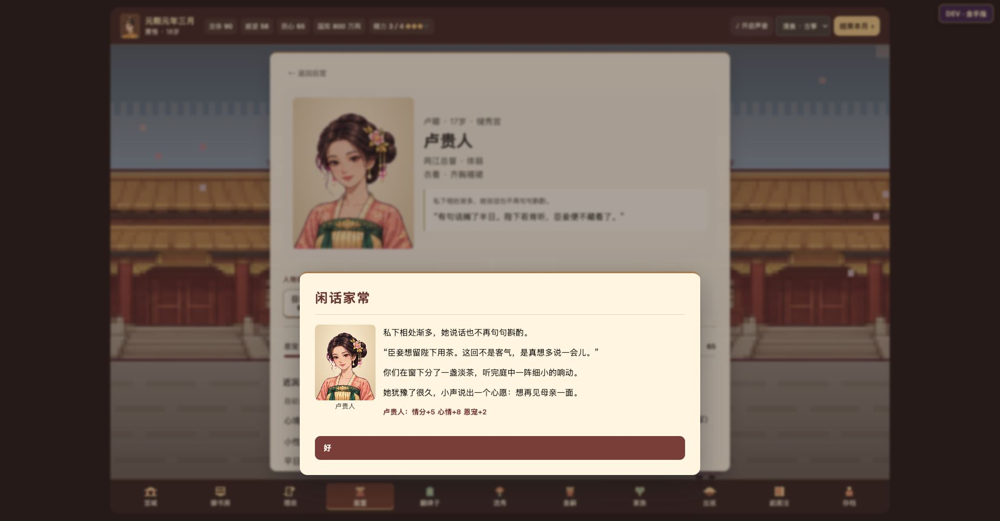

# 试玩反馈修复与验证 · 2026-11-14

基于远端 `2d56d6c`（已包含历史故事、子女性格、宫殿迎驾、选秀穿越自述和换婴追责）继续修复，未替换其他会话的新增内容。

## 修复与回归证据

| 问题 | 本轮处理 | 验证 |
|---|---|---|
| 普通事件在存读档后消失，冷却却保留 | 保存触发行动、队列、选择、随机结果与结果页，读档重建同一事件 | 新环境逐事件重启；对比人物属性、正文、选项和队列 |
| 闲聊等普通互动未自动存档 | 行动及选择完成后保存；写入失败撤回本次状态变化 | 浏览器闲聊后直接刷新，情分、心情、精力和对白仍一致 |
| 温泉显示 50，实际扣 60 | 显示与结算共用 60 万两常量 | 浏览器国库 800 → 740，刷新仍为 740；单元回归 |
| 潜邸旧人说初入宫对白 | 明确旧识标记，并兼容旧纪事 | 旧识与真正新入宫人物分开验证 |
| 入宫纪念月份漂移 | 只在真实对应月份提入宫；其他月份谈旧物 | 固定月份、跨年与旧档推算回归 |
| 御花园描述只剩一个字 | 修正把季节字符串再次当数组抽取的问题 | 春夏秋冬四种完整文案回归 |
| 各种性格遇到负面情绪都同声同气 | 六种性情表达 × 四种处境，共 24 条对白 | 分组区分，悲伤、寺居、冷宫等状态优先 |
| 通用鸳鸯帕让人物做出同样反应 | 六类信物、共同完成与平常照应；旧档保留已建立的绣帕 | 六种信物、旧章兼容、低情分结局检查 |
| 三个无人回应的邀请永久占位 | 一年后自主完成或收进旧册；已接受的承诺保留 | 未回应与进行中两类分别验证 |

新增 24 段共同小事，至少间隔六个月，并可在以后闲谈中提起。没有提高月末随机事件数量上限。

## 长期试玩

五种策略（均衡、专注陪伴、探索、只推进月份、随机选择）× 种子 101 / 202 / 303 / 404；每局最多 120 个月，皇帝死亡或游戏结束则停止。脚本按正常行动花费精力、选择可用选项，没有持续补钱、补血或强制触发稀有事件。

- 20 局，共 **2,251 个游戏月**、**4,616 条月末弹窗事件**，未捕获到脚本异常。
- 每月平均 **2.05 条**；中位数 **2**，95% 的月份不超过 **4 条**；最多 **7 条**，包含出生、岁首等必需事件。
- **139 种月末事件标题**，**23 个月没有月末弹窗**。标题数不等于独立剧情数：同名剧情可以有不同人物与分支。
- 统计只含月末事件，主动闲聊、赏赐、出巡等不计入这个密度；这不是线上玩家留存或主观趣味评分。

密度整体足够，主要改进方向是把人物的区别与后续写得更清楚。专注陪伴仍能较快达到高情分，本轮增加长期共同经历，并未宣称已经完成整套数值平衡。

[20 局统计](random-play-summary.json) · [五种玩法的事件样本（含选择、人物、结果）](match-samples.json)

## 运行与浏览器验收

```bash
node --test tests/*.test.cjs
node tests/palace-flow.cjs
node tests/palace-random-play.cjs
```

- **361 项回归全部通过**（13 个测试文件），另通过 60 个月完整流程。
- 逐事件重启测试：四个种子各 36 个月，合计 144 个月。每个弹窗出现、选择及结果页切换后在新 VM 中读档；不会复用原来的事件函数闭包。
- 额外检查：赐名输入草稿、初始选秀、地图迎驾、岁首快照、手动存档、配额失败、付费操作回退，以及无法兼容的事件记录禁止覆盖原档。
- 完整流程：60 个月，包含出生、宴会、家族、历史见闻、主动生活及存读档。
- Chrome 实测：开局 → 后宫闲聊 → 刷新读档；地图到坤宁宫 → 迎驾 → 刷新 → 接续闲聊；出巡温泉 → 刷新核对扣费。
- 手机宽度 390 × 844：对白、立绘、结算和按钮均可见；恢复桌面尺寸后继续验收。

桌面与手机截图为实际浏览器运行画面，使用独立测试存档：




## 保存边界

行动记录保存的是受限的命令名、参数和随机数，不保存或执行存档里的 JavaScript。回放时不重复写盘、提示确认或播放音效；重建后与已保存世界核对。普通旧档仍能迁移，但旧版从未保存过的事件无法凭空找回。遇到损坏或不兼容的事件记录，保留原始数据并暂停覆盖，允许下载备份。
