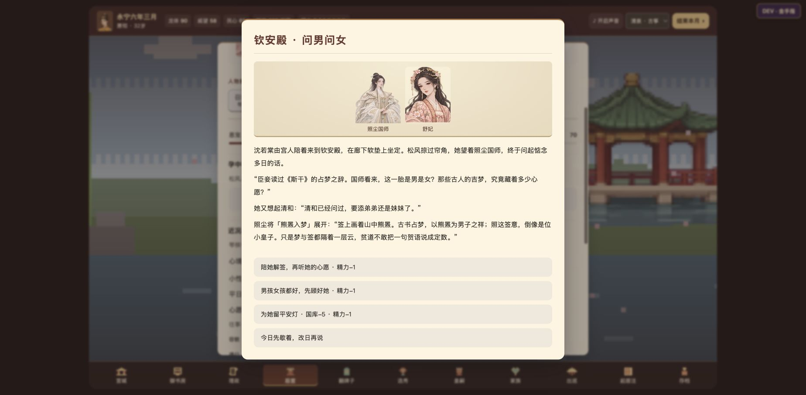
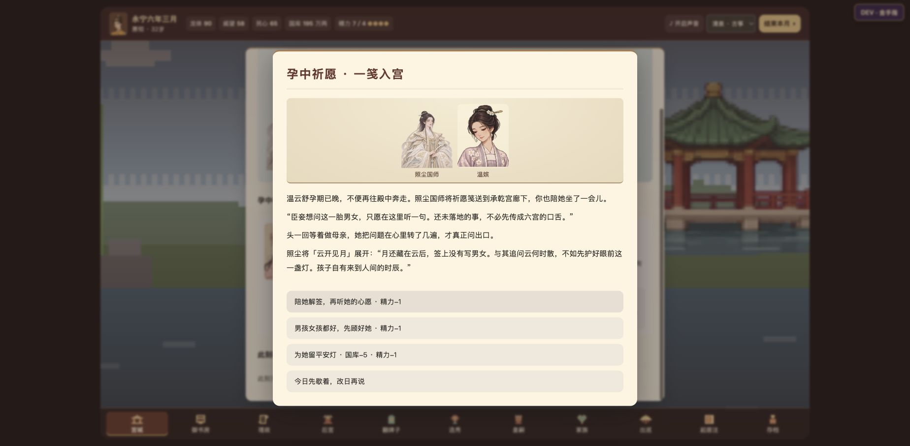
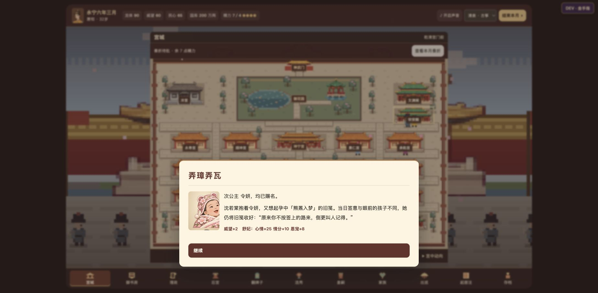

# 孕中祈愿验收

- 功能合入 [PR #5](https://github.com/AubreyKuang/Forbidden-City/pull/5)，提交 `989ba31`；[GitHub Pages 部署成功](https://github.com/AubreyKuang/Forbidden-City/actions/runs/43552381773)。
- 475 项完整回归通过，连续 60 个月流程通过；其中 12 项针对性测试覆盖资格、孕期、不同家况、固定签语、费用、重复结算、读档、后续怀孕、地图来访、生产回响与隐藏身世。补充保存原问与解签后，这 12 项再次通过。
- 线上测试入口经文件导入演示存档后实测：钦安殿可见孕四月舒妃候见、孕八月温嫔留宫接笺；人物详情有相同入口。
- 才女舒妃提及《斯干》和已有女儿清和，国师解「熊罴入梦」。留灯后国库 200→195、精力 8→7，刷新读取自动存档后数值不变；免费重读保留原问、签语和选择。
- 孕晚期温嫔收到送往承乾宫廊下的祈愿笺；持重性格不愿未定之事传遍六宫。曾失子的林贵人改问能否留下平安，不使用活泼性格的轻快问话。
- 导入已留签、临盆待赐名的演示档，为公主赐名后，母亲提起「签意与眼前的孩子不同」；实际出生性别未被签语改变。
- 浏览器未捕获运行错误或警告。发现常规听讲空场提示与孕妃候见可同时出现，改为明确区分「常规听讲的来客」，不再误说只有国师在场。
- 截图来自线上浏览器；演示档只用于稳定复现，月推进与随机来访规则另由脚本测试。

