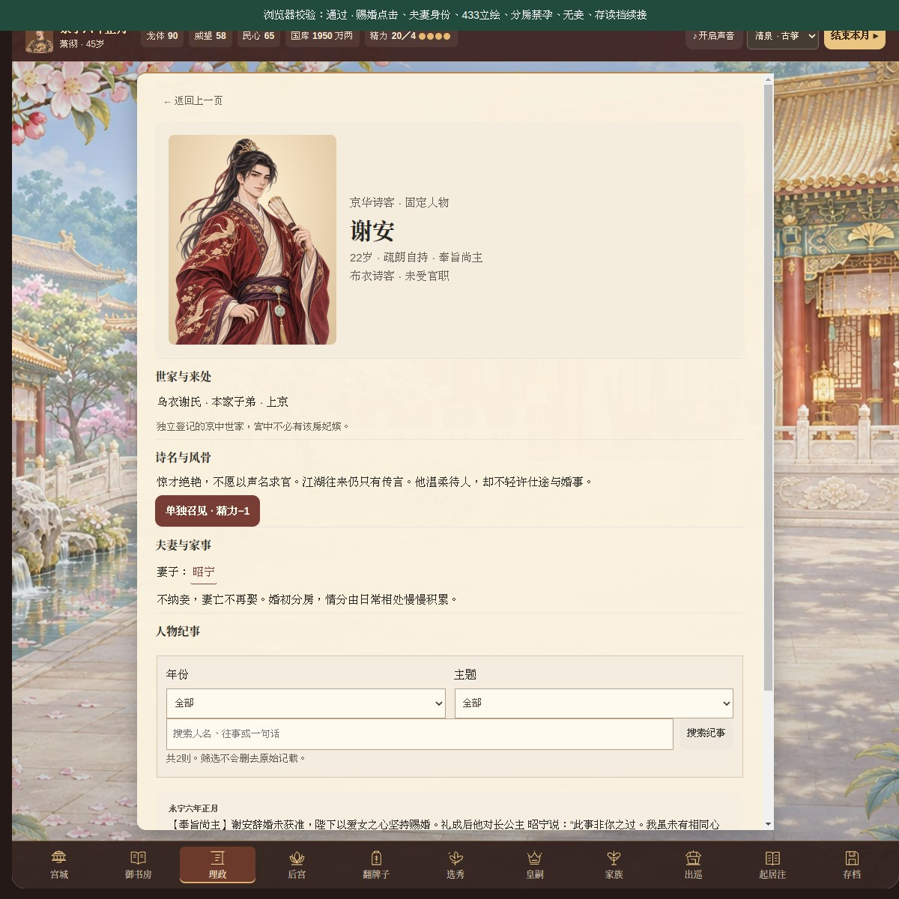
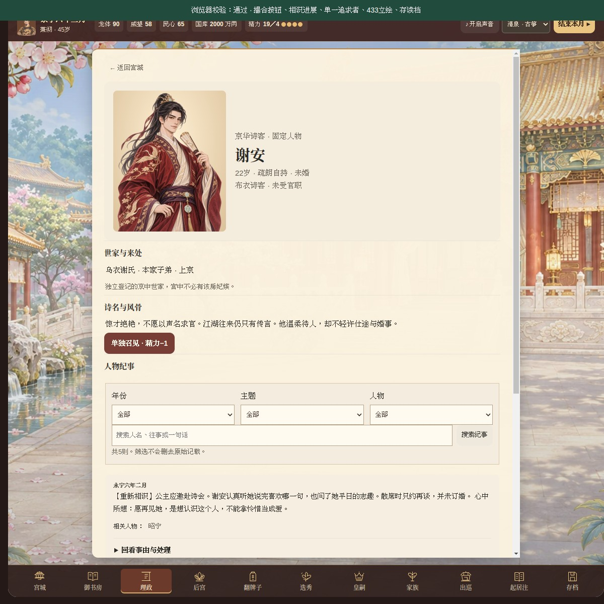
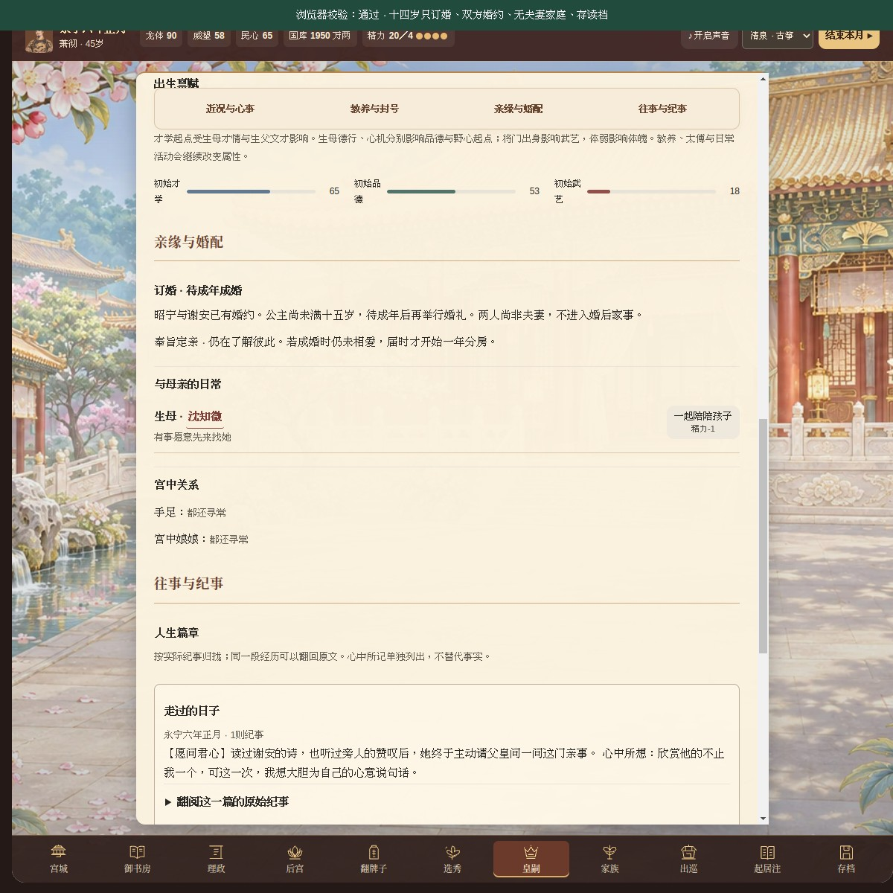
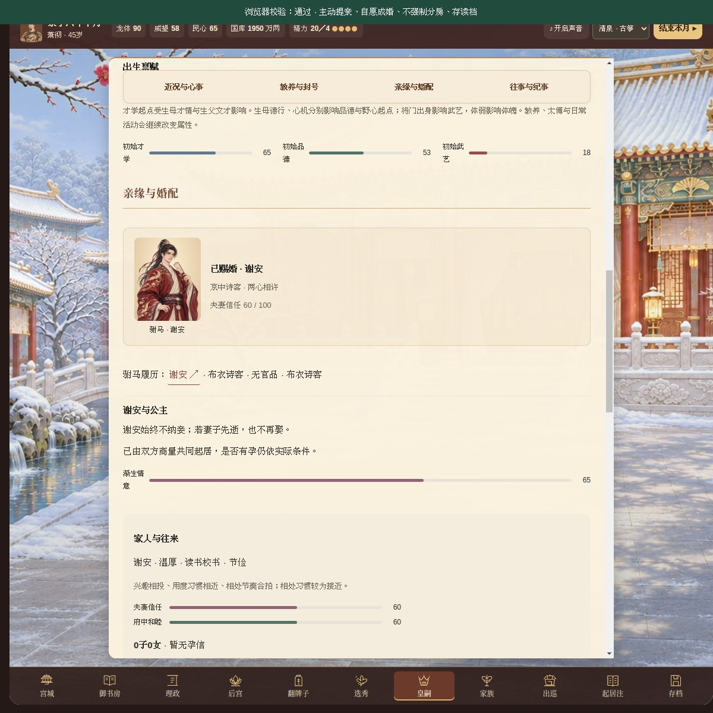

# 皇嗣心事与谢安验证

玩法说明见[人物经历](../character-experiences/royal-heart-and-xiean.md)。实现位于 `js/royal-heart.js` 与 `js/xie-romance.js`；本功能从事务日志版本 22 起启用；合入并行人物内容后的当前版本 23 继续保留 22、21 及更早未完事件的原样续接。

## 自动回归

合入并行的六位风华人物后，全量 **1,567 / 1,567 通过**（合并前 1,516 项亦全部通过）。皇嗣心事及谢安基础模块 63 项，新增爱情、撮合与订婚分支 67 项，演示存档恢复 13 项；其余为全项目回归。

| 检查 | 验证结果 |
| --- | --- |
| 触发年龄与单一追求者 | 12、25 岁可开启，11、26 岁不可；多位公主可欣赏，一局只绑定一位主动追求者 |
| 玩家干预 | 安排相遇、鼓励表达、尊重独身；消耗、间隔、相识进度与双方纪事均核对 |
| 提亲 | 八种性情分别相识；主动提亲之后，公主接受、婉拒或考虑；不会听到提亲就直接结婚 |
| 订婚 | 未满 15 岁只有双方婚约，无配偶、无夫妻家庭；满 15 岁再成婚；去世取消婚约，不伪造丧偶 |
| 分房 | 无感情的强制婚姻从婚礼日起计一年；自愿婚姻、定亲后已生情者不设等待 |
| 家常 | 相爱后才有亲近对白；没有孩子不写育儿；按真实孩子年龄、亲缘、在世和外出状态筛选 |
| 立绘 | 谢安本人和驸马小像都渲染实际 433 号图格，兼容缺少 `storyPerson` 的旧配偶副本 |
| 旧存档与陈旧操作 | 真正的旧版本未完事件恢复；新场景、选择结果、撮合与订婚均冷启动重放；身份改变后旧按钮不能继续执行 |

`tests/fixtures/royal-heart-legacy-v18.json`、`royal-heart-legacy-v19.json` 与 `xie-romance-legacy-v21.json` 均在修改相应版本代码之前真实生成，没有把新版存档改一个版本号来假装兼容。旧版本已经发生的辞婚，在原事件正常结束后，可以接上新后续；普通读诗不会凭空生成辞婚。

```sh
node --test tests/palace-royal-heart.test.cjs tests/palace-xie-romance.test.cjs tests/palace-royal-gallery.test.cjs
node --test tests/*.test.cjs
```

## 浏览器场景

`scripts/build-royal-heart-gallery.cjs` 构建十三个独立演示页，使用正式脚本、样式和真实人物档案。内存存档层在游戏启动前加载，不读写玩家真实存档。截图是实际网页渲染，未使用生成图片替代游戏画面。

四个校验页面直接执行真实 DOM 按钮点击，并保存、重新载入，再检查恢复后的状态。所有断言通过才显示绿色结果条；失败会覆盖显示红色错误。

| 演示页 | 页面内操作与断言 |
| --- | --- |
| `check.html` | 强制赐婚、真实夫妻身份、实际 433 图格、分房禁孕、无妾、存读档 |
| `romance-check.html` | 从人物页点击安排相遇、继续相识；改变独身倾向但未直接成婚；保留进展、单一追求者和 433 图格 |
| `betrothal-check.html` | 十四岁强制定亲；双方显示婚约，无夫妻家庭；存读档仍为订婚 |
| `proposal-check.html` | 公主接受主动提亲；自愿成婚，立即共同生活，不强制分房；存读档保持一致 |



<details>
<summary>撮合、订婚和自愿婚姻的浏览器校验画面</summary>







</details>

逐图审阅与校验结果见[截图记录](royal-heart-screenshots.json)。证据范围为实际浏览器渲染、页面内 DOM 点击与存读档；不等同于完整桌面／手机鼠标操作验收，也不宣称所有月结随机分支都经过浏览器点击。

## 线上资源

游戏及演示提交 `c4a29e0` 的正式入口、新剧情、订婚规则、事务日志、433 号素材与校验页面共十三项资源，逐字节对比结果见[线上校验](royal-heart-production.json)。[Pages 部署记录](https://github.com/AubreyKuang/Forbidden-City/actions/runs/43779890034)。
