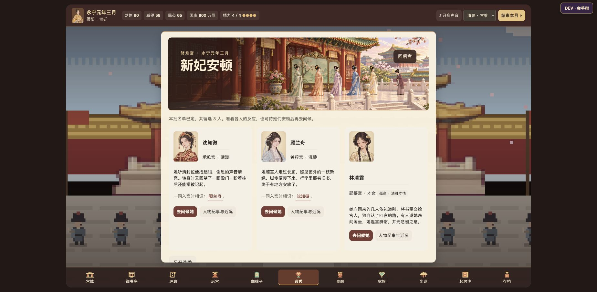

# 选秀名单与同批入宫验收

验收入口：线上 `dev.html`，使用隔离的测试存档；生产入口与测试入口共用游戏模块。

| 操作 | 观察结果 |
| --- | --- |
| 连续留选三人并册封 | 每次只显示册封结果，继续后回名册，没有插入初入宫门问答 |
| 最后一名候选处理完后刷新、读取自动档 | 已留选三人仍在，保留「确定名单，安排入宫」按钮 |
| 确认本批名单 | 新妃安顿页同时展示三人的反应，自选问候顺序 |
| 查看活泼、沉静、孤高三位人物 | 活泼者盼被记起，沉静者留心窗外新绿，孤高者守礼独处 |
| 同批相识 | 沈知微与顾兰舟因共同爱好读书相识，双方页面与纪事都记得对方；林清霜未被强制结交 |
| 先问候孤高者 | 对话保留独处意愿；回安顿页显示一人已问候、两人待问候 |
| 再次刷新并读取自动档 | 已问候标记、其余人的问候入口、相识名单均保留 |
| 浏览器控制台 | 验收标签页无 warning/error |

自动验证：33 个测试文件、711 项通过；连续 60 个月流程通过。
新增 8 项回归覆盖：不打断留选、末位候选确认、未完选秀续档、问候去重、同批关系双向记载与人数限制、孤高/敌对/姐妹争宠边界、月底收束、同月不同批隔离、后续熟人往来、久候后的对白期限。
