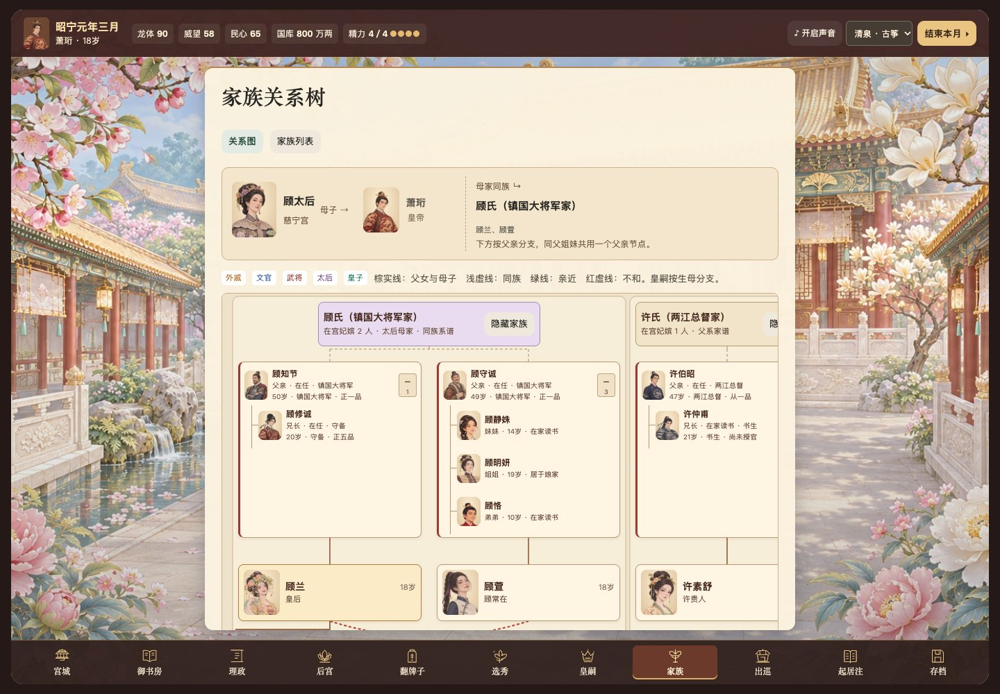
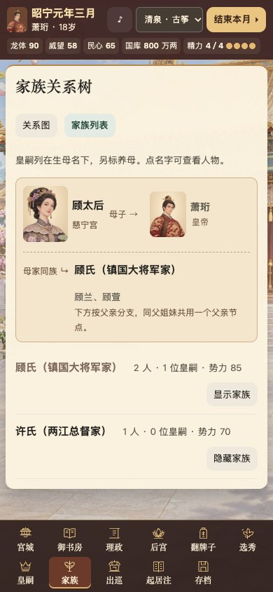
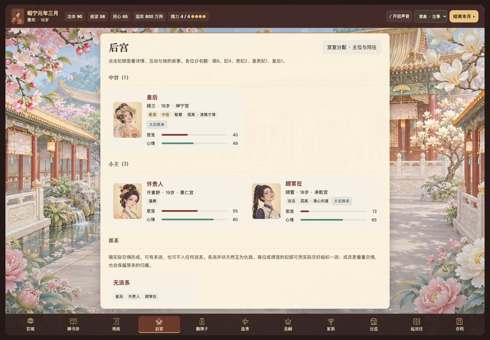
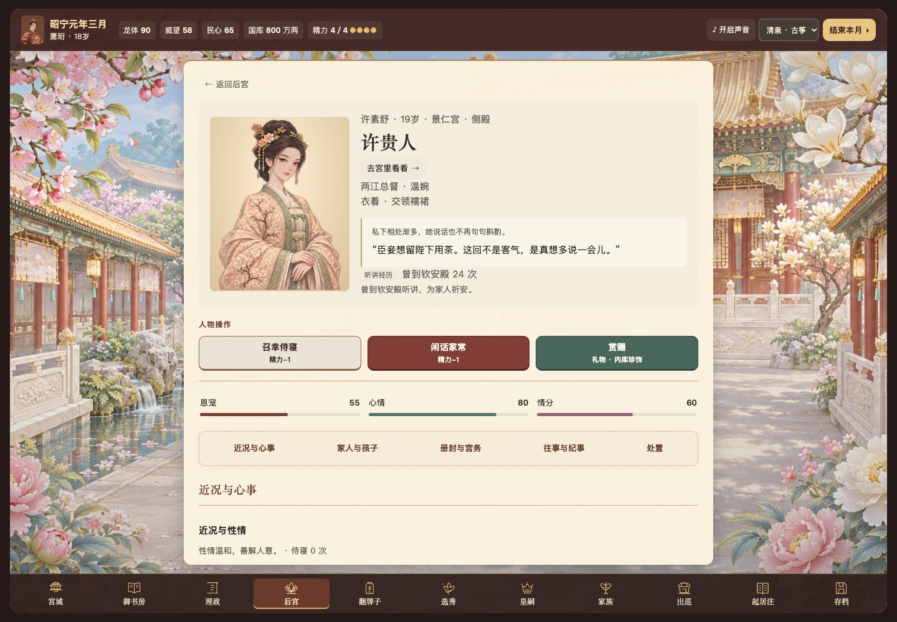

# 选秀间隔、家族隐藏与问道倾向验收

日期：2026-11-16。玩法版本：54。浏览器：独立 Chrome 测试环境，桌面 1440 × 1000 / 1280 × 900、手机 390 × 844。演示人物在测试存档中设置，截图由实际游戏页面生成。

## 实际操作

| 场景 | 操作与结果 |
| --- | --- |
| 家族整体隐藏 | 在关系图中点击家族名称右侧「隐藏家族」，父兄、妃嫔、皇嗣及连线一并收起，保留名称与「显示家族」；相邻家族仍显示，横向占用缩小。 |
| 列表、刷新与恢复 | 隐藏后切换家族列表，状态一致。刷新、读取自动存档、重新进入家族页，隐藏仍保留。点击「显示家族」恢复；手机列表中的按钮位于屏幕右侧，可直接点击。 |
| 太后族亲 | 后宫名册中，太后母家的皇后及堂姐妹均有灰色标签；无亲缘的另一位妃嫔没有。实际背景色为 `rgb(228, 228, 226)`。 |
| 旧问道记录 | 普通温婉妃嫔保留 24 次听讲和已有祈愿文字，详情显示「听讲经历」，不再显示「潜心问道」。 |
| 旧选秀弹窗 | 加载主线 `f8b3b63` 生成的真实 v53 大选待选存档，弹窗正常续接。点击「今年免了」，刷新后仍能读取，无续接阻断。 |
| 跳过后再开选 | 加载同一版本已跳过的大选存档，上次真实选秀恢复为第 0 月，停办记录为第 35 月。通过页面「下旨选秀」生成 6 名候选；国库仍为 2062、民心仍为 69，没有误收提前选秀代价。 |

家族、标签和普通听讲详情的浏览器操作未出现页面异常。

## 截图

| 家族名称右侧控件 | 手机列表的隐藏状态 |
| --- | --- |
|  |  |

| 灰色太后族亲标签 | 普通听讲经历 |
| --- | --- |
|  |  |

## 自动验证

- 完整回归：2333 项通过，0 失败。
- `tests/palace-flow.cjs`：连续 60 个月推进、存读档、宴会、家族记忆与后续剧情通过。
- 三个专项测试文件覆盖跳过与实际开选分离、次年奏请、只读界面、同姓异族、全家隐藏与恢复、读档持久化、真实亲缘、信佛排除、个人倾向固定及十年问道模拟。
- 倾向抽样使用固定种子：普通性情约 2.5%、淡泊或沉静约 45%、好学或聪慧约 18% 具备向道倾向，已有清心问道人设保留。这是个人倾向比例，仍须来访累计达到条件，不能解释为每月获得标签的概率。
- `selection-and-dao-legacy-v52.json`、`selection-and-dao-legacy-v53.json` 分别由未修改的已发布代码生成，验证待选、跳过结果和月末问道事件先按原规则续接，再启用新规则。
- 无法续接的损坏存档保持原数据和恢复提示；选秀日期迁移不会在恢复提示中改写数据或递归弹窗。

旧档的选秀日期仅在起居注有足够证据时修正；历史已截断、不能区分真实开选与停办时，不猜测日期。已有听讲次数和人物纪事均保留。
