# 六位剧情妃的宫中故事

从「御书房 → 剧情妃图鉴」看立绘和初遇条件。入宫后，在「后宫 → 人物档案 → 往事与纪事」可以续谈。主线与特殊事件也可能在转月时来报，暂缓后仍能从档案打开。亲自续谈用 1 点精力。

六位各有三幕宫中主线、一项可以再做的日常和一段满足条件才出现的特殊剧情。入宫满两个月可以开始，苏蘅通常还需要处理换香旧事并赔礼。两幕之间有一至三个月间隔。去世、离宫、冷宫或清修期间暂停。选择和结果会留在本人纪事与皇帝起居注，涉及皇嗣、皇后和家人的内容也会写入他们自己的纪事。

[游戏入口](https://aubreykuang.github.io/Forbidden-City/) · [钩弋夫人玩法参考](../character-experiences/court-family-life.md#固定剧情妃赵令仪钩弋夫人) · [最初六人设定](https://github.com/AubreyKuang/Forbidden-City/issues/35)

| 人物 | 黄色特殊标签 | 宫中主线 | 完成后的日常 | 特殊事件 |
| --- | --- | --- | --- | --- |
| [沈清漪](#沈清漪) | 京城第一美人 · 姑苏旧识 | 钟粹宫书案 | 灯下共校 | 秋夜归笺 |
| [陆绾](#陆绾) | 北境将门 · 百步穿杨 | 北苑骑课 | 校场授课 | 驿马归栏 |
| [阿依慕](#阿依慕) | 白泉公主 · 蝶落香肩 | 白泉关书 | 核白泉互市 | 母亲的香囊 |
| [楚晚](#楚晚) | 前朝遗孤 · 楚氏旧籍 | 旧仓新册 | 复核一处粮仓 | 一只旧木碗 |
| [苏蘅](#苏蘅) | 姑苏苏氏 · 调香辨账 | 供香账房 | 换季比香 | 一味无香 |
| [岑小满](#岑小满) | 京城灯市 · 铜钱戏法 | 宫宴戏班 | 排戏与结工钱 | 多出一枚铜钱 |

### 特殊事件之后

完成各自的特殊事件后，再过两个月，人物档案的「往事与纪事」会出现一段可暂缓的后续，也可能在转月时呈上。已完成特殊事件的旧存档可以直接接续。图鉴中，每位剧情妃各有一枚黄色专属标签，立绘下的小字显示当前经历。赵令仪的是「钩弋之遇 · 帝前展掌」，薛红笺的是「笺铺知己 · 染笺题诗」。

| 人物 | 后续 | 选择会带来什么 |
| --- | --- | --- |
| 沈清漪 | 书末谁署名 | 可让沈家母女合署讲本，以后陪皇嗣校书才学加 5，也可保留私本，请孩子做第一位读者。 |
| 陆绾 | 听马的人 | 可让退役驿马留栏教识马，今后皇嗣上骑课另加体魄 2，或把老马的近况送给北境军驿。 |
| 阿依慕 | 把曲子寄回白泉 | 可和曾学鼓、如今仍交好的妃嫔一起录谱，或让会白泉话的亲生孩子给外祖母写谱注。也能由皇帝陪她记拍。 |
| 楚晚 | 粥棚门前的孩子 | 可在粮册添迁户补领栏，以后就地访核另加民心 2，或花 6 万两立刻补给漏领的人家。 |
| 苏蘅 | 空炉也有领用单 | 可逐殿按需订香，往后每次抽查可节省 7 万两，或就这笔旧账退回 8 万两。 |
| 岑小满 | 幕布后面的人 | 可让幕后师徒同谢幕，此后真演出并付清工钱获民心 5，或另付 6 万两让师傅回街坊教艺。 |

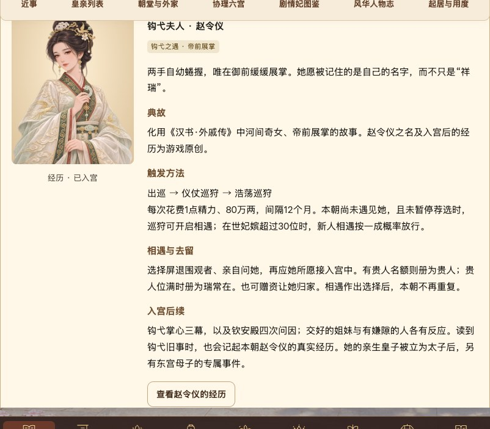 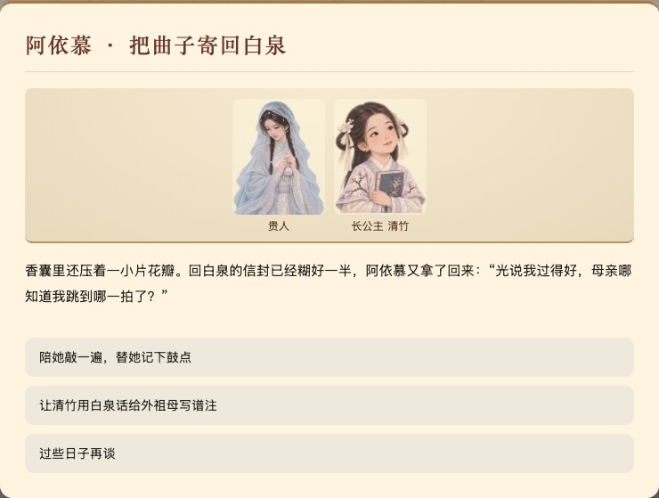

## 沈清漪

第三年起在南巡苏州相遇，经三个月掌书女官差事再议封答应。入宫后，她仍往姑苏寄家书。原有「两封家信」可请地方医者照看沈母，也可陪她问清病况。情分满 55 才续谈旧信，恩宠达到 60 且有在位皇后时，会多一个与中宫说清家事的选择。

- **旧本退还 → 两封回信 → 留一席读书**。可由清漪自己退还旧本，也可花 6 万两请女官抄副本。公事、家书分别装封。末幕可带在宫、满五岁的皇嗣来读书，才学加 4，或在皇后在位时请她共校，两人关系加 8。
- **灯下共校**。每四个月可陪她写一回家书，或带符合条件的皇嗣来校一页，才学加 3。
- **秋夜归笺**。主线走完，第二幕选择按她自己的写法递家书，秋季且情分至少 60 时出现。可让她自己收存新旧两封信，情分加 7，心情加 8。

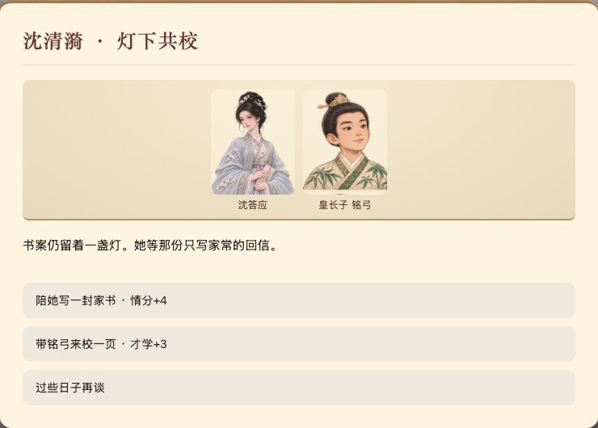 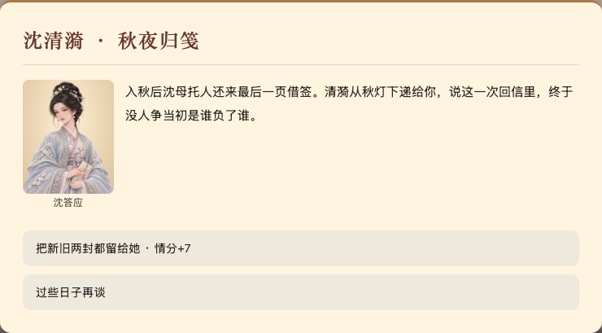

## 陆绾

出巡到北苑校场相遇。她子女原有的「将门虎子」影响出生武艺、体魄和习武速度。遇北境军报可准她出宫办差或留京接报，真正返回后，会记下前线家书和孩子的反应。

- **先学牵马 → 分场试骑 → 把伤簿送回去**。可拨 8 万两修轻弓，也可先教照管马匹。课上优先选择她自己的在宫皇嗣，再看其他满五岁的在宫皇嗣。选轻弓且皇嗣当下为习武教养，加武艺，否则加体魄。若没有皇嗣，可以和擅骑射的妃嫔练习，也可由随侍与皇帝先试课。
- **校场授课**。每四个月可继续约课。合适的皇嗣加武艺或体魄 3，有骑射同好时两人关系加 5，也可以同她慢骑，龙体加 2。
- **驿马归栏**。完成主线，且陆绾曾实际赴北境并回宫后出现。可拨 5 万两让跟她回来的老马在北苑养老。

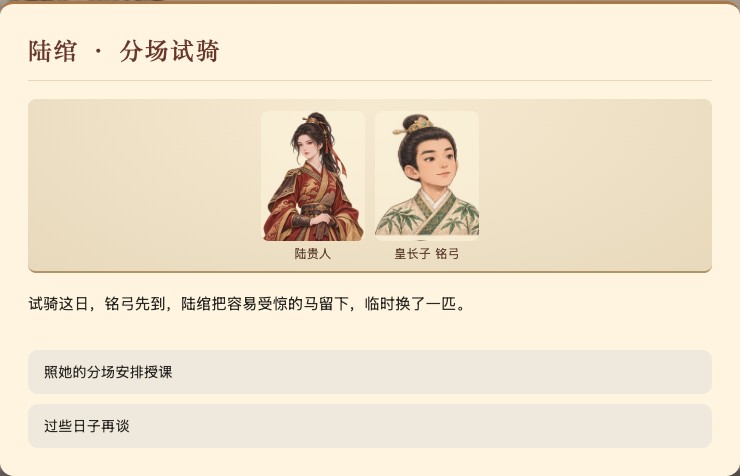 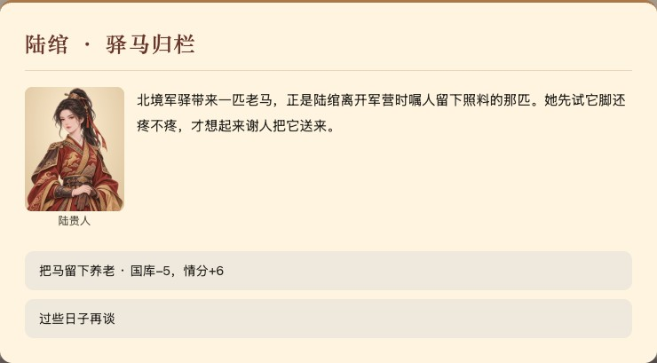

## 阿依慕

在「御花园 → 赴白泉国宫宴」花 1 点精力赴宴，也可从御书房剧情妃图鉴进入。陛下须满十五岁，当月服丧时暂缓。白泉国王携女求亲，阿依慕换上白泉舞服，在席前踏鼓献舞。腕上的银铃、腰间的香囊和脚下的鼓都画在这幕专属立绘里。你可当席应允，将她留在宫中，也可送父女归国，或请他们暂住京城，下月再听回话。

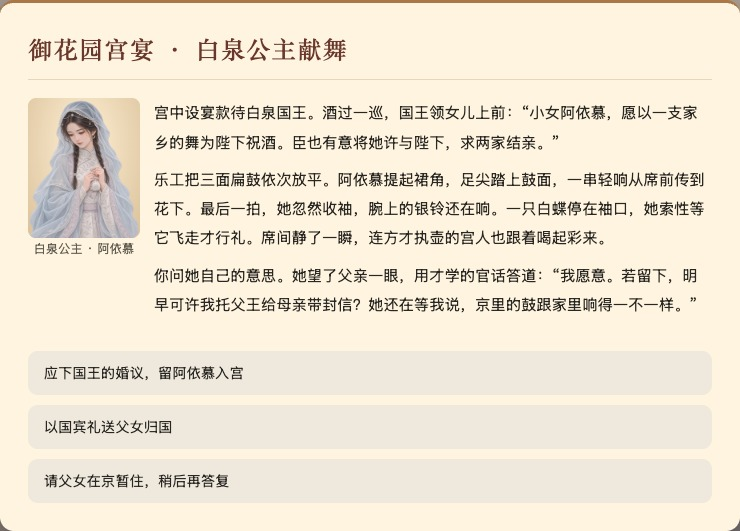

**入宫后再跳白泉舞**。在「御花园 → 筹办小宴」把阿依慕列入席单，点「请阿依慕独舞」，再开宴。投壶、共绘花枝都可以搭配这支《泉上铃》。小宴每三个月可办一次，排舞包含在宴费内。

在席妃嫔各自记下当日所见。交情达到 30 且无嫌隙的妃嫔中，每次交情最好的一位未学者可以学鼓；交恶者和在意争宠的人可能吃醋，懂琴的人也能单为曲子喝彩。下回把阿依慕和学过鼓的好友一并列入席单，选「请某某伴鼓」，就能听她们合演《归泉》。若已生嫌隙，伴奏会暂缓。演出写入阿依慕的纪事和皇帝起居注。

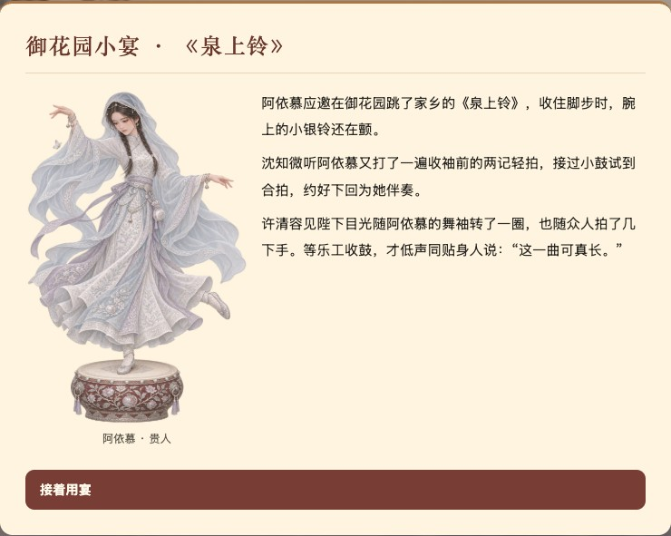

**子女与白泉婚书**。亲生儿女出生武艺加 20（上限 100）、魅力 25，在皇嗣名册与档案显示「异域血脉 · 白泉王裔」。皇子依游戏中的礼例不可立储。年满十五岁、尚未婚配或订亲且可议婚的公主，在皇嗣档案或已开的公主府点「议婚 / 赐婚 → 听她谈白泉国的和亲婚书」。可先相看、暂缓，或准她嫁到母亲的故国。识白泉话会有不同的相看对白。婚后住在白泉，可从公主府读白泉国家书；原本的北境婚事仍可另选。

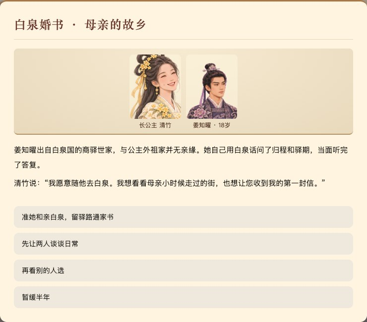

原有香囊澄清、妃嫔学香、蝴蝶与白泉家书的剧情会继续出现。教孩子白泉话的入口在原有「家书与互市」一线，孩子须满七岁且在宫。

- **两边的市日 → 驿路回单 → 席上两种话**。可付 8 万两先走一趟试市，两个月后看回单，也可等三个月重签。收到回单后可以留一条家书驿路。已学白泉话的皇嗣可随她核礼单并获才学加 4。
- **核白泉互市**。每四个月可以再核一份货簿。由阿依慕与礼官核对时成功率为 55%，有在宫且懂白泉话的皇嗣协助则是 75%。议成后民心加 3、威望加 1。参与核单的皇嗣有记事与才学加 2。
- **母亲的香囊**。春夏、主线完成且已经定过家书驿期时，使团可能捎来她母亲缝的新香囊。陪她问候和回信，情分加 6，心情加 8。

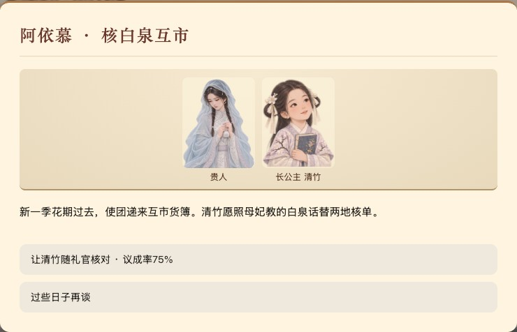 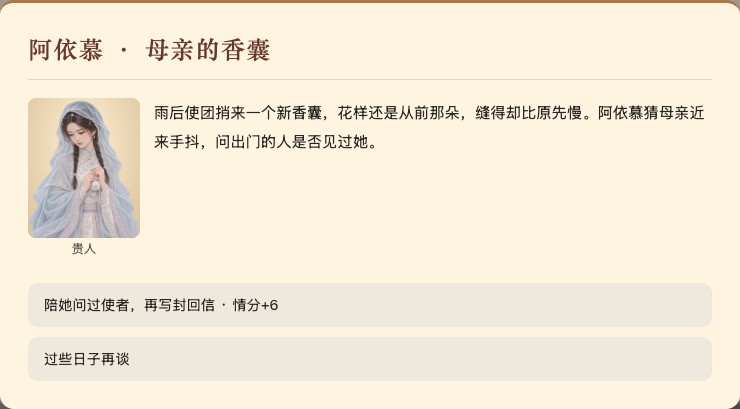

## 楚晚

第一代登基满十二年可在地方旧籍中遇到方晚。查实身世后才叫楚晚。入宫后既有晋位署名、追问前朝的路线，也可以从低位开始查仓册。

- **门外的证人 → 半批粮的去处 → 谁在卷尾署名**。可保护证人住址，或听证人自愿当面出证。赈济可以调拨半批常平仓现粮、另拨 16 万两市买，或先复核名册。调仓粮真实改变库存。有满八岁、在宫的亲生孩子时，末幕还会在孩子纪事里写下听她说前朝旧仓，品德加 4。
- **复核一处粮仓**。复核名册后隔四个月可再来。若实际调发半批粮，当次民心加 4，下一次须等六个月。
- **一只旧木碗**。主线中确实给灾户赈过粮，三幕完成后到秋季，可以收到一户人家捎来的木碗，写下她对当年在民间日子的记忆。

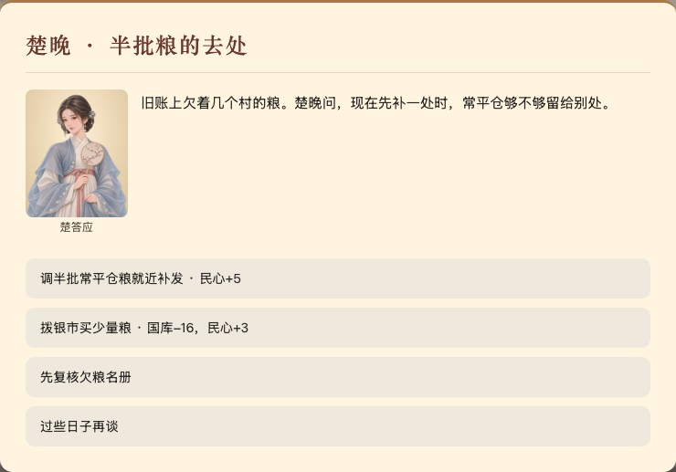 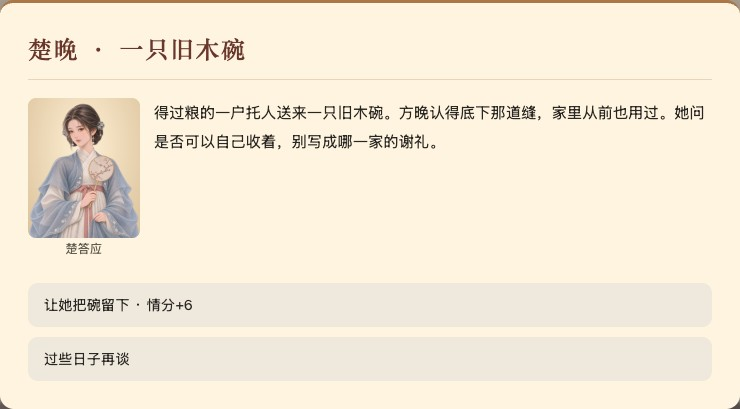

## 苏蘅

南巡苏州时从辨香相遇。入宫后通常先处理「动过的香炉」，苏蘅完成赔礼才可开账房。若宫中当时只有苏蘅一位可相见的妃嫔、尚未有换香案，可直接从查样入手。

- **香炉归位 → 三张供单 → 谁验最后一缸**。她只负责辨样，也可以找相好的妃嫔复核，银钱交给掌事。押款方案实付 10 万两，两个月后按签过的账退 6 万两。沿旧单只试样时就没有这笔押款与退回。
- **换季比香**。可与掌事抽查新一轮到期账目，收回多支的 5 万两，间隔六个月。只陪她看香样则加心情，可四个月后再来。
- **一味无香**。主线完成、情分至少 55、龙体低于 70 时，她会收起炉子请皇帝只喝一盏茶。安坐谈话可增加龙体 2。

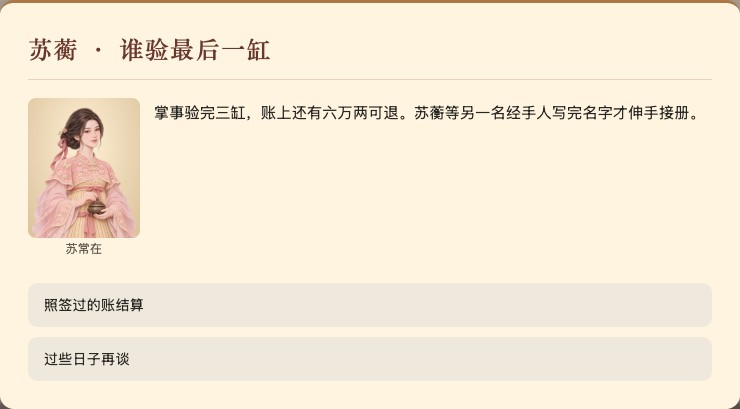 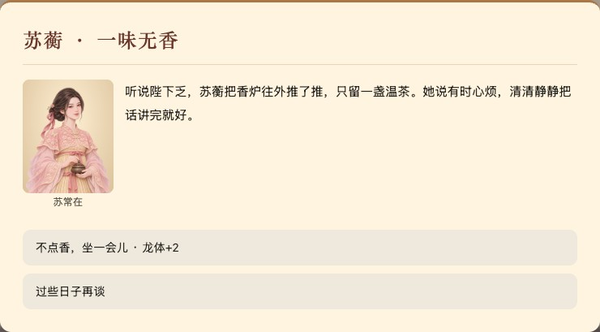

**姑苏香市口碑**。苏蘅在宫、连续三个转月恩宠达到 65，民心加 1，之后每六个月最多一次。「两杆秤」可拨 4 万两设公秤，或让苏家铺子先试行互验。两个月后收到复秤单，可以核准回帖。

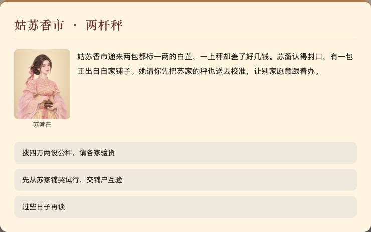

## 岑小满

京城灯市相遇，赴宴后先结清搭档的赏钱，才谈入宫。原有大杂院来信还可拨给孩子过冬钱，或请她讲清什么时候能补。

- **按手艺报工钱 → 一张要紧的契 → 第一场自己登台**。可花 8 万两垫学徒一月工钱，也可先让街坊师傅立约。学徒可以继续学艺或回大杂院。第三幕排的是下一场实际办成的宫宴，在「宫城 → 御花园 → 筹办小宴」开宴后可看到戏班登台的记录。
- **排戏与结工钱**。排好后等到实际开宴。散席后的工钱是 6 万两，结清可加民心 3 和情分 4，四个月后能再排。暂缓时保留欠付的凭签，下月仍可结算。宫中有适龄皇嗣时，也可以单独带去学戏法，才学加 2。
- **多出一枚铜钱**。结清一场戏的工钱后出现。她故意多藏一枚钱，等学徒先发现钱数与账上不同，再把那枚钱给最认真查账的人。

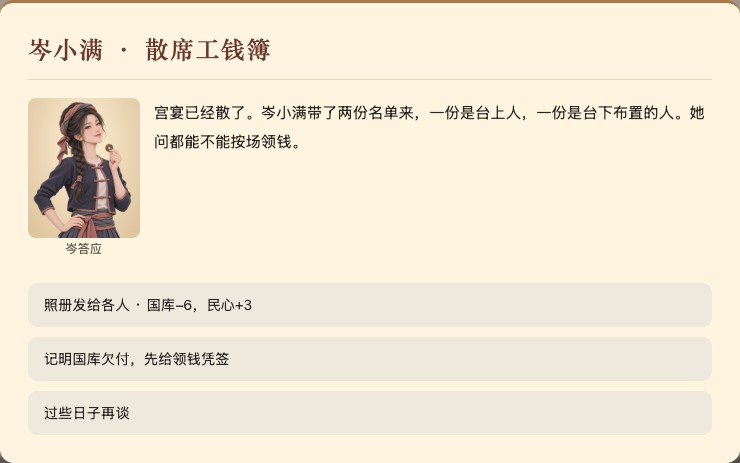 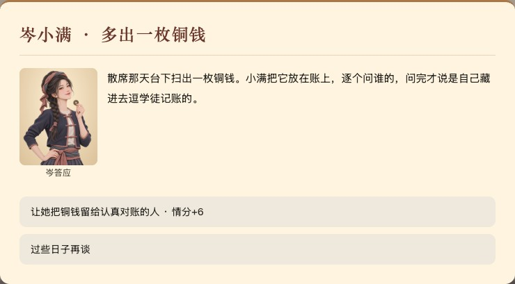

**灯市口碑**。岑小满在宫且连续三个转月恩宠达到 65，民心加 1，每六个月最多一次。庙会散工找她追工钱，可从国库先垫 4 万两，也可让班主照约支付。两个月后核销领条，国库垫付的银钱会如数归还。

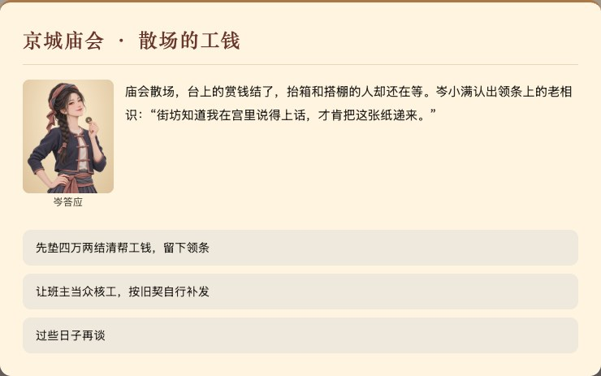

## 截图与验收

截图来自 Chrome 里的游戏弹窗。使用独立测试存档准备已入宫、皇嗣年龄和节令，实际在人物档案打开并处理 18 幕主线、六位的日常及特殊剧情。岑小满的演出在御花园确认宴席后结算，楚晚的赈粮也在实际选择后核对库存。文档中的数值以事件面板及结算为准。
